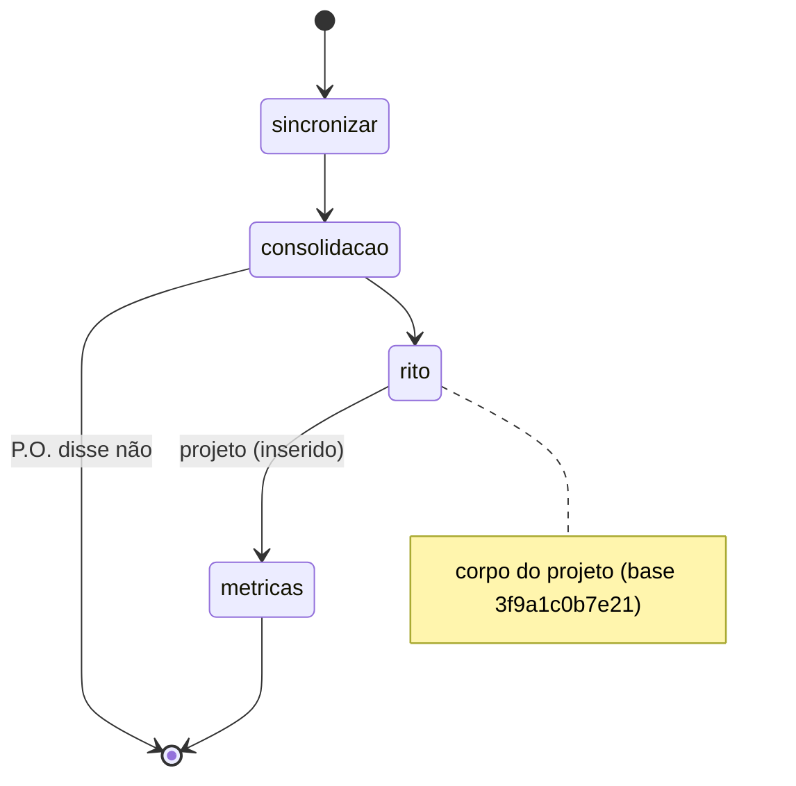
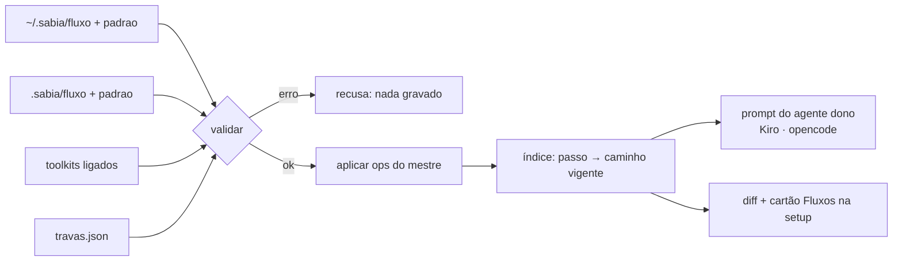
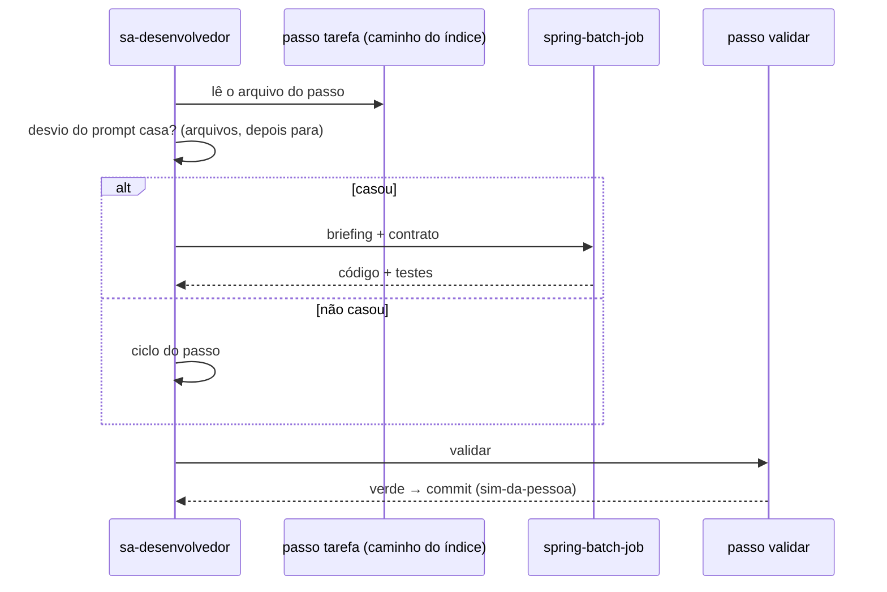

# Sabiá 2.0 — Plano (rev. 01/11)

> **Estado (01/11):** F0, F1, F2.0, F2 (commit `2d286bc`, push em `origin/sabia-2.0`) e F3 feitas; F3 sem commit. F3: sai o Claude Code do gerador; shell `*` para quem escreve, com `negar` (credenciais com curinga, travas, destrutivos, arquivos dos agentes e do harness), push/reset/curl em `ask` com curinga no início; harness com `.sabia/fluxo/**`, `.sabia/padrao/**` e `.claude/**`, `sabia.md` liberado só ao `sa-produto` e só na raiz; `override()` (delta do dono, padrões a todos, recusas e avisos de base), `--base <id>`, desvio de toolkit pelo id com gancho (`desvio`), compatibilidade 1.x (papel), regra de chamada no prompt; revisão adversarial em 2 lentes aplicada; 37 testes no gerador, 25 no CLI; 2.0.0-alpha.1 instalada em `~/.config/opencode` e testada com um modelo de um provedor interno (skill, multi-fluxo, override, agente com delta). Pendente: a linha "No projeto" abrir direto (decisão da pessoa); `references/agentes.md` e a setup (F4).
>
> **Modelo compilado (as-built) — DECIDIDO pela pessoa em 01/11**, depois da comparação com o modelo atual (hubs + `~/.sabia/fluxo/` em runtime): o as-built ganha em sessão sem agente, prompt (só o delta), atualização (recompila), permissão (as `references/` dentro da skill já funcionam na 1.1.x) e portabilidade; perde em "o que roda = o que se lê" e no custo do compilador. Seções 1, 3, 5, 8, 9 e 10 ajustadas.
>
> **Toolkit — opção 1, DECIDIDA em 01/11:** o toolkit fica **fora da compilação**. A skill compilada (por usuário) leva só o Sabiá e um gancho genérico nos passos com `"desvio": true` no mestre (`sa-codificar/codificar/tarefa`, `sa-prd/prd/escrever`); o desvio vem do projeto (`agentes.json` → prompt do dono + tabela Passos de toolkit no `sabia.md`, que vale na sessão sem agente). `sabia toolkits` e a setup recusam `passo.passo` sem gancho. Opção 3 (toolkit com `fluxo/`/`padrao/` próprios) fica para uma 2.x. os fluxos existem só no framework; o `sabia instalar --alvo` os compila em skills comuns na pasta do usuário (`~/.config/opencode/skills/`, power do Kiro). Nada vai para o projeto, salvo o override esparso que o time criar. Substitui "hubs + `~/.sabia/fluxo/` lido em runtime". Seções 1, 3, 5, 8, 9 e 10 ajustadas; a seção 5 (índice no prompt) vale como **delta** do dono.
>
> **Renomes (01/11, feitos na F1):** agente `sa-codificador` → **`sa-desenvolvedor`** (papel `codificador` → `desenvolvedor`, inclusive no `toolkit.json`: os toolkits `java`, `spring-batch` e o de batch de um projeto real precisam de versão nova junto com a 2.0); skill `sa-loop` → **`sa-orquestrar`** (fluxo `orquestrar`; o agente `sa-orquestrador` fica). `sa-produto` fica (papel do P.O.).
>
> **F0, a prova (01/11).** Um agente do projeto com o índice no prompt: o passo `a` só em `~/.sabia/fluxo/`, e o
> passo `b` no Sabiá e no projeto, com o índice apontando para o projeto. Esperado: `F0-A-SABIA` e `F0-B-PROJETO`.
>
> | Ferramenta | Segue o índice | Lê `~/.sabia/` sem pedir permissão |
> |---|---|---|
> | opencode 2.1.3 (`opencode run`, sem `--auto`) | ✅ 3/3 | ✅ com `external_directory` `~/.sabia/fluxo/*: allow` |
> | kiro-cli 2.37, motor v3, `--no-interactive` | ✅ 3/3 (com `--trust-all-tools`) | ❌ **toda** leitura pede aprovação, dentro ou fora do projeto, com qualquer forma da regra `fs_read` (com match, sem match, caminho absoluto, `read`) e com `--trust-tools=fs_read` ou `read` |
>
> - **Conclusão:** o desenho (índice no agente e caminho por passo) está validado. No modo não interativo do Kiro
>   v3, as regras de permissão do agente não são aplicadas; é uma limitação da ferramenta, que não atinge o uso
>   interativo (decisão 2).
> - **Falta:** uma rodada interativa no Kiro (IDE ou `kiro-cli chat --agent-engine v3 --agent f0-agente`), pela
>   pessoa, para ver se a regra evita a pergunta.
> - **Agente:** o v3 exige `--agent-engine v3`; no motor padrão (v2) dá "Mode not found". Na primeira consulta, o
>   agente só apareceu depois do `welcomeMessage`, ou da segunda leitura do diretório.
> - **Artefatos:** a prova está em `scratchpad/f0` e em `~/.sabia/fluxo/f0prova/`, a apagar depois da rodada interativa.
>
> | # | Decisão da pessoa |
> |---|---|
> | 1 | **Sim:** sessão sem agente é o caso mais comum; o hub direciona para o agente responsável |
> | 2 | **Permissões flexíveis.** O uso é interativo (IDE ou CLI), quase nunca sem cabeça. Shell e git ficam liberados; restam só as travas de fluxo |
> | 3 | **Sim:** a versão vai no `agentes.json`, e a setup e o hub avisam se ela diferir |
> | 4 | **Sim:** o modelo decide o desvio pela regra do prompt (`arquivos` e `para`); o `sabia rota` explica e testa |
> | 5 | **Ok:** fallback "carregue a skill do toolkit"; medir na F5 |
> | 6 | **Sem mecanismo de customização de prompt na 2.0.** Os agentes vivem no projeto e cada time os ajusta por conta própria; a setup mostra o diff e pergunta antes de sobrescrever um agente editado à mão. Revisar na próxima iteração |
> | 7 | **Kiro só no motor v3** (`--agent-engine v3`). O gerador emite o formato v3, e a setup e a documentação dizem que ele é obrigatório |

## 0. Mudanças desta revisão

| Antes (rev. as-built) | Agora |
|---|---|
| A `sa-setup` compilava todas as `sa-*` dentro do projeto, e a global ficava só com a `sa-setup` | **As skills ficam globais (hubs).** O projeto guarda só o que alterou |
| `sabia/references/` era copiado para o projeto | **Não copia nada** do Sabiá para o projeto |
| A resolução era pela skill compilada, que exigia a precedência de skill | **A resolução fica no agente gerado,** que já mora no projeto e vence nas duas ferramentas |
| ADRs e glossário ficavam em `docs/` | **`.sabia/adr/` e `.sabia/glossario.md`**: tudo do Sabiá sob `.sabia/` |
| Alvos: Kiro, opencode e Claude Code | **Só Kiro e opencode.** O Claude Code sai (emissor, CLI, setup e testes) |

## 1. Decisões

| Decisão | Valor |
|---|---|
| Fonte do fluxo | **Só no framework:** `~/.sabia/framework/fluxo/<skill>/<fluxo>/<fluxo>.md` (mestre), `.../passos/<passo>.md`, `fluxo/<skill>/regras.md`, `fluxo/travas.json` |
| Fonte dos padrões | `~/.sabia/framework/padrao/<skill>/<arquivo>` |
| **Compilação (as-built)** | O `sabia instalar --alvo <opencode\|kiro>` **compila** cada skill de fluxo numa skill comum e a instala **na pasta do usuário**: `SKILL.md` (estados, regras e travas em texto) + `references/<fluxo>/<passo>.md` + `references/padrao/*.md`; links reescritos para relativos (`../sa-codificar/references/codificar/validar.md`). opencode: `~/.config/opencode/skills/sa-*`; Kiro: compila em `~/.sabia/compilado/kiro/` e `kiro-cli powers install` (→ `~/.kiro/powers/installed/sabia`). Na skill instalada **não há fluxo**. Nada é copiado para o projeto. O inventário guarda o sha de cada fonte |
| Override do projeto em runtime | Linha fixa em cada `SKILL.md` compilado: antes de cada passo (ou padrão), se existir `.sabia/fluxo/<rel>` (ou `.sabia/padrao/<rel>`), ele vale no lugar do da skill. Passos **inseridos** só pelo agente dono (D1 = A) |
| Override | `<projeto>/.sabia/fluxo/...` e `.sabia/padrao/...`, no mesmo caminho relativo. **Esparso:** só o que o projeto pediu para customizar |
| Unidade | Passo ou padrão: **o arquivo inteiro**. Mestre: **só operações** (`inserir`, e `remover` em passo `removivel`). Sem reordenar |
| Formato | Front-matter JSON em todo `.md`. O mestre é a fonte; o diagrama é gerado |
| Delta no agente | O **gerador** (`sa-setup`) escreve no prompt do agente **dono** de cada fluxo só o que o projeto mudou (passo trocado → caminho em `.sabia/fluxo/`; passo inserido → depois de qual). Fluxo de outro dono: **chamar o agente dono como subagente** no ponto e continuar com a resposta (sem subagente: carregar a skill) |
| Skills | `sa-*` globais e **compiladas** (completas, sem hub). Os `SKILL.md` de `skills/` no repo viram saída do compilador |
| Toolkit | O desvio (`passo`, `para`, `arquivos`, `agente`) vai no prompt do agente dono |
| `sabia rota` | Comando de diagnóstico para pessoas. A mesma `rota()` serve ao gerador e aos testes |
| Travas | Catálogo fixo na 2.0 (`liberavel_por: []`). O formato já aceita `liberar` |
| `verificar.sh` | Sai e vira o passo `validar` |
| Toolkit transparente | Sem marca no `status.md` nem no `tasks.md` |
| Permissões | Só de fluxo (escrita, registros, harness). Credenciais negadas |
| Pasta do projeto | Tudo do Sabiá em `.sabia/`: `planejamento/`, `adr/`, `glossario.md`, `fluxo/`, `padrao/`, `config/`, `sabia.md` |
| Alvos | **Kiro e opencode.** O Claude Code sai |
| Migração | Nenhuma (não há projeto em uso) |

## 2. Precedência (conferida em 01/11) e consequência

| Ferramenta | Skill homônima projeto × usuário | Agente homônimo projeto × usuário |
|---|---|---|
| opencode 2.1.3 | projeto vence só em `.opencode/skills/` | projeto |
| kiro-cli 2.37 | as duas aparecem, e o modelo escolhe | projeto (`.kiro/agents/`) |

Consequência:
- Customizar pela skill não é determinístico no Kiro. **Customizar pelo agente funciona nas duas.**
- As skills `sa-*` não têm homônima no projeto: ficam globais e únicas.
- O agente gerado no projeto carrega o índice resolvido e aponta o arquivo de cada passo pelo caminho.

## 3. Árvores

```
~/.sabia/
├── framework/                        tag sabia-<versão>, só leitura: FONTE
│   ├── skills/sa-*/                  front-matter, references/ de procedimento, scripts
│   ├── padrao/<skill>/*              templates (prd, plano, status, ficha, rubricas, …)
│   └── fluxo/                        mestres + passos + regras.md + travas.json
│   ├── sa-planejamento/
│   │   ├── sprint/sprint.md          + passos/*.md
│   │   ├── review/review.md          + passos/{sincronizar,consolidacao,rito}.md
│   │   └── retrospectiva/retrospectiva.md + passos/*.md
│   ├── sa-codificar/codificar/codificar.md + passos/{tarefa,validar,revisar,verificar,pr}.md
│   └── travas.json
├── compilado/kiro/                   saída do compilador para o power (opencode compila direto na pasta dele)
├── toolkits/<tk>/                    toolkit.json · agentes/*.md · skills/*/SKILL.md
└── inventario.json                   versão, sha por arquivo, toolkits

~/.config/opencode/skills/sa-*/  ~/.kiro/powers/installed/sabia/   COMPILADAS: SKILL.md + references/
```

```
<projeto>/
├── .sabia/
│   ├── sabia.md                      steering (Comandos = entrada do passo validar)
│   ├── config/agentes.json           ferramentas, toolkits ligados, "sabia": "2.0.0"
│   ├── planejamento/                 backlog, sprints, épicos, fatias, aprendizado
│   ├── adr/                          ADRs (antes em docs/adr)
│   ├── glossario.md                  (antes em docs/glossario.md)
│   ├── fluxo/                        ESPARSO: só o que o projeto customizou
│   │   └── sa-planejamento/review/
│   │       ├── review.md             só operações
│   │       └── passos/{rito,metricas}.md
│   ├── padrao/                       ESPARSO
│   └── local/                        fora do git
├── .opencode/agents/  .kiro/agents/      GERADOS: índice resolvido no prompt
└── opencode.json · .kiro/steering/sabia.md    ponteiros para o sabia.md
```

## 4. Modelo do fluxo

**Mestre:** `~/.sabia/fluxo/sa-planejamento/review/review.md`

```markdown
---
{"fluxo": "review", "dono": "sa-produto", "travas_gerais": ["sim-da-pessoa"],
 "passos": [
   {"id": "sincronizar"},
   {"id": "consolidacao", "travas": ["po-decide-fechamento"], "saidas": {"P.O. disse não": "fim"}},
   {"id": "rito", "removivel": true}
 ]}
---
# Review da sprint
```

**Passo:** `.../review/passos/consolidacao.md`

```markdown
---
{"resumo": "Fatias prontas ou mergeadas sem consolidar param a review até o P.O. decidir."}
---
## Entrada
## Faça
## Saída
## Pare se
```

**Override do projeto:**

```
.sabia/fluxo/sa-planejamento/review/passos/rito.md     arquivo inteiro + {"base": "<sha12 do original>"}
.sabia/fluxo/sa-planejamento/review/review.md          {"inserir": [{"id": "metricas", "depois": "rito"}]}
.sabia/fluxo/sa-planejamento/review/passos/metricas.md passo novo
```

**Estados resolvidos** (gerado no `sabia rota --fluxo` e na setup):



## 5. Resolução (gerador)



**Índice no prompt** do `sa-produto` (gerado):

```text
Fluxo review (sa-planejamento). Ao começar um passo, leia o arquivo dele e só ele:
1. sincronizar   ~/.sabia/fluxo/sa-planejamento/review/passos/sincronizar.md
2. consolidacao  ~/.sabia/fluxo/sa-planejamento/review/passos/consolidacao.md   [po-decide-fechamento]
3. rito          .sabia/fluxo/sa-planejamento/review/passos/rito.md             (projeto)
4. metricas      .sabia/fluxo/sa-planejamento/review/passos/metricas.md         (projeto, inserido)
Travas: sim-da-pessoa · po-decide-fechamento (texto no catálogo; valem sobre o corpo).
```

**Recusas** (a setup não grava nada):

| Caso | Mensagem (resumo) |
|---|---|
| Arquivo órfão em `.sabia/fluxo/` | não é passo nem fluxo do Sabiá; para passo novo, declare em `inserir` |
| `remover` de passo sem `removivel` ou com trava | a trava X não pode ser liberada na 2.0 |
| Chave proibida no override (`passos`, `travas`, `dono`, `ordem`) | só valem `inserir`, `remover`, `liberar` |
| `## Travas` ou `## Desvios` no corpo | seção gerada; tire do arquivo |
| Override sem `base` | crie pela setup ("customizar review/rito") |
| Dois toolkits no mesmo passo | escolha um na setup |
| Versão do Sabiá diferente da do `agentes.json` | atualize o Sabiá do projeto ou o seu |

**Avisos:** a base mudou desde a cópia (`base` diferente do sha atual) e o padrão do projeto não pede `_Arquivos:_`.

## 6. Travas

| id | Regra | `liberavel_por` (2.0) |
|---|---|---|
| `sim-da-pessoa` | commit, push e escrita no ELM só com "sim"; o GATE para a sessão | `[]` |
| `backpressure` | nada é dado como pronto ou comitado sem o passo `validar` verde | `[]` |
| `revisao-independente` | quem implementou não revisa | `[]` |
| `aceite-independente` | quem implementou não verifica | `[]` |
| `pr-lido-por-pessoa` | merge só depois de uma pessoa ler o PR | `[]` |
| `po-decide-fechamento` | só o P.O. fecha a sprint sem consolidar | `[]` |
| `toolkit-sem-commit` | o toolkit devolve código e testes, sem commit, push nem PR | `[]` |

- **Onde aparecem:** no índice do prompt (curtas) e no catálogo, nunca no corpo do passo.
- **Liberação futura:** `liberavel_por: ["projeto"]` numa 2.x, mais `{"liberar": [...], "motivo", "por"}` no mestre do projeto. É o mesmo formato.

## 7. Toolkits pelos agentes

```json
{"caminho": "skills/spring-batch", "papeis": ["codificador"],
 "passo": {"passo": "sa-codificar/codificar/tarefa", "para": "tarefa que cria ou altera job, step, reader/writer ou tasklet",
           "arquivos": ["**/*JobConfig.java", "**/batch/**/*Step*.java"], "agente": "spring-batch-job"}}
```

No prompt do `sa-desenvolvedor` (gerado):

```text
Desvio em tarefa (toolkit spring-batch): arquivos **/*JobConfig.java, **/batch/**/*Step*.java, ou "tarefa que cria
ou altera job…" → delegue ao subagente spring-batch-job (briefing e contrato do passos.md); sem subagente, carregue
a skill spring-batch. Senão, siga o passo. Rastro no resumo da tarefa.
```



```text
$ sabia rota src/main/java/com/exemplo/pedido/jobs/ImportarPedidosJobConfig.java
passo   sa-codificar/codificar/tarefa   ~/.sabia/fluxo/... (Sabiá 2.0.0)
dono    sa-desenvolvedor                  .opencode/agents/sa-desenvolvedor.md
desvio  spring-batch-job                toolkit spring-batch 1.1.1
motivo  casou **/*JobConfig.java
skills  sa-codificar, spring-batch, java, java-teste
travas  sim-da-pessoa, backpressure, toolkit-sem-commit

$ sabia rota src/main/java/com/exemplo/pedido/api/PedidoDto.java
passo   sa-codificar/codificar/tarefa
dono    sa-desenvolvedor
desvio  — fluxo padrão                  nenhum padrão casou
```

## 8. Permissões

| Papel | Escrita | Registros |
|---|---|---|
| produto, especificador | projeto | backlog, sprints, epicos |
| codificador, orquestrador | projeto | backlog, sprints |
| revisor, verificador | projeto | — |
| pesquisador | nenhuma | — |
| agente de toolkit | herda do dono | herda do dono |

| Harness (nenhum agente escreve) | Leitura liberada |
|---|---|
| `.sabia/config/**`, `.sabia/sabia.md`, `.sabia/fluxo/**`, `.sabia/padrao/**`, `.opencode/**`, `opencode.json`, `.kiro/agents/**`, `.kiro/settings/**`, `AGENTS.md`, `.git/**` | as pastas das skills compiladas e `~/.sabia/toolkits/**`: `external_directory` no opencode, `fs_read` no Kiro (`~/.sabia/fluxo/**` não é mais lido em runtime) |

Credenciais negadas. Saem os 81 padrões de shell. O shell e o git seguem a ferramenta: liberado para quem escreve (decisão 2 da seção 10).

## 9. CLI mínimo

| Comando | O que faz |
|---|---|
| `sabia instalar` / `atualizar` | baixa a tag, **compila** as `sa-*` por alvo na pasta do usuário, instala os MCPs, atualiza o inventário |
| `sabia desinstalar` | como hoje |
| `sabia toolkits …` | como hoje, validando `passo.passo` e `passo.arquivos` |
| `sabia rota <arquivo\|tasks.md#T-nn\|--fluxo <skill>/<fluxo>>` | explica o passo, o dono, o desvio, o motivo, as skills e as travas; com `--fluxo`, a tabela e o diagrama resolvidos |

Ficam na `sa-setup`, em linguagem natural:
- "customizar review/rito": copia para `.sabia/fluxo/` e grava o `base`;
- "o que este projeto mudou?": diff de `.sabia/fluxo/` contra a base;
- descustomizar: apagar o arquivo e regenerar.

## 10. Fases e decisões em aberto

| Fase | Entrega | Pronto quando |
|---|---|---|
| F0 Prova | Agente do projeto lendo um passo em `~/.sabia/fluxo/` e outro em `.sabia/fluxo/` (nonce) no Kiro e no opencode, sem pedir permissão | os dois leem o passo certo |
| F1 Conteúdo | Os `SKILL.md` viram mestre + passos em `fluxo/` e as skills viram hubs. Templates para `padrao/`. `verificar.sh` vira o passo `validar`. ADR e glossário em `.sabia/`. `travas.json` | nenhuma regra perdida (inventário da 1.1.3) e nenhum link quebrado |
| F2.0 Fonte | Limpeza da fonte para o compilador (11.8 + 11.9): ids `skill.fluxo.passo` e arestas (`chama`, passagens `→`) nos mestres, `quando`, hubs reduzidos a front-matter + H1 (resto para `quando`/`regras.md`), referências em prosa e por posição → id/âncora, saídas que faltam, prefixos `~/.sabia/framework/` | conferidor da F2.0 sem erro e inventário N/N |
| F2 Compilador | `compilar()` no CLI (node) conforme a seção 11: validação (as regras do conferidor da F2.0 portadas), `SKILL.md` + `references/` por alvo no staging, instalação pelo `copiar()`, testes da 11.7 | testes verdes; golden da `sa-codificar`; smoke do `fluxo/` real |
| F3 Gerador | Delta do projeto e desvios no prompt do agente dono (Kiro e opencode), regra da chamada ao dono, harness, permissões só de fluxo, `rota()`; **sai o emissor do Claude Code** (`claude()`, `claude_settings()`, `LACUNAS['claude']`) | `test_gerar_agentes.py` verde |
| F4 CLI e setup | Compilação no `instalar`, `sabia rota`, cartão Fluxos, "customizar", W4 com `.sabia/adr` e `.sabia/glossario.md`; **sai o alvo `claude`** do CLI (`ALVOS`, `PASTA_SKILLS`, MCP por `claude mcp add`) e da setup (detecção, W0 linha 8, W8, W9) | instalação limpa e setup no `alta` |
| F5 Ponta a ponta | `alta`: review com override + inserir; FT-001 com desvio para `spring-batch-job` e uma tarefa REST sem desvio; N rodadas em modo autônomo | o log confirma o passo certo, o desvio e o não desvio |

| # | Decisão em aberto | Recomendação |
|---|---|---|
| 1 | Sessão sem agente (a pessoa chama a skill direto) | o hub manda usar o agente do papel (como a `sa-iniciar` já roteia) e, sem agente, ler o passo em `.sabia/fluxo/` e, se não houver, em `~/.sabia/fluxo/`; sem ops de mestre nesse modo |
| 2 | Shell no modo autônomo (sem regras de shell, o "pergunta" vira recusa) | liberado por padrão para os papéis com escrita no projeto; push e `--force` ficam como travas |
| 3 | Colegas com versões diferentes do Sabiá | `agentes.json` grava a versão, e a setup e o hub avisam quando a versão local difere |
| 4 | `arquivos` do desvio só como regra no prompt (o modelo decide) | sim; determinismo só se a F5 mostrar erro |
| 5 | Profundidade de subagentes (loop → orquestrador → codificador → toolkit) | prompt com fallback "carregue a skill do toolkit"; medir na F5 |
| 6 | Prompts dos agentes (`assets/agents/sa-*.md`) customizáveis em `padrao/` já na 2.0 | não na 2.0: ficam no `framework/`; o formato espelhado permite abrir depois |
## 11. F2 — Compilador as-built (especificação, rev. 2 após revisão em 3 lentes)

### 11.1 Fonte (`~/.sabia/framework/` = tag; no repo, a raiz)

```
skills/<s>/SKILL.md          front-matter YAML + H1 (sem "hub"). Corpo além do H1 = erro
skills/<s>/references/ · assets/ · scripts/      procedimentos, copiados
fluxo/<s>/<f>/<f>.md         mestre: {"fluxo","dono","quando"*,"travas_gerais","passos":[{"id","travas","saidas","desvio","removivel"}]}
fluxo/<s>/<f>/passos/<id>.md {"resumo"} + Entrada · Faça · Saída · Pare se
fluxo/<s>/regras.md          regras comuns (opcional) · fluxo/travas.json · padrao/<s>/<n>.md {"resumo"}
                             * "quando" obrigatório em skill com 2+ fluxos (frases de gatilho)
```
Referência canônica na fonte (a validação recusa as outras formas, com arquivo:linha):
- passo: `` `sa-y`, fluxo `f`, passo `x` `` — omitir `sa-y`/`fluxo` quando são os do arquivo; id repetido em 2+ fluxos da skill → `fluxo` obrigatório (erro "passo ambíguo");
- padrão: `` o padrão `sa-y/n.md` ``; procedimento: link `~/.sabia/framework/skills/<s2>/<resto>[#a]`;
- nada de caminho de `fluxo/` em code-span, nem frase "abra pelo caminho / em `fluxo/`".

### 11.2 Saída — por alvo, numa pasta de staging recriada do zero

```
~/.sabia/compilado/<alvo>/skills/<s>/
  SKILL.md                      tudo que é da skill: regras, fluxos, travas, arquivos
  references/<f>/<id>.md        um por passo  ·  references/padrao/<n>.md
  references/*.md · assets/ · scripts/        da fonte
opencode: copiar(staging/skills/<s>, ~/.config/opencode/skills/<s>)   ← o copiar() de hoje (inventário, edição à mão)
kiro:     staging/{plugin.json, mcp.json, README.md, skills/} → kiro-cli powers install (sem detecção de edição à mão)
```
Links: caminho **absoluto com `~`** do alvo (`~/.config/opencode/skills/<s2>/…` ou
`~/.kiro/powers/installed/sabia/skills/<s2>/…`), também na coluna Arquivo — o modelo não resolve `../../../`.
Front-matter tirado de todo `.md` de fluxo/padrão (o `resumo` vira 1ª linha em itálico no passo e no padrão).

### 11.3 `SKILL.md` compilado (todos os fluxos inline; `references/<f>/fluxo.md` só se passar de ~16 KB — hoje nenhuma)

```markdown
---  front-matter da fonte; metadata.version = versão do Sabiá
# <H1>
## Regras                       ← regras.md (H1 removido, títulos rebaixados)
## Fluxo <f> — <H1 do mestre>   ← um bloco por fluxo; com 2+, antes uma tabela "fluxo · quando"
Agente: `<dono>`. Sem ele, sugira à pessoa usá-lo; seguindo aqui, os passos inseridos pelo projeto e os
desvios de toolkit (⇢) não entram.
<corpo do mestre, títulos rebaixados>
| # | Passo | Quem | Arquivo | Travas | Saídas |
| 4 | revisar | sa-revisor (subagente) | ~/…/references/codificar/revisar.md | revisao-independente | REVISAR → tarefa · … |
Ao começar um passo, leia o arquivo dele (não os dos outros passos) e o que ele mandar ler. Sem Saídas, segue o próximo.
## Travas                       ← texto do catálogo, só as usadas
## Arquivos                     ← padrões (com o resumo) e references da skill
## No projeto                   ← linha fixa:
Uma vez, no início: liste `.sabia/fluxo/` e `.sabia/padrao/` na raiz do projeto. Não existem → ignore esta seção.
Existem → todo arquivo `…/skills/<s2>/references/<f>/<id>.md` que for ler (de qualquer skill) vale como
`.sabia/fluxo/<s2>/<f>/passos/<id>.md` se este estiver na lista; `…/references/padrao/<n>.md` vale como
`.sabia/padrao/<s2>/<n>.md`. Com agente do Sabiá, o prompt já lista as trocas: siga o prompt.
```

### 11.4 Prompt do agente (F3, o gerador python lê os mestres em `~/.sabia/framework/fluxo/`, `--framework` nos testes)

- **Delta**, só dos fluxos de que ele é dono, só se o projeto mudou algo: passo trocado (caminho em `.sabia/fluxo/`)
  e passo inserido (depois de qual). Sem override → nada.
- **Desvios de toolkit** (`texto_passos()`, só em passo com `desvio`).
- **Texto fixo de todo agente:** passo de fluxo de outro dono → se o dono está nos seus subagentes e o passo não pede
  decisão da pessoa, chame-o e continue com a resposta; senão diga a próxima ("use o agente `<dono>`") e pare.

### 11.5 Código

`compilar(fw, alvo, staging)` dentro do `sabia.mjs` (ou `compilar.mjs` em `package.json#files`); `inv.framework.compilador`
= versão do CLI (o `atualizar` recompila se o framework **ou** o compilador mudou). `desinstalar` apaga o staging.
Toolkit cita o Sabiá pelo nome, nunca por caminho; `validarToolkit(pasta, nome, fw)` confere `passo.passo` contra os
passos com `desvio`. Sai o alvo `claude` (`ALVOS`, `PASTA_SKILLS`, MCP; `atualizar` ignora alvo fora de `ALVOS`).

### 11.6 Validação (falha a compilação)

Estrutura (mestre, passos, saídas, travas, `quando`), 4 seções por passo, forma canônica das referências, passo
ambíguo, todo "→ passo `x`" do corpo = próximo da lista ou está em `saidas`, links e âncoras (slug do GitHub:
minúsculas, Unicode mantido, pontuação fora, espaço → `-`, sem colapsar), e no compilado nenhum `~/.sabia/`,
nenhum `…/passos/` e nenhum "em `fluxo/`".

### 11.7 Testes (`node --test` + `unittest`)

Golden `sa-codificar` (árvore, `SKILL.md`, hierarquia de títulos) · skill de 2+ fluxos (`sa-revisar`, tabela "quando")
· reescrita e âncoras (cada regra; erro com arquivo:linha) · passo ambíguo · salto do corpo fora de `saidas` · skill
sem fluxo · Kiro: staging com plugin/mcp/README, skill tirada some · `instalar --alvo opencode` grava `copias` dos
gerados; editar um passo → `atualizar` pergunta · `metadata.version` = `plugin.json` · todo import do `sabia.mjs` em
`package.json#files` · gerador rodando de uma cópia fora do repo acha o mestre e gera o delta · smoke: o `fluxo/` real
compila e todo link do compilado resolve.

### 11.8 Limpeza da fonte antes do compilador (F2.0)

`quando` nos 27 mestres de skills com 2+ fluxos · corpo dos 17 hubs → `quando`/`regras.md` (H1 sem "hub") ·
referências na forma canônica (≈ 49 em outras ordens, 29 passos de outro fluxo sem qualificador, 4 ambíguas) ·
code-spans de `fluxo/` → link · tirar as frases "abra pelo caminho" e os ponteiros "`sa-x/regras.md`, em `fluxo/`" ·
saídas que faltam: `onde` "verificada (AFK)" → `pr`; `hitl/pr` "PR atualizado com a [REV] concluída" → `assumir`;
`verificar/executar` "algum rejeitado ou ⚠️" → `decisao` · prefixos `~/.sabia/fluxo|padrao/` → `~/.sabia/framework/fluxo|padrao/`.

### 11.9 Ids e referências (decidido em 01/11)

- **Id qualificado `skill.fluxo.passo`** (ponto; `sa-desenvolver.desenvolver.iniciar`; fluxo `sa-revisar.aprovar-pr`).
  Forma curta "passo `x`" só dentro do mesmo fluxo; ao cruzar de fluxo, o id inteiro. O `passo.passo` do toolkit
  passa a usar o mesmo id (`sa-codificar.codificar.tarefa`). O compilador transforma o id em link; a F2.0 normaliza a
  prosa para ids (substitui a "forma canônica" em prosa do 11.1).
- **Arestas no mestre:** `"chama": "<fluxo qualificado>"` = subagente, volta ao passo; destino de saída com `→`
  (`"→ sa-revisar.hitl"`) = passagem (o fluxo termina; outro papel ou sessão segue). Validação: `chama` exige que o
  dono do fluxo chamado esteja nos subagentes do dono de quem chama; senão tem de ser passagem. O mapa entre skills
  (`sabia rota --mapa`) sai dessas arestas.
- **Referências por posição:** "item N" só dentro do próprio arquivo (de outro arquivo → id ou âncora); "§N" fica e o
  validador confere que o arquivo citado tem um título com esse número.
- **Linha nas mensagens:** o validador mostra `arquivo:linha` só no erro, calculado a cada compilação; nada guarda linha.
- **Id no registro (decidido em 01/11):** o Histórico do `status.md` **não** cita id de passo (é lido por pessoas);
  o log do loop (`.sabia/local/loop-<data>.md`) cita. A F5 prova o caminho pela sequência de arquivos de passo lidos
  no transcript da sessão (`references/<f>/<id>.md`), sem depender do modelo anotar.
- **Arestas, ajuste (decidido em 01/11):** (a) `chama` também **em linha**: vale se o dono do fluxo chamado é o mesmo
  de quem chama, ou se o agente de quem chama tem a skill no `papeis.json` (roda a skill compilada, sem o delta do
  projeto); **subagente** se o dono do chamado é subagente de quem chama. No `SKILL.md` compilado, a coluna Quem mostra
  "você (em linha)" ou "<agente> (subagente)". (b) `chama` aceita lista (as fases do orquestrador chamam 5 fluxos).
  (c) Passagem `→` = o fluxo termina e segue em outro, do mesmo agente ou de outro papel.
- **Regras aprendidas (decidido em 01/11):** um `sabia.md` por projeto com dois donos de seção. A setup grava tudo e
  preserva `## Regras aprendidas`; o `sa-aprender.promover` (agente `sa-produto`) grava só essa seção, com diff e
  "ok", na base. O `.sabia/sabia.md` sai do harness **só do `sa-produto`** (F3).

### 11.10 Customizar pela setup (nota da pessoa, 01/11; implementar na F4)

O desenvolvedor pede em linguagem natural, na `sa-setup` (sessão padrão: `.sabia/fluxo/` e `.sabia/padrao/` são
harness, nenhum agente escreve), por exemplo "quero estender o passo de implementar da sa-codificar":

1. **Achar o ponto:** a setup casa o pedido com o `quando` dos fluxos e o `resumo` dos passos → `sa-codificar.codificar.tarefa`;
   mostra a tabela do fluxo (passo, travas, saídas) e o resumo, e confirma.
2. **Escolher a forma:** **trocar** o passo (cópia inteira para editar) · **inserir** um passo novo depois de outro ·
   **remover** (só passo `removivel` e sem trava) · **trocar um padrão** (`padrao/<skill>/<n>.md`).
3. **Copiar:** trocar → `~/.sabia/framework/fluxo/<s>/<f>/passos/<id>.md` vai para `.sabia/fluxo/<s>/<f>/passos/<id>.md`
   com `"base": "<sha12 do original>"` no front-matter; inserir → esqueleto (Entrada · Faça · Saída · Pare se) em
   `.sabia/fluxo/<s>/<f>/passos/<novo>.md` e `{"inserir": [{"id": "<novo>", "depois": "<id>"}]}` em
   `.sabia/fluxo/<s>/<f>/<f>.md`; padrão → `.sabia/padrao/<s>/<n>.md` com `base`.
4. **Editar:** a pessoa (ou a setup, a pedido dela) edita o arquivo; as travas continuam valendo (texto no SKILL.md).
5. **Regenerar:** o gerador valida (recusas da seção 5) e põe o delta no prompt do agente dono; a setup mostra o diff e
   grava com "ok".
6. **Depois:** "o que este projeto mudou?" → diff de cada override contra a base; `sabia atualizar` com `base`
   diferente → aviso e fusão à mão; "descustomizar" → apaga o arquivo e regenera.

### 11.11 Notas da pessoa (01/11)

- **Seguir sem parar:** ao terminar uma fase, se não houver decisão para ela, passar direto para a próxima.
- **Ao final da 2.0 (depois da F5):** atualizar o **gh-pages** com a nova versão do Sabiá e incluir seções dedicadas
  aos **toolkits** e aos **pontos de extensão** (customizar passo/padrão, inserir passo, desvio de toolkit pelo id),
  com exemplos de como fazer.

### 11.12 F5 — ponta a ponta no `alta` (01/11, opencode 2.1.3 + modelo de um provedor interno, 2.0.0-alpha.1 instalada)

| Cenário | Resultado |
|---|---|
| Setup em modo atualização 1.x → 2.0 | ✅ na 2ª rodada, depois de corrigir a setup (W0-A linha 8 "Migração" e a regra do Passo 0): sai o `verificar.sh`, entra `"sabia"` no `agentes.json`, "Desvios de toolkit" pelo id, `sa-codificador` → `sa-desenvolvedor`, Regras aprendidas idênticas; W9 roda os Comandos um a um |
| A · customizar pela setup (trocar `rito`, inserir `metricas`) | ✅ ponto achado pelo resumo, `base` = `--base`, `inserir`, delta no `sa-produto`, `sabia rota --fluxo` resolvido |
| Planejar a sprint · iniciar FT-001 · plano | ✅ os passos na ordem dos mestres; `pesquisa` e `analise` chamam subagentes (análise AJUSTAR → OK, com achado real); GATE do Sênior |
| C · codificar FT-001 | ✅ 6 tarefas, um commit cada; a do job foi ao subagente `spring-batch-job` (sessão filha), sem commit dele (`toolkit-sem-commit`); as outras ficaram com o dono; revisão automática pelo `sa-revisor` |
| B · review com override | ✅ leu `sincronizar`/`consolidacao` da skill e `rito`/`metricas` do projeto; aplicou o rito novo e o "Pare se" das métricas |
| Loop autônomo da FT-002 | ✅ parou no `lote` (bloqueada por FT-001), sem worktree nem commit |

Não testado: push, PR, merge e consolidação (o `alta` não tem remoto); o Kiro (só opencode na F5); rodadas autônomas
completas. Achados: (1) sem interação, o modelo toma o pedido como o "sim" da pessoa para gravar na base (numa
sessão interativa ele pergunta); (2) o detector de travamento dos testes confundia raciocínio longo com travamento
(limite subiu para 8 min; não é do Sabiá).

### 11.13 Grafo gerado de cada fluxo (decidido pela pessoa em 02/11)

Ideia da pessoa, a partir do grafo em caixas do fluxo de lote de um projeto de referência privado. O grafo é **gerado** do mestre pelo
compilador (nunca escrito à mão) e fica:
- em `references/<fluxo>/grafo.md` da skill compilada, com o link na tabela do fluxo, fora do contexto do agente;
  `grafo` passa a ser id reservado (o validar recusa passo com esse id);
- no `sabia rota --fluxo <skill.fluxo>`: o ASCII junto com o Mermaid, resolvido no projeto (override e desvios);
- no site: uma página **Fluxos** com o grafo de todos os fluxos.

Legenda: `↓` segue · `↑` volta · `↺` repete · `⇄` chama · `⇒` passa a (o fluxo termina) · `■` fim · `🔒` trava ·
`⇢` passo com desvio de toolkit. Protótipo em `scratchpad/grafo.mjs`. Implementar depois do workflow do IARA e dos
pontos menores (mexe no `cli/`).

### 11.14 Toolkit IARA de especificação e tipos de artefato — PROPOSTA (não decidida; 02/11)

Escopo da pessoa: os fluxos e padrões por tipo do IARA (HF, REG, EL, ET, CT, ATA), lidos num projeto de referência privado; os outros fluxos de lá não são do IARA. O Sabiá tem de tratar todos os tipos; o toolkit iara (privado, `~/Pessoal/toolkits/iara`) traz um fluxo de criação por tipo.

**Recomendada:** toolkit-compilado: catálogo de tipos no núcleo (fluxo/tipos.json) + toolkit iara compilado na instalação, com um fluxo de criação por tipo (iara.hf/reg/el/et/ct/ata) ligado pelo desvio por tipo, mais os enxertos das outras duas

**Placar:** toolkit-compilado venceu em 2 de 3 juízes (J1 e J3, nota 7,5 nos dois). J2 deu a vitória ao catalogo-dados (7,5 contra 5,5 do toolkit-compilado). Soma das notas: toolkit-compilado 20,5; nucleo-nativo 19,5 (6,5 nos três); catalogo-dados 17 (5 + 7,5 + 4,5). O nucleo-nativo não venceu em nenhum juiz, mas foi o mais consistente e é o que mais doa enxertos (camada() única, regras de conflito, ligações da ATA). Motivo decisivo: é a única abordagem que cumpre as duas camadas do enquadramento (núcleo genérico com todos os tipos + um fluxo de criação por artefato no toolkit) com id, trava e rota validados pelo compilador.

**Desenho:**

DUAS CAMADAS. Precedência: projeto > toolkit > Sabiá.

CAMADA 1: NÚCLEO PÚBLICO (este repositório, genérico, sem nada do IARA)
```
fluxo/tipos.json                  catálogo fechado (molde do travas.json): HF REG GL EL ET CT ATA
padrao/sa-prd/{hf,reg,gl}.md      'Corpo por tipo' tirado de okf-elm.md:101 (conteúdo igual)
padrao/sa-prd/el.md               NOVO genérico: HF ligada, tela, campos (componente, obrig., máscara, padrão), ações; protótipo = anexo
padrao/sa-codificar/et.md         NOVO genérico: interfaces, contratos, dados, integrações, assíncronos, permissões
padrao/sa-especificar/ata.md      NOVO genérico: itens classificados (decisão, pendência, regra/requisito candidato, complemento, contexto) + confiança + origem; papéis, não nomes
fluxo/sa-especificar/reuniao/     NOVO: transcricao → contexto(chama sa-pesquisar.pesquisar) → classificar → rodada(sa-entrevistar.entrevistar, decisao-da-pessoa) → escrever
padrao/sa-verificar/ct-csv.md     já existe (o CT aponta para ele)
```
Entrada do catálogo: {sigla, nome, arquivo, titulo, bundle elm|trabalho, padrao, cria (id do passo), dono, gate (itens de rubrica), indice (seção do index.md), publica{sistema rm|qm|nenhum, depois, embute, liga_ib, politica}, cobre, anexa}.
- O compilador (cli/compilar.mjs: carregar/validar/compilar) lê o catálogo e valida: sigla única, `cria` existe, padrão existe, `depois` sem ciclo e gate existente em rubricas.md. Depois gera skills/sabia/references/tipos.md. Toda a prosa (okf-elm, elm-publicar, elm-pa bloco 8, similares, gate, sabia.md, elm.md, backlog) cita essa tabela.
- Ativação no projeto: linha 'Tipos de artefato: HF REG GL [EL] [ATA]' no sabia.md + a sigla em rm.artefatos do pa_<nome>.json. O mcp-elm não muda, porque elm_publicar_req já aceita a sigla do pa.
- Publicação: ordem topológica por `depois` (GL → REG → HF → EL), embute e liga_ib vêm do catálogo, e há uma segunda passada (modificado_em) quando existe link de volta HF↔EL. Chave de pendência: [<SIGLA>-nn publicar].
- ATA no núcleo: saída 'transcrição de reunião → sa-especificar.reuniao' em especificar/passos/encaminhar.md. A ata registrada conta como fonte em entrevistar/passos/arvore.md. A transcrição fica só em .sabia/local.

DESVIO POR TIPO (mecanismo genérico novo no núcleo)
- O passo `cria` de cada tipo é o ponto de desvio daquele tipo: sa-prd.prd.escrever (HF/REG/GL/EL), sa-codificar.codificar.pr ou sa-plano.plano.escrever (ET, conforme a decisão 2), sa-verificar.verificar.casos (CT), sa-especificar.reuniao.escrever (ATA).
- O gerador escreve no prompt do dono 'Tipos com fluxo de toolkit: HF → iara.hf …' e a tabela 'Tipos e padrões de toolkit' no .sabia/sabia.md. O NO_PROJETO de compilar.mjs passa a citar essa tabela, para que a sessão sem agente não ignore o padrão do toolkit em silêncio.
- Contrato do modo lote: chamado em linha pelo passo `cria`, o iara.<tipo> devolve depois de escrever, e a revisão, o GATE, o validar e o commit são os do Sabiá. Sozinho (EL depois do gate, ATA na sessão), vale o gate do tipo.
- O "desvio": true de sa-prd.prd.escrever sai (decisão 1). O de sa-codificar.codificar.tarefa fica. Desvio por passo e desvio por tipo no mesmo passo = erro.

CAMADA 2: TOOLKIT PRIVADO iara (~/Pessoal/toolkits/iara)
```
toolkit.json
fluxo/iara/{hf,reg,el,et,ct,ata}/<f>.md + passos/<id>.md     formato da fonte do Sabiá
padrao/sa-prd/{hf,reg,el}.md, sa-codificar/et.md, sa-verificar/ct-csv.md, sa-especificar/ata.md   {base: sha12}
rubricas/<tipo>.md                só acrescentam itens (P5/P8/P11 fixos)
steering/*.md                     contexto do toolkit
fluxo/iara/ata/scripts/vtt.py     parser .vtt/.docx (+ teste)
```
- Os fluxos são finos: só as regras de escrita e as perguntas do tipo. Estado/ALM (similares), pontos de parada (rodadas), versão (log.md), aprovar (revisao + gate) e publicar (consolidar.elm) continuam no Sabiá.
- Ponto de parada do original vira passo com trava do catálogo, nunca prosa.

COMPILAÇÃO E INSTALAÇÃO
- `sabia toolkits instalar <git privado | índice em ~/.sabia/indices.json>` (nunca o sabia-toolkits) segue esta ordem:
  - confere `requer`;
  - roda compilarToolkit(tk, fw) contra a fonte instalada. O espaço de nomes é sa-* + as skills de fluxo declaradas, sem regex genérica;
  - grava em ~/.sabia/compilado-toolkits/<alvo>/iara/. No opencode copia para ~/.config/opencode/skills/iara; no Kiro usa skill:// da pasta compilada.
- Links do toolkit para sa-*.f.p resolvem para a skill do Sabiá no alvo. A skill sa-* compilada não sabe que o toolkit existe.
- `sabia atualizar` recompila e revalida. Se falhar, mantém o compilado antigo e avisa 'a base mudou'.
- Colisões (dois toolkits no mesmo tipo, padrão ou id de skill) dão erro na instalação.

DONO
- O catálogo, os tipos genéricos e o mecanismo são da manutenção do Sabiá. Os fluxos e padrões iara são da pessoa.
- Em execução, o dono do fluxo iara.<tipo> é o dono do passo `cria`: sa-especificador (hf, reg, el, ata), sa-desenvolvedor (et), sa-verificador (ct). O fluxo usa as permissões e MCPs desse papel, sem tool nova. A skill iara entra na conta do modoChamada() (skillsAgente) desses donos.

CUSTOMIZAÇÃO NO PROJETO
- gerar_agentes.py:override vira camada(raiz, rótulo, ops). A mesma função aplica primeiro os padrões trocados pelo toolkit e depois o override do projeto, que também vale sobre os fluxos iara.*, com base = sha12 da fonte do toolkit. `descustomizar` volta ao toolkit.
- Por tipo, o projeto ajusta: política no sabia.md (ET, publicação, CT.csv com colunas e valores fixos) e sigla no pa.

ROTA
- contextoRota/resolverFluxo (cli/sabia.mjs:654/681) carregam também os fluxos compilados dos toolkits e mostram a origem por linha (Sabiá | toolkit iara | projeto). `sabia rota --fluxo iara.hf` funciona, e o desvio por tipo aparece em `sabia rota --fluxo sa-prd.prd`.
- Uma fixture confere que a rota (JS) e o prompt (Python) resolvem a mesma ordem.

CRITÉRIO DE PRONTO DO NÚCLEO
- Sem toolkit, a compilação sai byte-igual, exceto tipos.md. java e spring-batch instalam iguais.
- Busca por HF|REG|GL|ET fixos fora do catálogo e dos padrões volta vazia.
- Fixtures só sintéticas (toolkit 'exemplo' com tipo HF e fluxo exemplo.hf).

**Lacunas de artefatos:**

| Tipo | No Sabiá | Falta no núcleo | Fica no toolkit |
|---|---|---|---|
| HF (História Funcional) | sim | entrada no tipos.json; padrao/sa-prd/hf.md extraído; desvio por tipo; prosa lendo o catálogo | iara.hf + padrão hf {base} + rubrica do tipo |
| REG (Regra de Negócio) | sim (épico e ficha as-built) | entrada no catálogo; padrao/sa-prd/reg.md extraído | iara.reg + padrão reg {base} |
| GL (Termo de glossário) | sim | entrada no catálogo; padrao/sa-prd/gl.md extraído | nada (o IARA não tem fluxo nem padrão de GL) |
| EL (Especificação de Leiaute) | não | tipo EL no catálogo (rm, depois [GL, REG], segunda passada HF↔EL); padrao/sa-prd/el.md genérico; P12 na rubrica; sigla no bloco 8 do elm-pa; seção 'Leiautes' no index.md; política de publicação no sabia.md. Sem mudar o papeis.json: elm_anexo já está com o especificador | iara.el + padrão el {base} + rubrica do tipo + steering |
| ET (Especificação Técnica) | parcial (só as-built e opcional, sem padrão, fora do index.md) | entrada no catálogo; padrao/sa-codificar/et.md genérico; ET no index.md; momento 'no plano' em sa-plano.plano.escrever se a decisão 2 aceitar | iara.et + padrão et {base} + steering |
| CT (Cenários de Teste) | sim (CSV + ETM, um por cenário verificado, fora do OKF) | entrada no catálogo (sistema qm) apontando para o ct-csv.md; CT de homologação pré-código só se a decisão 3 aceitar (mexe no papeis.json) | iara.ct + troca de ct-csv.md só se a linha CT.csv não bastar + rubrica do tipo |
| ATA (Ata de reunião) | não | tipo ATA no catálogo (sistema nenhum, bundle trabalho, local); padrao/sa-especificar/ata.md genérico; fluxo sa-especificar.reuniao; saída em encaminhar.md; fonte em arvore.md; regra de dado pessoal (.sabia/local, papéis) | iara.ata + padrão ata {base} + scripts/vtt.py (parser .vtt/.docx) |

**Decisões da pessoa (pendentes):**

- 1. Desvio por tipo substitui o "desvio": true de sa-prd.prd.escrever? — opções: substitui (um mecanismo só na especificação; codificar.tarefa mantém o desvio por passo) · os dois convivem (erro se ambos no mesmo passo) — recomendada: substitui
- 2. Momento da ET — opções: 'no plano': nasce em sa-plano.plano.escrever, passa pelo gate do plano e é atualizada no PR (C15 aceita), dono sa-desenvolvedor · só as-built (como hoje) e o iara.et se adapta · ET no PRD, dono sa-especificador (abre uma exceção à regra 'PRD sem SQL') — recomendada: 'no plano' como política opcional do sabia.md (padrão: as-built)
- 3. CT de homologação gerado da HF antes do código — opções: fica de fora: só o CT verificado, com iara.ct dando o formato · entra no núcleo como momento novo (CT planejado sem evidência, elm_criar_ct no verificador: mudança pública no papeis.json) — recomendada: fica de fora até haver um segundo usuário
- 4. EL e ATA entram já no núcleo público como tipos genéricos? — opções: sim, escritos do zero, sem abrir os templates do IARA, revisados antes do push · esperar outro caso e o toolkit cobrir sozinho (impossível: o toolkit não cria tipo) — recomendada: sim (a pessoa já quer o Sabiá tratando todos os tipos)
- 5. Toolkit pode criar tipo? — opções: não: catálogo fechado, tipo novo = PR público genérico · sim: catálogo aberto pelo toolkit — recomendada: não
- 6. EL: dentro do lote do PRD ou depois do GATE do PRD? — opções: no lote de sa-prd.prd.escrever, com o mesmo GATE · sozinha depois de sa-prd.prd.gate, com gate próprio — recomendada: no lote do PRD (um gate só, sem momento novo)
- 7. Formato do artefato — opções: OKF .md em tudo; o mcp-elm converte (texto_md) · manter o formato legado do original (exige outro contrato de publicação) — recomendada: OKF .md
- 8. HF↔EL — opções: link num sentido só (EL → HF) · segunda passada de publicação (modificado_em) grava o link de volta — recomendada: segunda passada (a HF também cita a EL)
- 9. Granularidade: HF desdobradas × limite de ~8 histórias por épico — opções: o limite vira valor do sabia.md e as desdobradas contam · as desdobradas não contam no limite · vale o limite do Sabiá e o IARA se adapta — recomendada: o limite vira valor do sabia.md, com as desdobradas contando
- 10. CT.csv: formato do CSV do IARA × o do Sabiá e colunas do ALM do cliente — opções: linha CT.csv no sabia.md do projeto (colunas e valores fixos), sem troca de padrão · troca de ct-csv.md pelo toolkit — recomendada: linha CT.csv primeiro; troca só se não couber
- 11. ATA: anexar à [ESP]? — opções: só em .sabia/local, nunca anexada · anexada com papéis no lugar dos nomes — recomendada: só em .sabia/local (dado pessoal)
- 12. Toolkit acrescenta itens de rubrica por tipo? — opções: sim, só acrescentar; P5/P8/P11 fixos · não; as regras do IARA ficam sem revisão independente — recomendada: sim, só acrescentar
- 13. Parser .vtt/.docx — opções: no toolkit (fluxo/iara/ata/scripts) e promovido ao núcleo se outro projeto pedir · já no núcleo junto do tipo ATA — recomendada: no toolkit
- 14. REG 'Dados' com tabela/campo × P9 (negócio sem técnico) — opções: só nome de negócio na REG; o técnico vai para a ET · o toolkit aceita o conflito com P9 e documenta — recomendada: só nome de negócio na REG

**Fases:**

- F0 (sem código): pessoa fecha as decisões 1–14. Fatos já conferidos: elm_anexo com o especificador (papeis.json:17); elm_criar_ct só no produto (:86); 'especificacao' fora do enum e passo.passo ^sa- (toolkit.schema.json:25,145,317); regex sa-[a-z]+ fixa (cli/compilar.mjs:7,138,161,202); EL e ATA ausentes do repositório.
- F1 Sabiá, catálogo: fluxo/tipos.json com HF REG GL ET CT; compilar.mjs carrega, valida e gera tipos.md; extrair padrao/sa-prd/{hf,reg,gl}.md e criar padrao/sa-codificar/et.md; reescrever a prosa (okf-elm, elm-publicar, elm-pa bloco 8, similares, gate, prd.md, rubricas, sabia.md, elm.md, backlog) para ler o catálogo. Pronto: byte-igual sem toolkit exceto tipos.md + grep de siglas fixas vazio.
- F2 Sabiá, tipos novos genéricos: EL (catálogo, el.md, P12, bloco 8, index 'Leiautes', segunda passada HF↔EL), ATA (catálogo, ata.md, fluxo sa-especificar.reuniao, encaminhar.md, arvore.md, regra de .sabia/local); ET 'no plano' se a decisão 2 aceitar. Testes com fixtures sintéticas. O núcleo sozinho já cobre todos os tipos sem toolkit.
- F3 Sabiá, mecanismo do toolkit compilado: schema (requer, fluxos, tipos, padroes, rubricas, 'especificacao', anyOf skills/fluxos, passo.passo); compilarToolkit + espaço de nomes + base por camada; sabia.mjs instalar/atualizar/remover/validar com requer e colisões; gerar_agentes.py: desvio por tipo, camada(raiz, rótulo, ops), skillsAgente/modoChamada, regras de erro; NO_PROJETO cita a tabela de toolkit; rota carrega os compilados com a origem por linha. Testes: toolkit sintético 'exemplo' (tipo HF → exemplo.hf); java e spring-batch instalam iguais; a rota e o prompt resolvem a mesma ordem.
- F4 Sabiá, docs e prova: toolkits.md, wizard.md W5/W6, passos.md, só com exemplos sintéticos; prova ponta a ponta no teste alta com o toolkit 'exemplo'. Revisão de sigilo antes do push (nada do IARA neste repositório nem no sabia-toolkits). Commit sem coautoria, com o e-mail pessoal do autor.
- F5 toolkit privado iara (~/Pessoal/toolkits/iara): toolkit.json; 6 fluxos finos iara.{hf,reg,el,et,ct,ata} com passos de trava nos pontos de parada; 6 padrões convertidos para OKF .md sem resíduo do projeto de referência, com {base}; rubricas extras; steering; scripts/vtt.py com teste; índice privado em ~/.sabia/indices.json.
- F6 prova no projeto IARA: sabia toolkits instalar (git privado) → sabia rota --fluxo iara.hf e sa-prd.prd → épico real com HF/REG/EL/ATA (+ ET/CT conforme as decisões) até publicar no ELM; dado pessoal só em .sabia/local.

**Riscos:**

- Maior mudança de CLI dos três: compilarToolkit, espaço de nomes dinâmico, base por camada em mapear/reescrever/destinoId, recompilar no atualizar, colisões; tudo isso duplicado para opencode e Kiro (skill://). Mitigação: ordem núcleo → mecanismo → toolkit, e teste byte-igual sem toolkit.
- Refator de prosa grande (cerca de 15 arquivos já provados na F5 da 2.0): risco de regressão. Mitigação: grep de siglas fixas fora do catálogo = vazio e saída compilada igual. Não precisa de migração, porque só o teste alta usa o Sabiá.
- Duplicação JS × Python: resolverFluxo (cli/sabia.mjs:681) e camada() (gerar_agentes.py) aplicam a mesma ordem. Mitigação: fixture que compara a rota com o prompt.
- Acoplamento de versão: o toolkit cita ids sa-*.f.p e padrões com {base}. Um Sabiá novo pode invalidar o toolkit ou deixar cinco padrões com 'a base mudou' sem fusão. O atualizar mantém o compilado antigo e avisa, mas a fusão é manual.
- Sessão sem agente: o padrão trocado e o desvio por tipo dependem da tabela do sabia.md e do NO_PROJETO. Se a tabela faltar, vale o núcleo em silêncio.
- Fluxos iara.hf e iara.reg ficam finos (3 a 6 passos): muito mecanismo para pouco conteúdo. Aceito porque é o pedido da pessoa (um fluxo por artefato).
- Dois desvios (por passo em codificar.tarefa e por tipo) são um conceito a mais para documentar, gerar e testar.
- Sigilo: a versão genérica de EL e ATA no público não pode copiar a forma do IARA. Escrever do zero e revisar antes do push. Fixtures e docs só sintéticas. O toolkit entra só por git privado ou índice local.
- Dado pessoal: transcrição, ata e consultas ao banco ficam só em .sabia/local, e os passos do toolkit não podem contornar essa regra.
- Não verifiquei nesta fase: o elm_publicar_req com a sigla EL numa PA real e o elm_anexo com o protótipo. Os templates do projeto de referência não foram relidos; o mapa se apoia nas leituras das abordagens e dos juízes.

#### 11.14.1 Respostas da pessoa (02/11), que valem sobre a proposta acima

- O IARA é de **outro time**; primeiro entender como ele trabalha e como vira toolkit.
- O **núcleo prevê todos os tipos**, inclusive EL e ATA (decisões 4 e 5). Projetos front + back (React/Angular), o maior
  uso esperado, têm uma etapa de **protótipo → aprovação com o cliente → EL na especificação, antes do PRD**; só batch
  terá uso menor.
- **ATA sobe ao ELM:** é tipo de requisito do DOORS Next (provavelmente "Reunião") — revê a 11 ("só local").
- Formato do arquivo: a pessoa acha que o IARA grava numa pasta própria no projeto (a confirmar na leitura).
- O IARA é só de especificação: não mexe em `sa-codificar.codificar.tarefa`.
- **ET:** versão inicial na elaboração do PRD, gerada ou atualizada as-built no codificar/consolidar (2).
- **CT:** CSV ou integração com o QM (ETM), que a maioria dos projetos não tem configurado (3).
- **7:** OKF. **8:** link nos dois sentidos. **9:** limites no contrato da sprint (acordos). **12:** sim.
- **13:** VTT de reunião transcrita; avaliar `.md` no lugar de `.docx`. **14:** dados técnicos na REG são opcionais
  por projeto. **10 e 15:** não entendidas — reexplicar.
- Execução: segue **alfa**; final depois de fechar tudo. Toolkits existentes **ficam nas versões atuais**; só entra o
  IARA. Manter **retrocompatibilidade com a 1.x**. A 2.x será usada primeiro pelo público geral.

### 11.15 Toolkits de back-end, front-end e migração — PRÓXIMO, depois do IARA (anotado em 02/11)

Pedido da pessoa: o Sabiá ainda não tem skills de back-end nem de front-end, e elas virão como **toolkits**. O Sabiá
precisa estar preparado:
- **Tarefa vertical:** uma tarefa do `tasks.md` pode criar a rota no back-end e a tela no front-end. Logo, uma tarefa
  pode tocar **vários toolkits de stack**, por exemplo java/spring-web e react ou angular. Hoje o desvio de
  `sa-codificar.codificar.tarefa` escolhe um toolkit por casamento de `para`/`arquivos`.
- **Toolkits de migração:** levar uma tecnologia a outra, inclusive com receitas do **OpenRewrite**.
- A pergunta é **como organizar isso**. A resolver logo depois do framework do IARA. Nada decidido.
- **1 (respondida em 02/11):** sim. No `sa-prd.prd.escrever`, o desvio por tipo substitui o `"desvio": true`. A
  especificação já gera artefatos para o ELM; com o IARA, ela gera todos os tipos que ele prevê, no formato e no padrão
  dele. O IARA não toca na codificação.
- **Princípios da pessoa (02/11), sobre a especificação:**
  - **O PRD vem primeiro e gera os artefatos (manter).** Do PRD saem HF, REG, EL etc. Não se troca pela lógica
    de pedir um artefato isolado ("especifique a HF tal"). Acrescenta-se só que o especificador **pode alterar** um
    requisito gerado, e o fluxo **confere se ele continua condizente com o PRD**.
  - **A ATA é perene:** uma por reunião com o cliente (dia 1, dia 2…), ao longo da especificação, e elas embasam o
    PRD. Preocupação: como o especificador aciona isso ("registrar ata", "converter para md"), que é menos automático
    que o resto. Primeiro reunião → ata → decisões; depois o PRD.

### 11.16 Pré-condição padrão e menos idas e vindas entre fluxos — A FAZER ANTES DE FECHAR A V2 (anotado em 02/11)

A pessoa viu nos grafos do site (página Fluxos) idas e vindas demais entre skills. Exemplos: `sa-atender`,
`sa-executar` e o `sa-desenvolver`, que passa por trilha, encaminhar, verificar e revisar. A proposta dela é um
**comportamento padrão de entrada** para toda skill que pega um item:

```
item não existe                          → "use a sa-triar" e para
existe no backlog, fora da sprint atual  → "use a sa-planejamento" (o P.O./SM decide alocar ou não) e para
na sprint atual                          → assumir (sem responsável → quem executa assume) → trabalho → encerrar
                                           (encerrar confere desdobramento: não há → fim)
estado que é de outro papel              → "entre pela sa-<x>" e para (ex.: PR aberto esperando revisão
                                           → sa-revisar; aguardando verificação → sa-verificar). Sem encaminhar.
```

- **Exemplo do `sa-executar`:** assumir → registrar o trabalho (comentário na tarefa) → encerrar (com
  desdobramento).
- **O que está certo:** o `sa-desenvolver` ter dois fluxos, `desenvolver` (até o PR criado) e `encerrar` (depois de
  verificado). São duas linhas do tempo, processos assíncronos.
- **O que evitar:** não criar uma skill que mapeie os fluxos de todas as outras. Isso só aumenta a complexidade e a
  manutenção.
- **Pedido:** análise crítica (se o entendimento dela estiver errado, explicar como funciona hoje), levantamento dos
  fluxos com essa divergência e proposta de simplificação, com as pré-condições e o retorno correto.
- **Quando:** logo depois do workflow do IARA (v2.1) e antes de fechar a v2.

#### 11.16.1 Troca de modo da fatia (anotado em 02/11; entra na análise da 11.16)

- **AFK → HITL:** sem aprovação. Aumenta a verificação. Hoje passa pelo `sa-planejamento.troca-modo`, com a decisão do
  P.O./SM.
- **HITL → AFK:** a aprovação depende da senioridade do responsável.
  - **Sênior:** aprovado direto.
  - **Pleno:** pergunta sempre e anota a decisão.
  - **Júnior:** nunca muda para AFK. É a regra que já existe: o Júnior é sempre HITL (corrigido pela pessoa em 02/11).
- **Na troca HITL → AFK:** cancelar no ELM a `[REV]` e a `[VER]` que já existem (o AFK só tem a `[DEV]` e a `[APR]`).
- **Quem decide (respondido em 02/11):** ninguém aprova. A regra já vem do perfil (Júnior, Pleno, Sênior), e o Dev
  responde pela tarefa que desenvolve. No Pleno, a pergunta é feita a ele, e a decisão fica anotada.
- **Onde (respondido em 02/11):** continua no `sa-planejamento.troca-modo`, como hoje. É tarefa de planejamento, não de
  desenvolvimento, então esse desvio é válido. Quem faz: **só o P.O. ou o SM, no agente `sa-produto`** (corrigido pela
  pessoa em 02/11). O Dev não faz a troca: o fluxo dele orienta a falar com o P.O. ou o SM (`sa-produto`) e para.

#### 11.14.2 Especificação v2.1 — PROPOSTA (02/11, com os princípios da pessoa: PRD gera os artefatos, ATA perene, alteração conferida)

##### especificacao_v21
 sa-triar.triar → sa-planejamento.sprint ([ESP]; limites: linha 'Especificação' do acordos.md)

sa-especificar.especificar (sa-especificador)
 chegou → assumir → pasta (.md da [ESP] + ata-* → atas/; .vtt|.docx|.txt anexados pela pessoa → reunioes/, só local)
        → encaminhar (painel)
               │
 ┌─ ENTRADAS CONTÍNUAS (0..n, qualquer ordem, qualquer Fase) ─────────────────────────────────┐
 │ R sa-especificar.reuniao [NOVO]   uma ATA por reunião                                        │
 │   0 sem pasta → sa-especificar.especificar · sem [ESP]/sprint → <produto>/reunioes/ (pend. 3) │
 │   transcricao  .vtt|.docx|.txt|colado → reunioes/<data>-<slug>.md (automático; só local)       │
 │   → contexto   (chama sa-pesquisar: ELM, atas/, decisoes.md)                                   │
 │   → classificar (decisão · pendência · requisito candidato · contexto; [mm:ss] + confiança)    │
 │   → rodada     (chama sa-entrevistar.entrevistar.rodadas; destino = a ATA em rascunho)         │
 │   → escrever   atas/ATA-<data>-<slug>.md [tipo ATA; desvio por tipo → iara.ata]                │
 │                frontmatter: transcricao: reunioes/<arq> + sha · validacao: aguardando          │
 │   → revisao    (chama sa-revisar.revisar, rubrica A1–A4)                                       │
 │   → aprovar    sim-da-pessoa · validada <P.O.> <data> <canal> | aguardando                     │
 │   → decisoes   único escritor de D-nn de reunião (só acréscimo; antiga → substituída)          │
 │        aguardando → D-nn 'em aberto (aguarda ATA)' → fechar-sessao                             │
 │        validada   → D-nn 'decidida' · verified human:<P.O.> → publicar                         │
 │        pendência  → em aberto + 'pauta da próxima reunião' no rascunho.md                      │
 │   → publicar   (só validada) DOORS · elm_ligar([ESP], ATA) · sem tipo no pa → só repositório   │
 │   Fase aprovado|fatiado: decisão que muda o aprovado → sa-prd.mudanca                          │
 │                                                                                                │
 │ P sa-especificar.prototipo [NOVO]   só com política EL = sim e épico com tela                  │
 │   telas → prototipo [desvio por passo] ⟲ vN → aprovacao ══ GATE do cliente ══                  │
 │      trava aprovacao-do-cliente (quem · data · vN · evidência ATA | e-mail)                    │
 │      ├ ajuste → prototipo   ├ aguardando → fechar-sessao   └ aprovado vN → painel             │
 └────────────────────────────────────────────────────────────────────────────────────────────────┘
        │ insumos: atas/ (só validadas) + decisoes.md (D-nn) + prototipo.md (aprovado vN | n.a.)
        ▼ 'escreve o PRD' (a pessoa escolhe no painel)
 sa-prd.prd
   entender   guarda: EL = sim e Protótipo ∉ {aprovado, n.a.} → sa-especificar.prototipo
              fonte: ATAs validadas + D-nn; ELM e código pelo sa-pesquisar
   → entrevistar (só a fronteira que as ATAs não fecharam)
   → similares
   → escrever ══ PRD primeiro; artefatos gerados do PRD ══
        prd.md (índice + 'Insumos: ATA 1..n · protótipo vN')
        elm/: GL → REG → HF → EL (do protótipo aprovado) → ET inicial (pela política)
        desvio por tipo: HF→iara.hf · REG→iara.reg · EL→iara.el · ET→iara.et (GL no núcleo)
        sources: prd.md + D-nn + ATA ; HF↔EL nos dois sentidos
   → revisao (P1–P14 + itens do toolkit) · sha de cada elm/* no revisao-prd-<N>.md
   → gate ══ GATE do PRD ══   sha ≠ revisão → volta ao revisao
        verified humano em GL REG HF EL ET (atas/ fora) · sha aprovados no log.md
        painel: 'ATAs n (aguardando k) · protótipo vN aprovado em D-nn · EL n · ET s|n'
 fechar-sessao (anexa .md da pasta, elm/ e atas/ como ata-*; nunca reunioes/)
 → fechamentos (base) → publicar [passo novo com id]
     GL → REG → EL → HF → 2ª passada (id ELM) → ET inicial
     conteúdo ≠ sha do último verified → 'ELM pendente: conferir <id>'
 sa-fatiar.fatiar ══ GATE do backlog ══ ⋯
 sa-plano.plano.entender           lê elm/EL-* e o link do protótipo
 sa-codificar.codificar.pr item 0  ET as-built: atualiza o MESMO id · senão cria (C15)
 sa-verificar.verificar.casos      CT.csv (como hoje)
 sa-consolidar.consolidar.elm      ET pelo id · CT: qm ? elm_criar_ct : o CSV é a entrega

 LAÇO DE ALTERAÇÃO (antes do GATE; depois → sa-prd.mudanca)
 gatilhos: 'altera a HF-03: …' · 'editei a REG-02, confere' · ATA validada depois do prd.md
 sa-prd.requisito [NOVO]
   localizar
     Fase aprovado|fatiado        → sa-prd.mudanca (aprovado só na pasta → fechamentos antes)
     requisito=false (ATA, PROT)  → recusa: ATA nova de retificação | protótipo vN+1
     busca: pasta (elm/) → base do épico → bundle
     bundle ou outro épico        → linha 'altera <id>' no prd.md pelo similares = saída (b) | sa-triar
   → alterar  (padrão do tipo; desvio por tipo → iara.<tipo>; artefato novo = saída (b))
   → conferir (chama sa-revisar.revisar 'P parcial: <ids>': P14 + rubrica do tipo + dependentes
               → rodada N+1 do revisao-prd-<N>.md)
        ├ condizente → status draft · generated.at novo · log.md
        │     Fase em-revisao ou no gate → Fase em-revisao → sa-prd.prd.revisao → gate
        └ diverge → decisao-da-pessoa
              (a) ajusta o requisito ao PRD → conferir
              (b) muda o PRD: D-nn nova (quem decidiu = P.O. | ATA validada; só o especificador
                  → em aberto + pauta, e a P8 segura o GATE) + prd.md + dependentes → conferir

 ENCAMINHAR (uma linha casa por vez, na ordem; as Fases não mudam)
 1 arquivo em reunioes/ sem ATA que o cite (qualquer Fase)  → sa-especificar.reuniao
 2 ATA aguardando e a pessoa traz a validação               → sa-especificar.reuniao.aprovar
 3 Protótipo: pronto vN                                      → sa-especificar.prototipo.aprovacao
 4 sem prd.md · sem ATA · sem reunioes/ · EL ≠ sim           → sa-prd.prd (como hoje; batch)
 5 sem prd.md (demais casos) → painel: nova reunião | montar/ajustar protótipo | sem telas (n.a.)
                                       | escrever o PRD   + recomendada
     'escrever o PRD' bloqueado se EL = sim e Protótipo ∉ {aprovado, n.a.}
 6 ATA validada depois do prd.md
     candidatos + D-nn novas            → sa-prd.prd.entrevistar → similares → escrever
     artefatos com D-nn substituída     → sa-prd.requisito.conferir
 7 rascunho/em-revisao com prd.md       → sa-prd.prd no passo em que parou
 8+ aprovado / fatiado                  → como hoje (fechamentos, sa-fatiar)

##### ata_perene
 **Modelo:** a reunião é uma atividade contínua da [ESP], em qualquer Fase. Cada reunião segue o mesmo caminho: transcrição → ATA → revisão A → aprovação → D-nn. O PRD vem depois, quando a pessoa escolhe no painel.

```
dia 1  reunião ─► ATA 1 (validada)   ─► D-01..D-06 decidida ┐
dia 2  reunião ─► ATA 2 (aguardando) ─► D-07..D-09 em aberto ├─► decisoes.md ─► 'escreve o PRD'
dia 4  reunião ─► ATA 3 (validada)   ─► D-10 · D-04 substituída ┘  (P8 bloqueia enquanto a ATA 2 aguarda)
```

**Como o especificador aciona** (sem comando de conversão):

| Jeito | O que ele faz | O que acontece |
|---|---|---|
| Automático | deixa o .vtt/.docx em `.sabia/local/especificacao/<EP>/reunioes/` e diz 'retomar a especificação' | linha 1 do encaminhar (arquivo que nenhuma ATA cita) → `sa-especificar.reuniao` |
| Frase natural (`quando`) | 'tive reunião com o cliente', 'registra a reunião de hoje', 'segue a transcrição: <arq>', ou cola o texto | verificação 0 (sem pasta → `sa-especificar.especificar`), copia para `reunioes/` e roda |
| Validação | 'a P.O. validou a ATA de 02/11 (e-mail)' | `reuniao.aprovar` → `decisoes` (em aberto → decidida) → `publicar` |
| Pauta | 'o que levo para a próxima reunião?' | painel do encaminhar: D-nn em aberto + pauta do `rascunho.md`, sem gravar nada |

**Passos que rodam sozinhos:**
- `transcricao`: `transcricao.py` do núcleo (stdlib, com teste) gera `.md` no formato `[mm:ss] Nome (papel): fala`. O LLM lê só o `.md`, e a transcrição, bruta ou limpa, fica só em `.sabia/local`.
- `contexto`: o `sa-pesquisar` consulta o ELM, as `atas/` e o `decisoes.md`, para não registrar de novo o que já foi decidido.
- `classificar`: cada item recebe origem `[mm:ss]` e confiança.
- `rodada`: chama `sa-entrevistar.entrevistar.rodadas`, só para os itens ambíguos e com o especificador; as respostas vão para a ATA em rascunho, nunca para o `decisoes.md`.
- `escrever`: pelo `padrao/sa-especificar/ata.md` (desvio por tipo → `iara.ata`), com frontmatter `transcricao` (arquivo + sha) e `validacao`.
- `revisao`: o `sa-revisar.revisar` aplica a rubrica A: A1 origem `[mm:ss]` conferível na máquina que tem a transcrição; A2 nada sem fonte; A3 nenhum dado de cliente final; A4 pendência vira pergunta.
- `aprovar`: trava `sim-da-pessoa`. A ATA sai `validada <P.O.> <data> <canal>` ou `aguardando`.
- `decisoes`: roda nas duas saídas e grava as D-nn pelo formato do `registrar.md` (só acréscimo; a decisão revista fica substituída). Com `aguardando`, a Situação é 'em aberto (aguarda ATA)'; com `validada`, é 'decidida'. O termo novo fica pendente, como no `linguagem.md`. A opção (b) do pendente 2 muda só a Situação gravada aqui.
- `publicar`: só para a ATA validada, que recebe o `verified {by: human:<P.O.>}`.

**Onde fica:**
- `atas/ATA-<AAAA-MM-DD>-<slug>.md` na pasta de trabalho; no GATE vai para `<produto>/epicos/<EP>-<slug>/atas/`. Fica fora de `elm/`, então o gate, a P11 e o lote de publicação não a tocam.
- O id por data não colide entre máquinas; a ordem (ATA 1, 2, 3) é só de exibição.
- Vai à [ESP] como anexo `ata-*`, que o `pasta.md` baixa.
- `reunioes/` nunca é anexado (`especificar.md:28`). Para anexar, ver o pendente 7.
- Reunião sem [ESP], de produto ou de vários épicos: pendente 3.

**Como o PRD usa as atas:**
- `prd.entender` e `arvore.md` leem só as ATAs validadas e as D-nn.
- A entrevista pergunta só a fronteira.
- O `prd.md` ganha a linha 'Insumos: ATA 1..n · protótipo vN'.
- O `sources` de cada conceito cita as D-nn e as ATAs.
- A P5 aceita ATA validada como fonte.
- A P8 diz: 'nenhuma D-nn em aberto que mude comportamento, inclusive as que aguardam ATA'.
- ATA validada depois do `prd.md`: os candidatos e as D-nn novas voltam ao `sa-prd.prd` (entrevistar → similares → escrever); os artefatos que citam D-nn substituídas vão ao `sa-prd.requisito.conferir`. Com a Fase aprovado ou fatiado, vão ao `sa-prd.mudanca`.

**DOORS:**
- Sigla ATA → tipo de reunião da PA. Publica na validação, sem depender de 'Publicar requisitos'.
- `elm_ligar([ESP], ATA, rastreia)`.
- Data, participantes e duração vão no corpo, porque o mcp-elm grava só título e corpo.
- Sem o tipo no pa, a ATA fica só no repositório, sem 'ELM pendente'.
- Com o épico cancelado, fica no DOORS como histórico.
- Nomes e sync: pendente 7.

##### alterar_requisito
 **`sa-prd.requisito`** (dono `sa-especificador`; travas `sim-da-pessoa` e `decisao-da-pessoa`): `localizar → alterar → conferir`. Vale só antes do GATE e só para conceitos do épico com PRD dono. Não existe alteração isolada.

**Gatilhos:**
- O especificador pede: 'altera a HF-03: bloqueio em 5 tentativas', 'ajusta a EL-01 ao protótipo v3'.
- Ele avisa uma edição à mão: 'editei a REG-02, confere'.
- O encaminhar detecta uma ATA validada depois do `prd.md` (só para artefatos que citam D-nn substituídas).
- Edição sem aviso: o sha de cada `elm/*` gravado no `revisao` é comparado no gate (diferença → revisao) e na publicação (diferença do sha do último verified → 'ELM pendente: conferir <id>').

**localizar:**

| Caso | Saída |
|---|---|
| Fase aprovado ou fatiado | `sa-prd.mudanca`, sem alterar aqui. Se o aprovado ainda está só na pasta, roda o fechamentos antes |
| ATA ou PROT (requisito=false) | Recusa. ATA → ATA nova de retificação, com as D-nn substituídas. PROT → vN+1 com aprovação nova |
| id em `elm/` da pasta ou na base do épico | Segue |
| id no bundle ou de outro épico | Linha 'altera <id>' no `prd.md` pelo `similares` = saída (b); ou `sa-triar` |

**alterar:** usa o padrão do tipo. O desvio por tipo (`altera` no `tipos.json`) leva ao `iara.<tipo>`. Um artefato novo é sempre a saída (b), nunca nasce aqui.

**conferir:** chama `sa-revisar.revisar` com a entrada 'P parcial: <ids>'. O resultado vira a rodada N+1 do `revisao-prd-<N>.md`, e o painel do gate não fica desatualizado.

| Verificação | Contra |
|---|---|
| P14: fonte viva (D-nn não substituída, ATA validada) | `decisoes.md`, `atas/` |
| P14: não contradiz Solução, Atores, Não funcionais nem Fora de escopo | `prd.md` |
| P14: a linha do índice bate | `prd.md` |
| Dependentes: HF embute REG, HF↔EL, ET → HF/EL/REG (análise de impacto) | `elm/` |
| EL bate com o protótipo aprovado vN (não se aplica sem protótipo aprovado; pendente 5) | `prototipo.md` |
| Rubrica do tipo: P2/P3 HF, P4 REG, P12 EL, P13 ET | `rubricas.md` |

**Resultado:**
- **Condizente:** `status: draft`, `generated.at` novo, `log.md`. Os dependentes afetados passam pelo mesmo laço, com o 'sim'. Se a revisão P já tinha passado (Fase em-revisao ou no gate), a Fase volta a em-revisao → `sa-prd.prd.revisao` → gate. Antes da revisão, o requisito segue no lote.
- **Diverge** (`decisao-da-pessoa`):
  - (a) **ajusta o requisito ao PRD** → conferir. É a recomendada quando o PRD tem fonte e a alteração não tem.
  - (b) **muda o PRD:** D-nn nova, com 'quem decidiu' = o P.O. ou uma ATA validada. Decidida só pelo especificador, ela fica 'em aberto', vai para a pauta da próxima reunião, e a P8 segura o GATE. Depois atualiza o `prd.md` e os dependentes → conferir.

**Antes × depois do GATE:**

| | Antes do GATE | Depois do GATE (aprovado/fatiado) |
|---|---|---|
| Fluxo | `sa-prd.requisito` | `sa-prd.mudanca` direto (1.1 correção, 2.0 escopo); a P14 está na rubrica P, e a `prd.revisao` confere |
| Onde | pasta de trabalho | base (Gravar na base) |
| Publicação | junto do lote | atualiza o mesmo id; sem verified posterior ao `generated.at`, não publica (`okf-elm.md:69-70`); redação: pendente 1 |
| Fatias entregues | n.a. | fatias novas (`mudanca.md:13-14`) |

O `sa-prd.mudanca` não muda de estrutura.

##### comandos
| especificar o EP-03 / retomar a especificação | Monta a pasta (inclusive atas/ e as transcrições anexadas), mostra o painel e encaminha pela primeira linha que casar | sa-especificar.especificar |
| (nenhuma) .vtt/.docx deixado em reunioes/ | A linha 1 detecta um arquivo que nenhuma ATA cita e registra a ATA | sa-especificar.reuniao (via encaminhar) |
| tive reunião com o cliente, segue a transcrição: <arq> / registra a reunião de hoje / (texto colado) | Monta a pasta se faltar, converte, classifica, escreve a ATA, revisa (A1–A4), aprova e grava as D-nn (em aberto até a validação) | sa-especificar.reuniao |
| a P.O. validou a ATA de 02/11 (e-mail) | Registra a validação, muda as D-nn para decidida, grava o verified human:<P.O.> e publica | sa-especificar.reuniao.aprovar |
| o que levo para a próxima reunião? | Só leitura: D-nn em aberto + pauta do rascunho.md, com a recomendada; não grava nada | painel do sa-especificar.especificar.encaminhar |
| vamos alinhar / quais decisões estão em aberto | Rodadas com o especificador; o que for decisão de negócio fica em aberto até o P.O. | sa-entrevistar.entrevistar (como hoje) |
| monta o protótipo / ajusta o protótipo | Lista as telas e gera ou anexa a vN | sa-especificar.prototipo |
| o cliente aprovou o protótipo v2 (ATA | e-mail) | Trava aprovacao-do-cliente; Protótipo 'aprovado v2 <data>' | sa-especificar.prototipo.aprovacao |
| escreve o PRD | Guarda do protótipo; entrevista só a fronteira; escreve o prd.md e gera do PRD GL, REG, HF, EL e ET inicial; revisão P com sha | sa-prd.prd |
| altera a HF-03: … / editei a REG-02, confere | Antes do GATE: altera e confere contra o PRD (P14 e dependentes); se diverge, a pessoa escolhe (a) ou (b). Depois do GATE: encaminha para o sa-prd.mudanca | sa-prd.requisito |
| aprova o PRD | Compara os sha; GATE com o painel de insumos (ATAs aguardando incluídas); verified em GL REG HF EL ET | sa-prd.prd.gate |
| muda o PRD aprovado / muda a HF-03 (depois do GATE) | Abre a versão 1.1 ou 2.0, revisa (P14 incluída) e repete o GATE | sa-prd.mudanca |
| fechar a sessão | Créditos, comentário, anexos (.md da pasta, elm/, atas/ como ata-*; nunca reunioes/) e horas | sa-especificar.especificar.fechar-sessao |

##### catalogo
{"tipo": "ATA (registro de reunião; perene; requisito=false)", "nasce": "sa-especificar.reuniao.escrever, uma por reunião, de 0 a n vezes em qualquer Fase. Desvio por tipo → iara.ata. As D-nn nascem no passo decisoes: em aberto até a validação, decidida depois. Correção só por ATA de retificação", "onde_fica": "atas/ATA-<AAAA-MM-DD>-<slug>.md (fora de elm/) → <produto>/epicos/<EP>-<slug>/atas/ no GATE; anexo ata-* da [ESP]. A transcrição fica só em .sabia/local/.../reunioes/. Fora do épico: pendente 3", "elm": "DOORS Next: sigla ATA → tipo de reunião da PA. Publica na validação (verified human:<P.O.>), sem depender de 'Publicar requisitos'. elm_ligar([ESP], ATA). Sem o tipo no pa, fica só no repositório. Fora do gate, da P11 e do lote", "existe_hoje": "não (o rascunho.md é o caderno; as decisões vão ao decisoes.md sem ata)"}
{"tipo": "PROT (protótipo; requisito=false, desviavel=false; ENTRADA do PRD)", "nasce": "sa-especificar.prototipo, com a política EL = sim e épico com tela; uma vN por ajuste; GATE do cliente (aprovacao-do-cliente). Desvio por passo (pendente 4). Correção só por vN+1", "onde_fica": "prototipo.md (telas, vN, work item do anexo, URL, D-nn); binários em .sabia/local/.../prototipo/v<n>/ e como anexo da [ESP]; só dado fictício", "elm": "elm_anexo no work item; a EL cita a URL; nunca  no corpo", "existe_hoje": "não"}
{"tipo": "GL (glossário)", "nasce": "sa-prd.prd.escrever (termo da entrevista ou da ATA); núcleo, desviavel=false", "onde_fica": "elm/GL-*.md + glossário no GATE", "elm": "DOORS Next, sigla GL; sobe primeiro", "existe_hoje": "sim"}
{"tipo": "REG (regra de negócio)", "nasce": "sa-prd.prd.escrever, gerada do PRD (sources: D-nn, ATA). Desvio por tipo → iara.reg. altera: sa-prd.requisito.alterar, sa-prd.mudanca.mudanca", "onde_fica": "elm/REG-*.md", "elm": "DOORS Next, sigla REG; depois do GL. Política 'REG com dados técnicos' = sim → a P9 não vale para a seção 'Dados'", "existe_hoje": "sim"}
{"tipo": "HF (história funcional)", "nasce": "sa-prd.prd.escrever, gerada do PRD, antes da EL no lote. Desvio por tipo → iara.hf (substitui o desvio:true). altera: sa-prd.requisito.alterar, sa-prd.mudanca.mudanca", "onde_fica": "elm/HF-*.md", "elm": "DOORS Next, sigla HF: embed das REG e hyperlink para a EL; sobe depois da EL; a 2ª passada fecha HF↔EL", "existe_hoje": "sim"}
{"tipo": "EL (especificação de leiaute)", "nasce": "sa-prd.prd.escrever, no lote, depois da HF (draft), a partir do protótipo aprovado vN. Desvio por tipo → iara.el (HF do lote + protótipo; aprovação conjunta no GATE). altera: sa-prd.requisito.alterar, sa-prd.mudanca.mudanca", "onde_fica": "elm/EL-<slug>.md; padrão em padrao/sa-prd/el.md (genérico, sala limpa); seção Leiautes no index.md", "elm": "DOORS Next, sigla EL → tipo de leiaute da PA; depois da REG e antes da HF; a 2ª passada troca o link pelo id. P12: toda tela ou ação do vN aprovado tem EL, HF↔EL nos dois sentidos, e não há EL sem vN aprovado", "existe_hoje": "não"}
{"tipo": "ET (especificação técnica)", "nasce": "inicial: sa-prd.prd.escrever pela política 'inicial no PRD + as-built' (desvio por tipo → iara.et; P13; a P9 não vale). as-built: sa-codificar.codificar.pr item 0, com o padrão do tipo (o do iara, se ele desvia a ET; fluxo intocado). altera: sa-prd.requisito.alterar, sa-prd.mudanca.mudanca", "onde_fica": "inicial: elm/ET-<slug>.md do épico; as-built: .kiro/specs/<ft>-<slug>/elm/ET-<slug>.md com o resource da inicial; padrão em padrao/sa-prd/et.md", "elm": "DOORS Next, sigla ET; a inicial sobe por último; a as-built atualiza o MESMO id no consolidar + elm_ligar(IB, ET)", "existe_hoje": "parcial (só as-built, opcional, sem padrão)"}
{"tipo": "CT (caso de teste)", "nasce": "sa-verificar.verificar.casos, um por cenário verificado; desviavel conforme o pendente 9 (padrão: false)", "onde_fica": "CT.csv da fatia pelo padrao/sa-verificar/ct-csv.md", "elm": "qm no pa → ETM (elm_criar_ct, só o sa-produto); sem qm, o CSV é a entrega, sem ELM pendente", "existe_hoje": "sim"}

##### respondidas
- P1 · PRD primeiro (02/11) | Do PRD nascem GL, REG, HF, EL e ET inicial no lote do sa-prd.prd.escrever, com um GATE só. A alteração é o laço sa-prd.requisito (P14), só para conceitos do épico com PRD dono. Artefato novo ou id de fora do épico = mudança do PRD
- Momento da EL (antes pendente 1) | EL no lote do PRD, a partir do protótipo aprovado, pelo P1 (02/11). O protótipo e a aprovação do cliente são ENTRADAS anteriores ao PRD
- P2 · ATA perene (02/11) | Uma ATA por reunião, de 0 a n vezes, em qualquer Fase. Reunião → ATA → validação → D-nn com fonte; o PRD vem por escolha da pessoa. A conversão é um passo automático (arquivo em reunioes/ ou frase natural). Fora do épico: pendente 3. Com a Fase aprovado ou fatiado: sa-prd.mudanca
- P3 · protótipo × PRD (conciliado) | O protótipo e a aprovação são entradas, como as atas. Uma guarda no prd.entender e a P12 impedem EL sem vN aprovado
- 1 · desvio do PRD | No prd.escrever, o desvio por tipo substitui o desvio:true (prd.md:9). Com o IARA, gera todos os tipos que ele prevê, no padrão dele. O IARA não desvia nenhum fluxo da codificação
- Lugar do parser de transcrição (derivado, não é resposta sua) | No núcleo (transcricao.py, stdlib, com teste), derivado de P2 + decisões 4 e 13 (a 11.14 recomendava o toolkit): a conversão é automática num fluxo do núcleo, e o núcleo sem toolkit precisa converter
- 4 e 5 · núcleo prevê todos os tipos | fluxo/tipos.json com 8 tipos (ATA PROT GL REG EL HF ET CT), cada um com requisito, desviavel, cria e altera; o toolkit só desvia tipos, não cria
- O que o cliente aprova | O protótipo, num GATE do cliente com trava. A ATA é validada pelo P.O. A EL escrita é aprovada no GATE do PRD
- 11 · ATA no ELM | Tipo de requisito do DOORS Next ('Reunião'), publicado na validação; sem o tipo na PA, fica no repositório
- 2 · momento da ET | Inicial no PRD + as-built no codificar/consolidar, com o mesmo id ELM
- 3 e 6 · destino do CT | CSV ou ETM; sem qm, o CSV é a entrega
- 7 · formato | OKF .md; o formato legado do IARA morre no toolkit
- 8 · HF↔EL | Nos dois sentidos; nascem juntas no lote; a 2ª passada troca o arquivo pelo id
- 9 · limites | Linha 'Especificação' no acordos.md (~8 HF, 1 objetivo, ~3 cenários) e linha 'Plano'; sem as linhas, valem os números de hoje
- 12 · rubrica | O toolkit só acrescenta itens; P5/P8/P11 fixos
- 13 · transcrição | .vtt e .docx são só entrada; a saída é .md '[mm:ss] Nome (papel): fala', só local
- 14 · REG com tabela/campo | Política 'REG com dados técnicos' = não | sim (padrão não)
- Sala limpa e sigilo | O toolkit iara é privado (~/Pessoal/toolkits/iara, git privado ou ~/.sabia/indices.json) e compilado na pasta do usuário; os fluxos e padrões do núcleo são escritos do zero; a pasta do IARA no projeto é só fonte
- B, C e público geral | Segue alfa (2.0.0-alpha.N); toolkits atuais byte-iguais, só entra o iara; o núcleo genérico sai antes do iara, com revisão de sigilo antes de cada push

##### pendentes
{"item": "1 · Alteração só de redação depois do GATE (bloqueia F5)", "pergunta": "Depois do GATE, toda alteração vai ao sa-prd.mudanca. Uma correção só de redação, condizente com o PRD, também passa pelo GATE do P.O.?", "opcoes": ["Sempre: sa-prd.mudanca 1.1 com GATE do P.O.", "Correção só de redação: o especificador aprova sozinho"], "recomendada": "Sempre pelo sa-prd.mudanca 1.1", "por_que": "Sem verified humano posterior ao generated.at, nada é publicado (okf-elm.md:69-70). A segunda opção abriria exceção na regra de publicação e no sha"}
{"item": "2 · Quando a decisão da ATA vale (bloqueia F3)", "pergunta": "A D-nn de uma ATA vale como 'decidida' só depois da validação do P.O., ou já com o sim do especificador?", "opcoes": ["Só com a ATA validada: o decisoes grava 'em aberto (aguarda ATA)', e a validação muda para 'decidida'", "Vale com o sim do especificador: o decisoes já grava 'decidida', e a validação é só registro"], "recomendada": "Só com a ATA validada", "por_que": "Decisão de negócio é do P.O. (entrevistar.md, Regras). A P8 bloqueia o GATE com a ATA aguardando. As duas opções mudam só a Situação gravada no passo decisoes"}
{"item": "3 · ATA sem [ESP], de produto ou de vários épicos (bloqueia F3)", "pergunta": "Onde fica a reunião do dia 1, anterior à [ESP] ou à sprint, ou a que trata de vários épicos?", "opcoes": ["Entrada 'reunião de produto' (sa-produto, ou o especificador sem [ESP]): grava <produto>/reunioes/ATA-<AAAA-MM-DD>-<slug>.md pelo Gravar na base, liga aos IBs dos épicos e não gera D-nn. O contexto do reuniao de cada épico importa as decisões como D-nn com a fonte 'ATA-<data>-<slug> [mm:ss]'", "Fora da 2.0: a reunião anterior à [ESP] não tem casa; só a ATA do épico"], "recomendada": "Entrada 'reunião de produto' em <produto>/reunioes/", "por_que": "Com a ATA perene, a reunião não respeita a fronteira do épico, e o assumir para sem sprint (assumir.md:16,31). Sem essa entrada, a ATA do dia 1 se perde. As D-nn continuam por épico, num decisoes.md só"}
{"item": "4 · Forma do protótipo (bloqueia F4)", "pergunta": "O protótipo é externo (Figma, imagem, HTML) e anexado, ou o agente o gera? Um protótipo vindo de toolkit entra como desvio do passo prototipo?", "opcoes": ["Núcleo externo (anexo + prototipo.md); iara.prototipo como desvio por passo", "Núcleo externo; geração só num futuro toolkit de stack front", "Núcleo gera um HTML autocontido"], "recomendada": "Núcleo externo; iara.prototipo como desvio por passo", "por_que": "Núcleo pequeno e em sala limpa; quem usa protótipo de toolkit não perde nada"}
{"item": "5 · Fatia sem épico que muda tela (bloqueia F5)", "pergunta": "Numa fatia sem épico que muda tela, como fica a EL, se não há PRD nem protótipo aprovado?", "opcoes": ["A ficha da fatia faz o papel do PRD; o protótipo é opcional; sem vN aprovado, a checagem 'EL × protótipo' e a parte de protótipo da P12 não se aplicam", "Exige protótipo aprovado pelo cliente também na fatia sem épico", "EL só em épico; a fatia sem épico não cria nem altera EL"], "recomendada": "A ficha faz o papel do PRD; protótipo opcional", "por_que": "Mantém o P1 (sempre há um documento dono) sem impor o GATE do cliente a um ajuste pequeno, e deixa explícito quando o conferir não tem protótipo de referência"}
{"item": "6 · Alcance da retrocompatibilidade 1.x (bloqueia F2)", "pergunta": "A retrocompatibilidade vale só para os toolkits 1.x ou também para os projetos .sabia criados na 1.x?", "opcoes": ["Só toolkits", "Toolkits e projetos 1.x, sem migração", "Toolkits e projetos 1.x, com migração automática no sabia atualizar"], "recomendada": "Toolkits sempre; projetos 1.x com migração no atualizar", "por_que": "A 1.1.2 e a 1.1.3 foram publicadas, e a 2.x vai primeiro ao público. A memória de 31/10 é anterior a isso"}
{"item": "7 · ATA: dado pessoal, sync e transcrição (bloqueia a publicação da ATA na F3)", "pergunta": "A ATA vai ao DOORS com os participantes por nome e papel ou só por papel? O elm_sync pode trazer as atas para o bundle no git? A transcrição vai como anexo da [ESP]?", "opcoes": ["Nome e papel; atas no git; transcrição só local", "Só papel; atas no git; transcrição só local", "Nome e papel; atas no git; transcrição limpa anexada (reuniao-*)", "Nome e papel; ATA fora do sync (exige opção por sigla no mcp-elm)"], "recomendada": "Nome e papel; atas no git; transcrição só local", "por_que": "Os participantes são partes interessadas, e o ELM tem acesso controlado. A transcrição é fala inteira com nomes: anexá-la fere especificar.md:28. A A1 confere pela máquina que tem a transcrição"}
{"item": "8 · Nome do toolkit privado de batch no índice público (bloqueia F0)", "pergunta": "O name, o path e a ref do marketplace.json público levam o nome de um projeto real. O que fazer?", "opcoes": ["Tirar do índice público (só git privado)", "Renomear, com a entrada antiga deprecada (alias)", "Manter o identificador; trocar só a description e a prosa"], "recomendada": "Tirar do índice público", "por_que": "Respeita o sigilo e a decisão C (versão intocada). Ele já se instala por git"}
{"item": "9 · CT com o IARA (bloqueia só F7)", "pergunta": "Com o IARA, o CT segue o CSV do Sabiá (só o cenário verificado, depois do código) ou o padrão do IARA, inclusive o CT de homologação pré-código?", "opcoes": ["CT do Sabiá, só o verificado; sem iara.ct", "Padrão do IARA (iara.ct troca o padrão), ainda só o verificado", "Padrão do IARA e também o CT de homologação pré-código (elm_criar_ct no especificador)"], "recomendada": "CT do Sabiá, só o verificado", "por_que": "O CSV do IARA tem outro formato, que não é o de caso de teste do ETM. O de homologação mexe no papeis.json público e cria um segundo momento de CT"}
{"item": "10 · Aval e alinhamento com o time do IARA (bloqueia F7)", "pergunta": "Você pede o aval para reaproveitar o conteúdo deles e alinha três pontos: a ATA sobe ao ELM; o iara.el aceita a HF do lote em draft, com HF e EL aprovadas juntas no GATE do PRD (no original a ordem é outra); e o original ainda grava no formato legado? Depois disso, nós mantemos o toolkit, fixado na versão lida?", "opcoes": ["Pedir o aval e alinhar antes da F7; depois, nós mantemos fixado na versão lida", "O outro time mantém o toolkit", "Seguir sem alinhar; o toolkit diverge deles"], "recomendada": "Pedir o aval e alinhar antes da F7", "por_que": "O produto não é nosso, e o material lido é a cópia adaptada por um projeto de referência privado. A diferença da EL diminuiu, mas não sumiu"}
{"item": "11 · Pacote de padrões ('sim' aceita todos)", "pergunta": "Aceita as recomendadas abaixo de uma vez? (a) As HF desdobradas contam no limite de ~8. (b) Com o iara, o padrão et dele também vale na ET as-built; o codificar.tarefa e o pr ficam intocados ('não toca' = não desvia fluxo). (c) Status do IARA → OKF por um mapa no steering, e versões pelo git. (d) ET inicial escrita pelo especificador, e a mesma ET atualizada por fatia. (e) HF↔EL no ELM por citação + 2ª passada na alfa, link tipado depois. (f) PA legado fora da 2.0. (g) Item 15: importar a pasta do IARA no projeto como override em .sabia/padrao, com links neutros ~/.sabia/framework/ reescritos por alvo (compilar.mjs:188-197). (h) Conferir o tipo de reunião e o de leiaute numa PA real antes da F6. (i) Commit por fase; push só quando você mandar", "opcoes": ["Sim, todas", "Responder por letra"], "recomendada": "Sim, todas", "por_que": "Nenhuma bloqueia o núcleo, e todas têm uma opção barata e coerente com o desenho. A (b) é a leitura da decisão 1 e evita duas formas de ET no mesmo id"}

##### fases
- F0 Sigilo (público): exemplos de prosa com o nome do projeto real trocados por nomes neutros (skills/sa-setup/references/toolkits.md:160,165) e a description do marketplace.json; o identificador espera o pendente 8; grep de nomes proibidos no pré-push dos dois repositórios.
- F1 Catálogo (núcleo): fluxo/tipos.json com 8 tipos (sigla, cria, altera, padrão, requisito, desviavel). cria: EL = sa-prd.prd.escrever; ATA = sa-especificar.reuniao.escrever. altera: sa-prd.requisito.alterar, sa-prd.mudanca.mudanca. O compilador valida sigla única, cria, altera e padrão existentes, gate em rubricas.md, e recusa desvio por passo em cria ou altera de tipo desviável. Gera tipos.md, e a prosa com siglas fixas passa a citar o catálogo.
- F2 Desvio por tipo (núcleo + CLI): campos opcionais no toolkit.schema.json; gerar_agentes.py escreve 'Tipos com fluxo de toolkit' no prompt do dono (cria + altera); a rota mostra ⇢ nos passos de altera; erro se dois toolkits disputam um tipo; sai o desvio:true do prd.escrever (prd.md:9); o papel 1.x fica em codificar.tarefa; rever o atalho de gerar_agentes.py:106; migração 1.x pelo pendente 6. Guardas: java, spring-batch e o privado de batch byte-iguais; fixture rota = prompt, incluindo a alteração.
- F3 Reunião perene (núcleo, sala limpa): transcricao.py (stdlib + teste com fixture sintética); fluxo sa-especificar.reuniao (verificação 0 → transcricao → contexto → classificar → rodada [chama sa-entrevistar.entrevistar.rodadas] → escrever → revisao [rubrica A] → aprovar → decisoes → publicar), com 'quando' em frases naturais; atas/ATA-<data>-<slug>.md com frontmatter transcricao + sha e validacao; seção A1–A4 em rubricas.md; P5 aceita ATA validada; P8 inclui as que aguardam ATA; o pasta.md lista sempre os anexos (ata-* → atas/; .vtt/.docx/.txt → reunioes/, só local); o fechar-sessao anexa atas/ e nunca reunioes/; linhas 1 e 2 do encaminhar; painel com as ATAs aguardando; arvore.md e prd.entender leem só ATAs validadas; pauta no rascunho.md; reunião de produto pelo pendente 3; revisão de sigilo comparando com o fluxo de reunião do IARA.
- F4 Protótipo como entrada (núcleo, sala limpa): fluxo sa-especificar.prototipo (passo prototipo desviável por passo); trava aprovacao-do-cliente no travas.json; campo Protótipo no status-epico.md (Fases intactas); padrão prototipo.md; linha 3 e painel único da linha 5 ('nova reunião | protótipo | sem telas | escrever o PRD', com o bloqueio); linha 4 = batch como hoje; política 'Protótipo e leiaute (EL)' no sabia.md e a pergunta 'tem telas?' no W4. Não há fluxo layout.
- F5 PRD gera os artefatos + laço de alteração (núcleo): guarda de protótipo no prd.entender; o escrever gera GL → REG → HF → EL → ET inicial, com sources PRD + D-nn + ATA e a linha 'Insumos'; padrões padrao/sa-prd/{el,et}.md; sigla EL no similares.md:4; seção Leiautes no index.md; P12, P13, P14 e exceções da P9; o revisao grava sha, o gate compara e registra no log.md, a publicação compara; painel do gate com os insumos; fluxo sa-prd.requisito (localizar com as recusas → alterar → conferir chamando sa-revisar.revisar 'P parcial'); entrada 'P parcial' no revisar.md; volta a em-revisao depois do revisao; linha 6 do encaminhar (ATA tardia → entrevistar/similares/escrever + conferir); sa-prd.mudanca citando a P14; passo sa-especificar.especificar.publicar (a saída do fechamentos aponta para ele, especificar.md:11); codificar.pr item 0 atualizando o mesmo id; CSV sem qm sem ELM pendente; linhas 'Especificação' e 'Plano' no acordos.md; fatia sem épico pelo pendente 5.
- Pontos de mudança F1–F5 (o compilador e a revisão de sigilo conferem contra esta lista). Fluxos novos: sa-especificar.reuniao, sa-especificar.prototipo, sa-prd.requisito. Chamas novos do encaminhar (especificar.md:9): reuniao, reuniao.aprovar, prototipo, prototipo.aprovacao, requisito.conferir. Passo novo: especificar.publicar. Arquivos: fluxo/tipos.json, travas.json (aprovacao-do-cliente), rubricas.md (A, P12–P14, P5, P8), revisar.md, pasta.md, fechar-sessao.md, encaminhar.md, status-epico.md, index.md, similares.md, entender.md, arvore.md, escrever.md, revisao.md, gate.md, mudanca.md, okf-elm.md, prd.md:9, codificar.pr, sabia.md, acordos.md, padrões ata/prototipo/el/et, transcricao.py + teste.
- F6 Prova (núcleo), ponta a ponta com fixtures sintéticas. Front+back: ATA 1 validada, ATA 2 aguardando (a P8 bloqueia), ATA 3 com D-nn substituída → protótipo v1 → v2 → aprovado → PRD → alteração condizente → divergente (a) e (b, com D-nn só do especificador em aberto) → edição à mão pega pelo sha → ATA tardia → alteração depois do GATE vai ao mudanca. Batch: sem ATA nem política EL, rota igual à de hoje. Conferir os tipos de reunião e de leiaute numa PA real; publicar 2.0.0-alpha.N.
- F7 Toolkit iara (privado, ~/Pessoal/toolkits/iara, 0.1.0), depois do aval (pendente 10): toolkit.json com tipos; fluxos finos iara.{ata,hf,reg,el,et}, com os pontos de parada como travas; iara.el com HF do lote (draft) + protótipo aprovado; padrão et também no as-built (pacote 11 b); iara.prototipo e iara.ct só se os pendentes 4 e 9 mandarem; 5 padrões OKF com {base}; rubricas extras, com a análise de impacto como itens do conferir; steering com o mapa de status; sem resíduo do formato legado.
- F8 Fechamento: fechar os pendentes restantes e o alinhamento com o time do IARA. Risco 11.16 registrado: o encaminhar cresce (reuniao.aprovar, prototipo.aprovacao, requisito.conferir); avaliar se a validação da ATA e a aprovação do protótipo entram só pelo 'quando' do próprio fluxo, para reduzir as idas e vindas. Versão final só depois disso.

#### 11.14.3 Ciclo da especificação, como a pessoa descreveu (02/11; vale sobre a v2.1)

Tudo acontece **dentro da tarefa `[ESP]`**, e o ciclo tem fim:
1. Com a `[ESP]` aberta: reuniões → ATAs (n), protótipo → aprovação do cliente. Isso é entrada.
2. A tarefa de especificação **termina com a geração do PRD**, e do PRD saem os artefatos para o ELM (GL, REG, HF,
   EL, ET).
3. O especificador **revisa e altera os artefatos**, sempre conferidos contra o PRD (`sa-prd.requisito`).
4. GATE do PRD → publicação no ELM → **fatiamento**: o ciclo se encerra.
5. Com a `[ESP]` concluída, **não há mais alteração** nesse ciclo.

Correções sobre a v2.1:
- As entradas não valem "em qualquer Fase", só com a `[ESP]` aberta, antes do PRD.
- A pendente 4 da v2.1 (redação depois do GATE) cai.
- A reunião sem `[ESP]` aberta não gera ATA de especificação; vira triagem de uma demanda nova.

**Pergunta aberta:** uma mudança depois do ciclo encerrado vira um ciclo novo (`sa-triar` → `[ESP]` nova)? Se sim, o
`sa-prd.mudanca` (versão 1.1 ou 2.0 depois do GATE, acionada pelo drift na consolidação) deixa de ser caminho à parte.

#### 11.14.4 Ordem dentro da [ESP]: artefatos primeiro, PRD no fim (DECIDIDO pela pessoa em 02/11; vale sobre a v2.1)

```
[ESP] aberta
  reuniões → ATA 1..n · protótipo → aprovado pelo cliente
  artefatos GL REG HF EL ET  ↺ o especificador elabora, revisa e altera livremente
  gera o PRD, consolidando os artefatos → confere PRD × artefatos
  GATE → publica no ELM → fatiamento
[ESP] concluída: fim do ciclo, sem mais alteração
```

- **Por quê (dela):** menos idas e vindas na elaboração do PRD e menos trabalho de alteração de requisitos.
- **Consequências:**
  - O `sa-prd.prd` passa a ter os artefatos antes e o PRD no fim.
  - Some o laço separado de alteração (`sa-prd.requisito` da v2.1): alterar é o trabalho normal até o PRD.
  - A conferência vira PRD × artefatos, uma vez, antes do GATE.
- **Sem artefato isolado:** isso não é a lógica de pedir um artefato isolado ("especifique a HF tal"). Os
  artefatos são do épico, elaborados a partir das ATAs e do protótipo aprovado, e fechados pelo PRD.
- **Aberto (11.14.3):** a mudança depois do ciclo encerrado vira ciclo novo?

#### 11.14.5 Correção da pessoa (02/11): as explicações dela NÃO mudam o fluxo de hoje

As seções 11.14.3 e 11.14.4 registraram como decisão o que eram **explicações**. O fluxo de hoje do Sabiá continua (a
especificação no `sa-especificar` → `sa-entrevistar` → `sa-prd.prd`, com revisão P e GATE → `sa-fatiar`). O escopo
é só **acrescentar**:
- os tipos que faltam no catálogo (EL, ATA; o protótipo como entrada);
- a ATA, que registra as reuniões com o cliente durante a `[ESP]`, como fonte da especificação;
- protótipo → aprovação do cliente → EL, para projetos com tela;
- ET inicial e CT (CSV ou QM) como política;
- o desvio por tipo e o toolkit IARA.

Ficam **fora**, salvo pedido explícito dela:
- inverter a ordem PRD × artefatos (11.14.4);
- o laço `sa-prd.requisito` com sha;
- trocar o `sa-prd.mudanca` por "ciclo novo" (11.14.3);
- o painel novo do `encaminhar`.

Melhorias sobre o fluxo de hoje só entram se ela as pedir.

#### 11.14.6 Mudança depois do PRD — posição da pessoa (02/11, opinião ainda não fechada)

- **Antes do fatiamento:** reabre ou continua a `[ESP]` e segue o processo, com alteração de requisito até fechar o
  PRD. A `[ESP]` hoje só conclui depois do fatiamento, então ela ainda está aberta.
- **Depois do fatiamento:** a mudança vem como **épico novo ou fatia nova**, senão atrapalha o fluxo.
- **Hoje:** o `sa-prd.mudanca` trata os dois casos com versão nova do PRD (1.1 ou 2.0) e GATE de novo.
- **Proposta:** a versão nova só existe se o PRD já foi publicado no ELM. O drift da consolidação vai para a
  `sa-triar`. Isso precisa da confirmação da pessoa.

### 11.17 Sem migração e sem versões anteriores — VERDADE ABSOLUTA (02/11)

O Sabiá nunca foi usado por ninguém, só no teste `alta`. Até a pessoa mudar isso:
- **sem migração** (nem de projeto, nem de toolkit);
- **sem citar versões anteriores** em páginas, README e tutoriais ("é assim, fazemos assim").

Isso vale sobre o "manter retrocompatibilidade com a 1.x" (11.14.1).

**Limpeza a fazer (levantar e remover):**
- README: "Origem" (sdd 3.4.4, 1.1.0) e "O que mudou na 2.0".
- Site: a seção "O que muda na 2.0" do índice e a tabela "Toolkits da 1.x" da página Toolkits.
- `sa-setup`: o modo e a regra de migração 1.x → 2.0 (W0-A linha 8 "Migração", Passo 0) e o aviso da 1.1.0.
- `toolkits.md`, schema e agentes.md: tudo o que for "1.x", `papel_1x` e `passo.papel`.

**Pergunta à pessoa:** os toolkits privados atuais (java, spring-batch e o de batch do projeto) usam `passo.papel`
(formato antigo). Com a regra nova: (a) atualizar esses toolkits para `passo.passo` e tirar a compatibilidade, ou
(b) manter a compatibilidade no código, sem citá-la nas docs?
- **Resposta (02/11): opção (a).** Os toolkits privados passam a usar `passo.passo` e o papel `desenvolvedor`, com
  versão nova; a compatibilidade sai do código (`papel_1x`, `passo.papel`, alias `codificador`). Isso vale sobre o
  "toolkits ficam nas versões atuais".

### 11.18 Ordem de execução (decidida pela pessoa em 02/11)

1. **Pré-condições (11.16 e 11.16.1):** análise → decisões → implementação.
2. **Só depois, a limpeza 11.17**, para não alterar os mesmos artefatos duas vezes em frentes paralelas. A limpeza foi
   lançada e parada ainda no levantamento, sem editar nada.
3. **IARA**, pelas fases do apanhado. As fases do núcleo que o apanhado marcou "JÁ" (F1 catálogo, F2 desvio por
   tipo, F3 ATA, F4 políticas) também esperam os itens 1 e 2, porque mexem nos mesmos fluxos.

#### 11.14.7 Apanhado do IARA sobre a base corrigida (02/11) — vale sobre 11.14 a 11.14.6

IARA: produto de outro time, só de especificação. Traz fluxos e padrões por tipo (HF, REG, EL, ET, CT, ATA). Os demais fluxos do projeto de referência ficam fora.
No Sabiá, a base é o fluxo de hoje: especificar → sa-prd.prd → revisão P → GATE → sa-fatiar → fechamentos. Só se acrescenta:
1. Catálogo fechado no núcleo (fluxo/tipos.json): HF REG GL EL ET CT ATA. EL e ATA são novos e genéricos, escritos sem abrir os templates do IARA.
2. ATA perene enquanto a [ESP] está aberta, pelo fluxo sa-especificar.reuniao. Dispara quando aparece uma transcrição sem ATA, na entrada ou no meio do entrevistar, sem comando de conversão. Só a ATA sobe ao DOORS; a transcrição fica local.
3. Projeto com tela: protótipo → aprovação do cliente (D-nn) → EL no lote do PRD. É a P2 = (a), recomendada, ainda não decidida.
4. Políticas novas no template sabia.md: ET inicial + as-built, CT em CSV ou ETM, REG com dados técnicos e Telas.
5. Desvio por tipo no lugar do "desvio": true de sa-prd.prd.escrever.
O toolkit privado iara traz iara.{hf,reg,el,et,ata}, padrões OKF com {base} e itens de rubrica extras. Não tem iara.ct e não toca a codificação.
11.17 (decidido): sem migração e sem compatibilidade. Os toolkits privados passam para passo.passo com versão nova. A limpeza (F0 docs, F8 código) começa já.

```
sa-planejamento.inicial.acordos   [+] linha "Especificação" no acordos.md (limites)
sa-triar.triar → sa-planejamento.sprint ([ESP])          (como hoje)

sa-especificar.especificar (sa-especificador)
  chegou → assumir → pasta   [+] .sabia/local/especificacao/<EP>-<slug>/reunioes/ (.vtt|.md)
                             [+] pasta.md item 2: baixa também anexos reuniao-* (prefixo, como o elm-)
        → encaminhar  (tabela por Fase de hoje)
            [+] transcrição sem ATA correspondente (arquivo|sha)
                  Fase rascunho|em-revisao ─────────────► sa-especificar.reuniao (chama e volta)
                  aprovado|fatiado c/ [ESP] aberta ─────► registra a ATA; as decisões seguem a P1
            [+] Telas=sim e sem D-nn "protótipo vN aprovado" ─► sa-especificar.prototipo (P2 = a, recomendada)
            rascunho sem prd.md / em-revisao ────────────► sa-prd.prd   (como hoje)
            aprovado / fatiado ──────────────────────────► fechamentos | sa-fatiar (como hoje)

  [+] sa-especificar.reuniao
        transcricao (transcricao.py: .vtt|.md → .md "[mm:ss] papel: fala"; fica SÓ local)
        → escrever [ATA ⇢ iara.ata] → aprovar (sim-da-pessoa grava status: stable + verified humano)
        → publicar (elm-publicar.md, seção ATA: fora da ordem GL→…→ET e da "Publicar requisitos";
                    DOORS "Reunião" da PA; elm_ligar([ESP], ATA)) → decisões em decisoes.md (D-nn)
  [+] sa-especificar.prototipo   (P2 = a, recomendada)
        registrar (anexo externo na [ESP], só dado fictício)
        → aprovacao (trava: quem·data·vN·evidência ATA|e-mail → D-nn)
             ├ ajuste → registrar      └ aguardando o cliente → fechar-sessao

  sa-prd.prd
    entender (sa-pesquisar.pesquisar)
    → entrevistar (sa-entrevistar)   [+] arvore.md: ATA-* = fonte
                                     [+] saída "transcrição nova → sa-especificar.reuniao (chama e volta)"
    → similares                      [+] EL
    → escrever   ["desvio": true e papel_1x SAEM]
                 [+] limite lido do acordos.md (padrão ~8 histórias)
                 [+] desvio por tipo: HF⇢iara.hf · REG⇢iara.reg · EL⇢iara.el · ET⇢iara.et · GL só no núcleo
                 [+] EL no lote (Telas=sim, lê o protótipo aprovado; P2 = a) · HF↔EL nos dois sentidos
                 [+] ET inicial (política ET; cardinalidade pela P6) · [+] REG com dados técnicos (política)
    → revisao (sa-revisar)           [+] P12 (EL) · P13 (ET inicial) · [+] itens de rubrica do toolkit
    → gate (GATE do PRD)             [+] contagem por tipo do catálogo
  fechar-sessao                      [+] não anexa reunioes/ (só a ATA sobe)
  → fechamentos (GATE do PRD)        [+] item 2: copia a pasta para a base, exceto reunioes/
  → publicação (elm-publicar)        [+] ordem do catálogo GL→REG→EL→HF→2ª passada HF↔EL→ET
  → sa-fatiar.fatiar (GATE do backlog)
  → fechamentos ([ESP] concluída, ou continua na próxima sprint: a linha segue iniciada)

sa-prd.mudanca                         como hoje, até a P1
sa-codificar.codificar.pr (ET as-built) [+] liga/atualiza a ET inicial conforme a P6 (fatia sem épico: como hoje)
sa-verificar.verificar.casos           CT.csv (como hoje)
sa-consolidar.consolidar.drift → elm   [+] CT: qm ? elm_criar_ct : o CSV é a entrega
sa-codificar.codificar.tarefa          intocado pelo IARA; a F8 tira o papel_1x ["desenvolvedor","codificador"] (codificar.md:6)
```

| Tipo | Hoje | Acréscimo | ELM |
|---|---|---|---|
| HF | sim: sa-prd.prd.escrever, OKF em elm/, DOORS | entrada no tipos.json; padrao/sa-prd/hf.md, extraído do okf-elm.md; desvio por tipo ⇢ iara.hf; cita a EL | DOORS HF; embed das REG; link para a EL (2ª passada) |
| REG | sim: prd.escrever + ficha as-built da fatia sem épico | tipos.json; padrao/sa-prd/reg.md; política 'REG com dados técnicos: não|sim' (com sim, a P9 não vale na seção de dados); ⇢ iara.reg | DOORS REG, depois do GL |
| GL | sim: prd.escrever | tipos.json; padrao/sa-prd/gl.md; não desviável (o IARA não tem GL) | DOORS GL, sobe primeiro |
| EL | não | tipo novo; padrao/sa-prd/el.md genérico; P12; política 'Telas: sim|não' (W4); seção Leiautes no index.md; ⇢ iara.el. Onde nasce: P2 (recomendada: no lote de prd.escrever, lendo o protótipo aprovado) | DOORS, tipo de leiaute da PA (bloco 8 do elm-pa); depois da REG e antes da HF; a 2ª passada grava HF↔EL pelos ids |
| ET | parcial: só as-built por fatia (pr.md:17-19, .kiro/specs/<ft>-<slug>/elm/ET-<slug>.md, elm_ligar(IB, ET)); linha ET em skills/sa-setup/assets/steering/sabia.md:122 | padrao/sa-prd/et.md; política ET ganha 'inicial no PRD + as-built'; a inicial sai em prd.escrever (P9 não vale; P13) ⇢ iara.et; a relação inicial × as-built segue a P6; ajusta pr.md:17-19 e elm-publicar.md (ET as-built) | DOORS ET; a inicial sobe com os requisitos; a as-built conforme a P6 |
| CT | sim: CT.csv por cenário verificado; ETM pelo sa-produto | política 'Casos de teste: CSV|ETM' no template sabia.md e no W4; colunas pela linha CT.csv (skills/sa-setup/assets/steering/sabia.md:129); não desviável, sem iara.ct | ETM (elm_criar_ct, valida a HF) só com qm; sem qm, o CSV é a entrega |
| ATA | não | tipo novo; padrao/sa-especificar/ata.md genérico (o sim grava stable + verified humano); fluxo sa-especificar.reuniao; transcricao.py (.vtt|.md, stdlib + teste); fonte em arvore.md; ⇢ iara.ata | DOORS, tipo 'Reunião' da PA; publica na aprovação pela seção ATA do elm-publicar.md, fora da 'Publicar requisitos'; elm_ligar([ESP], ATA); a transcrição nunca sobe |
| Protótipo (entrada, não é requisito) | não | P2 = (a), recomendada: fluxo sa-especificar.prototipo com anexo externo + trava de aprovação do cliente (D-nn). Quem gera o protótipo: em aberto (11.15) | elm_anexo na [ESP]; a EL cita o anexo (nunca imagem no corpo) |

**Decididas:**

- **IARA:** É de outro time. Toolkit privado (~/Pessoal/toolkits/iara), só de especificação, não toca sa-codificar.codificar.tarefa. Escopo: 6 fluxos e 6 padrões, um de cada por tipo; os demais fluxos do projeto de referência ficam fora
- **Base:** Fluxo de hoje (11.14.5); só se acrescenta
- **1 · desvio:** O desvio por tipo substitui o "desvio": true (e o papel_1x) de sa-prd.prd.escrever; a especificação gera todos os tipos do IARA no padrão dele
- **4/5 · tipos:** O núcleo prevê todos (HF REG GL EL ET CT ATA); o catálogo é fechado e o toolkit não cria tipo
- **2 · ET:** Versão inicial na elaboração do PRD (por política) e as-built gerada ou atualizada no codificar/consolidar; a cardinalidade fica na P6
- **3/6/10 · CT:** CSV (como hoje) ou ETM, por política. 'Os nossos casos que a gente já conhece' = o CT do Sabiá: sem iara.ct, colunas pela linha CT.csv. Essa é a nossa leitura da frase; corrija se for o contrário
- **7:** OKF .md em tudo; o formato legado do IARA morre no toolkit (status pelo OKF, versão pelo git)
- **8:** HF↔EL nos dois sentidos: citação nos dois corpos + 2ª passada na publicação; o mcp-elm não muda
- **9:** Limites no acordos.md: a linha 'Especificação' é gravada no sa-planejamento.inicial.acordos e lida no sa-prd.prd.escrever; sem ela, vale o ~8 de hoje
- **11:** A ATA sobe ao ELM como tipo do DOORS ('Reunião', a confirmar na PA)
- **12:** O toolkit só acrescenta itens de rubrica; P5/P8/P11 ficam fixos
- **13:** A entrada é .vtt ou .md (o .md no lugar do .docx) e a saída é .md. Consequência nossa da decisão 4, não fala dela: o parser fica no núcleo
- **14:** REG com tabela e campo é opcional por projeto (política no template sabia.md)
- **ATA perene:** Várias reuniões durante a [ESP] aberta embasam a especificação. O gatilho é 'transcrição sem ATA correspondente', na entrada (encaminhar) ou no meio da sessão (saída do entrevistar), sem comando de conversão. A transcrição fica local (fora do fechamentos e do fechar-sessao); só a ATA sobe
- **11.17:** Sem migração, sem compatibilidade e sem citar versões anteriores (verdade absoluta). Resposta (a): os toolkits privados passam a usar passo.passo e o papel desenvolvedor, com versão nova; papel_1x, passo.papel e o alias codificador saem do código
- **Execução:** Segue em alfa; o núcleo vai primeiro ao público. Só entra o iara; java, spring-batch e o de batch ganham versão nova só pelo formato (11.17)
- **11.16.1:** AFK→HITL sem aprovação. HITL→AFK: Sênior direto, Pleno pergunta e anota, Júnior nunca. Cancela [REV]/[VER]. Só o P.O. ou o SM fazem a troca, no sa-produto (sa-planejamento.troca-modo); o Dev é orientado a falar com eles. Entra na análise da 11.16

**Pendentes:**

- **P1** Mudança depois do PRD aprovado: qual caminho? Vale também para a ATA que chega com a Fase aprovado/fatiado e a [ESP] ainda aberta — opções: (a) Hoje: o sa-prd.mudanca trata aprovado e fatiado, com versão 1.1/2.0, revisão P e GATE de novo · (b) A sua (opinião não fechada): antes do fatiamento, continua a [ESP] até fechar o PRD; depois, épico novo ou fatia nova · (c) Híbrida: antes do fatiamento = (b), com versão nova só se o PRD já subiu ao ELM. Depois, escopo novo → sa-triar (épico ou fatia). O drift da consolidação fica no sa-prd.mudanca (1.1); isso diverge da proposta da 11.14.6, que leva o drift à sa-triar — recomendada: (c). Bloqueia: F6 (mudanca.md, saídas do gate.md, drift.md) e a linha 'aprovado|fatiado com [ESP] aberta' da reuniao. Não bloqueia o resto do IARA
- **P2** Projeto com tela: onde entram o protótipo e a EL? — opções: (a) Fluxo sa-especificar.prototipo (anexo externo + aprovação do cliente como D-nn) antes do sa-prd.prd; a EL no lote de prd.escrever, lendo o protótipo aprovado · (b) Protótipo como em (a) + fluxo próprio sa-especificar.layout (a EL sozinha) antes do sa-prd.prd · (c) Tudo dentro do sa-prd.prd (passos de protótipo e aprovação antes do escrever) — recomendada: (a). Bloqueia: F5 (prototipo, el.md, P12, política Telas, W4)
- **P3** ATA no DOORS: participantes por nome e papel ou só por papel? E você aceita que o elm_sync traga as atas para o bundle no git? — opções: (a) Nome e papel; aceita no git · (b) Só papel; aceita no git · (c) Nome e papel; ATA fora do sync (exige opção por sigla no mcp-elm) — recomendada: (a). Bloqueia: Só a regra de dado do padrão ata.md (F3). O resto da F3 segue
- **P5** Antes de escrever o toolkit iara: você pede o aval do outro time para reaproveitar o conteúdo e combina quem mantém? — opções: (a) Pedir o aval; nós mantemos, fixado na versão lida · (b) O outro time mantém o toolkit · (c) Seguir sem falar com eles — recomendada: (a). Bloqueia: Só a F9 (toolkit iara). Nada do núcleo
- **P6** ET num épico com N fatias: como a inicial (por épico, elm/ do PRD) se relaciona com a as-built (hoje por fatia, pr.md:17-19)? — opções: (a) Uma ET por épico; a as-built de cada fatia atualiza a seção dela na ET do épico (mesmo id) · (b) A inicial por épico + uma ET as-built por fatia, ligada à inicial (como hoje + link) — recomendada: (b). Bloqueia: A parte ET da F4 (et.md, pr.md:17-19, elm-publicar.md 'ET as-built'). A ET inicial no PRD segue

**Descartado:**

- Inverter a ordem PRD × artefatos (11.14.4)
- Laço sa-prd.requisito com sha e a conferência PRD × artefatos
- Trocar o sa-prd.mudanca por 'ciclo novo' (11.14.3): só aparece como opção na P1
- Painel novo do encaminhar e prioridade 1→5 (vinham da v2): ficam só 2 linhas na tabela de hoje e 1 saída no entrevistar
- Fluxo sa-especificar.layout e passo sa-especificar.especificar.publicar (vinham da v2): só como opção (b) da P2; a publicação usa o elm-publicar de hoje
- Tipo PROT no catálogo e campo Protótipo no status.md: o protótipo é entrada (anexo + D-nn)
- iara.prototipo e os demais fluxos do projeto de referência (não são do IARA)
- iara.ct e CT de homologação antes do código
- .docx no transcricao.py (o .md entra no lugar dele)
- ATA fora da [ESP] (kickoff, vários épicos) e fatia sem épico com tela
- Rubrica A1–A4 da ATA: a ATA não tem revisão independente no fluxo
- Linha 'Plano' no acordos.md (a v2 estendeu o item 9 sem pedido)
- Link tipado HF↔EL no mcp-elm
- PA legado (segunda PA)
- Item 15: sem resposta; fica fora até ela trazer um caso
- Pendente de retrocompatibilidade e migração (vinha da v2): vira limpeza (11.17)
- Mapa de status IARA→OKF como pendente: é consequência do item 7
- Commit e push por fase: as regras já estão na memória

**Fases (a ordem segue a 11.18):**

- JÁ · F0 Limpeza 11.17, docs e avisos. README.md:30-56 ('Origem', sdd 3.4.4, 1.1.0, 'O que mudou na 2.0', 'Sem migração…'), README.md:53 e :223/:227 ('herdou do sdd', 'no sdd 2.x'); o :222 (página 'migração' da doc do Kiro) e o :175 ('Kiro IDE 1.x') ficam. Ainda: sa-setup/SKILL.md:111-127 (1.0.0 → .kiro; 1.x → W8) e :220 (sdd/sdd2); wizard.md:128 (W0-A linha 8 'Migração'); toolkits.md:48; agentes.md:88; skills/sabia/references/passos.md:20,25; branch gh-pages: index.html:93-103 e toolkits.html:276. Confirmar com ela se o ../sabia-site (fonte.html:323,384,387, build.mjs:193, rodapé '1.0.0', sa-codificador/sa-loop) é a fonte do gh-pages ou é obsoleto
- JÁ · F8 Limpeza 11.17, código e testes (P4 respondida: a). Tirar papel_1x, passo.papel, o alias codificador, o fallback do framework sem fluxo/ e o tratamento do sdd e do alvo claude: codificar.md:6; compilar.mjs:85-105; sabia.mjs:312-320, :381-382, :426-458, :671; gerar_agentes.py:85, :96-106, :132, :352; toolkit.schema.json:153; toolkits.md:101-103, :121-122; agentes.md:10; SKILL.md:224. Testes: sabia.test.mjs:93-105, 253-255, 300, 311, 348, 356-359; test_gerar_agentes.py:235, 470-473; compilar.test.mjs:116. Patch e versão nova de java, spring-batch e do de batch (passo.passo + desenvolvedor), com a troca do nome do projeto real no índice público. Pronto quando o grep 'papel_1x|passo\.papel|codificador|1\.x' voltar vazio fora do CHANGELOG/git
- JÁ · F1 Catálogo (núcleo): fluxo/tipos.json com HF REG GL EL ET CT ATA. O compilar.mjs valida (sigla única, cria e padrão existem, depois sem ciclo, gate em rubricas.md) e gera tipos.md. Extrair padrao/sa-prd/{hf,reg,gl}.md do okf-elm.md. A prosa (okf-elm, elm-publicar, bloco 8 do elm-pa, similares, gate) passa a ler o catálogo. Pronto quando: compilado byte-igual sem toolkit, exceto tipos.md
- JÁ · F2 Desvio por tipo (núcleo + CLI): sai o "desvio": true/papel_1x de prd.md:9. O gerador resolve tipo → passo cria e escreve 'Tipos com fluxo de toolkit' no prompt do dono. Schema com tipos/fluxos/padroes/rubricas; colisão de toolkits dá erro; a rota mostra a origem; o NO_PROJETO cita a tabela. Testes com o toolkit sintético 'exemplo' (HF ⇢ exemplo.hf). Guarda: java e spring-batch compilam igual, exceto o passo.papel → passo.passo da F8
- JÁ · F3 ATA (núcleo, sem abrir os templates do IARA): transcricao.py (.vtt|.md) com teste; fluxo sa-especificar.reuniao; padrao/sa-especificar/ata.md (o sim grava stable + verified); seção ATA no elm-publicar.md. pasta.md com reunioes/ e prefixo reuniao-; 2 linhas no encaminhar + 1 saída no sa-prd.prd.entrevistar; arvore.md lê ATA-*. Exceção de reunioes/ no fechar-sessao.md e no fechamentos.md, item 2. Só a regra de participantes espera a P3; a linha aprovado|fatiado espera a P1
- JÁ · F4 Políticas: no template skills/sa-setup/assets/steering/sabia.md e no W4: ET (inicial + as-built), 'Casos de teste: CSV|ETM' (elm-publicar sem qm) e 'REG com dados técnicos'. padrao/sa-prd/et.md + P13 + ET inicial no escrever. Linha 'Especificação' no sa-planejamento.inicial.acordos, lida no escrever. Rubricas do toolkit só acrescentam. A parte as-built da ET espera a P6
- Após a P2 · F5 Tela: sa-especificar.prototipo (trava de aprovação → D-nn), política 'Telas' + pergunta no W4, padrao/sa-prd/el.md, P12, EL no escrever, ordem de publicação e 2ª passada HF↔EL
- Após a P1 · F6 Mudança pós-PRD: ajustar mudanca.md, as saídas do gate.md e o drift.md; fechar a linha aprovado|fatiado da reuniao
- F7 Prova do núcleo: fixtures sintéticas de front+back e de batch (sem Telas, o fluxo não passa por protótipo nem EL). Ela confere numa PA real (elm_setup_descobrir) o nome, o OT_ e os atributos obrigatórios de Reunião e Leiaute. Revisão de sigilo; 2.0.0-alpha.N público
- Após a P5 · F9 Toolkit privado iara: toolkit.json; iara.{hf,reg,el,et,ata} finos (os pontos de parada viram travas); 5 padrões OKF com {base}; rubricas extras; steering (status → OKF, versões pelo git); índice privado; prova no projeto
- Depois: 11.15 (toolkits de back e front, tarefa vertical, migração tecnológica, quem gera o protótipo) e, antes de fechar a v2, 11.16 + 11.16.1

#### 11.14.8 Pendências do IARA fechadas (02/11)

- **P5:** o time do IARA **já deu o aval**.
- As demais seguem a recomendada:
  - **P1 (c):** antes do fatiamento, continua a `[ESP]`, com versão nova só se o PRD já subiu ao ELM; depois, escopo
    novo vira épico ou fatia pela `sa-triar`; o drift continua no `sa-prd.mudanca` (1.1).
  - **P2 (a):** um fluxo de protótipo antes do PRD, com saída "aguardando o cliente"; a EL nasce no lote do PRD.
  - **P3 (a):** participantes por nome e papel; as atas também no git pelo sync.
  - **P6 (b):** uma ET inicial por épico e uma ET por fatia depois do código, ligada à inicial.
- `~/Pessoal/sabia-site` (o gerador antigo do site) foi removido da máquina a pedido dela. Estava igual ao
  `origin/main`; o repositório privado `dxaraujo/sabia-site` no GitHub continua lá.

#### 11.16.2 Análise das pré-condições — PROPOSTA (02/11)

##### analise_critica
O QUE ELA VIU E ESTÁ CERTO
- Há setas demais. A causa é que cada skill escreve a própria entrada, em lugar e ordem diferentes. O teste de sprint fica no assumir da sa-atender, no registrar item 1 da sa-executar, no compromisso item 3 da sa-desenvolver e no chegou da sa-especificar. A sa-plano e a sa-revisar.hitl quase não conferem a entrada.
- A sa-executar é o caso simples. Hoje tem 2 passos: o registrar faz assumir, trabalho e encerrar juntos, e o desdobramento fica escondido numa frase.
- Os dois fluxos da sa-desenvolver ficam: desenvolver vai até o PR, encerrar começa depois do aceite. São duas linhas do tempo assíncronas.
- Não criar uma skill (nem uma tabela central nova) que mapeie as outras. A proposta final respeita isso: o mapa completo continua só onde já existe, na sa-iniciar.

ONDE O ENTENDIMENTO DELA DIFERE DO QUE O SABIÁ FAZ HOJE
1. Nenhuma skill encaminha por dentro. "⇒ passa a" no grafo quer dizer "o fluxo termina, diz a próxima e para" (cli/compilar.mjs:242; sabia/SKILL.md:187-188). O peso vem da quantidade de casos que cada fluxo declara. Os 11 ⇒ do sa-desenvolver.desenvolver.encaminhar são 11 "diga e pare".
2. "Fora da sprint → sa-planejamento" só vale sem exceção para a Sustentação (reserva: sa-triar/triar/passos/registrar.md:73-78). Há duas puxadas:
   - fatia: a elegível do topo, com WIP folgado, entra sem o P.O. (compromisso.md:26-34);
   - épico: entra com a sprint aberta, sem topo e sem WIP (especificar/chegou.md:22-25).
   Aplicada ao pé da letra, a regra dela faz todo início passar pelo P.O. (D1).
3. O mapa de todas as skills já existe: é a tabela do Passo 2 da sa-iniciar (SKILL.md:34-54). Todo agente humano tem a sa-iniciar (papeis.json). A cópia à mão no encaminhar.md:16-27 é a ida e vinda, e tem rotas erradas. A correção é tirar a cópia, não criar outra tabela.
4. Falta no padrão dela o estado terminal (concluida/cancelada/dividida): mostra e para. Há uma exceção, o EP concluido com a linha da Especificação ainda iniciada (chegou.md:20-22), que retoma os fechamentos.
5. [REV], [VER] e [APR] só nascem com a fatia na sprint (elm-sprint §7/§8). Nesses fluxos o teste de sprint não roda.
6. "Assumir" não é genérico. As travas de quem pode assumir vêm antes da transição no EWM:
   - Sênior para [REV]/[APR] (hitl/assumir.md:12-13);
   - ≠ implementador na [VER], sem exceção (verificar/assumir.md:13-14);
   - Júnior não pega AFK (compromisso.md:23-25).
   Por isso a entrada comum não assume. Cada fluxo assume no próprio passo, travas primeiro.
7. Sem responsável → quem executa assume: isso já vale para todos (responsaveis.md:13-15), inclusive para a [REV] e a [VER].
8. A troca de modo hoje contradiz a 11.16.1 em dois pontos:
   - "HITL → AFK nunca" (modo.md:30-31; troca-modo.md:17; sabia/SKILL.md:119);
   - o AFK → HITL depende do P.O. (mostrar.md:18-23).
   Atenção: assumir uma fatia '—' e não iniciada é a PRIMEIRA definição do modo, não troca (modo.md:6-13; responsaveis.md:15-17). Ver D2.
9. A sa-entrevistar está no sa-produto. A saída atender.desdobramentos ⇒ sa-entrevistar sai porque contradiz o chegou.md:27-28 ("regra não decidida → sa-triar").

IDA E VINDA EVITÁVEL DE VERDADE
- O passo sa-desenvolver.desenvolver.encaminhar, que é a 2ª cópia do roteador, com rotas erradas:
  - verificando (AFK) → sa-verificar, que o sa-desenvolvedor não tem;
  - aguardando-aprovacao-plano com a [APR] criada → sa-plano, quando o certo é sa-revisar.aprovar-plano.
- "Use sa-iniciar <id>" para estados vizinhos que o fluxo conhece. desenvolver.chegou, especificar.chegou e codificar.onde fazem codificar → desenvolver → encaminhar → dona.
- Passagem `→` para um PASSO de outro agente: encaixe ⇒ desenvolver.compromisso e troca-modo ⇒ sa-plano.plano.gate. O compilador só valida `chama` contra o agente (compilar.mjs:108-116).
- O ramo "levar a concluido como a sincronização faz", copiado na sa-atender e na sa-executar.
- O pingue-pongue triar → iniciar → atender → triar (a sa-triar não trata categoria errada).
- refinamento ⇒ sa-prd.mudanca ⇒ prd.gate ⇒ refinamento, tudo no mesmo agente.
- A pré-condição dos ritos roda 2 a 3 vezes (planejamento × aprender.retrospectiva).
- O review.rito e o lint mandam o pedido novo à sa-prd/sa-fatiar, sem passar pela sa-triar.
- O durante.acompanhar repete a sa-status com o mesmo gatilho.

ONDE O SABIÁ TEM RAZÃO DE SER COMO É
- A puxada (Scrumban) e a reserva de Sustentação.
- O "diga e pare" entre agentes.
- As chamadas ⇄ a subagentes independentes.
- Os avisos ao próximo papel depois da entrega no remoto (linha do tempo assíncrona).
- O hub que não confere sprint nem WIP (sa-iniciar:96).
- O aviso de WIP com "WIP excedido" para a fatia JÁ planejada. O encaixe.md:11-12 só trata a fatia fora da sprint, então não há contradição.

##### placar
| desenho | J1 | J2 | J3 | soma |
|---|---|---|---|---|
| regra-compartilhada | 8 | 7 | 6 | **21** |
| passo-chegou-padrao | 6,5 | 7,5 | 4,5 | 18,5 |
| minimo | 5 | 5 | 7 | 17 |

1–1–1 nos votos, desempate pela soma. Venceu o regra-compartilhada (regra única, dono antes da sprint, 11.16.1 à risca).

O que as revisões mudaram:
- **Sem tabela central nova.** A tabela donos.md e a validação dela contra todos os fluxos saíram, porque eram o roteador central que ela recusou. Ficaram como opção da D7, com o custo dito.
  - No lugar: cada fluxo declara só os seus vizinhos, com a dona direto (enxerto do minimo).
  - Qualquer outro estado → "use sa-iniciar <id>". A tabela completa já existe e fica única ali.
- **Mecanismo** (enxerto do passo-chegou-padrao): o passo compartilhado `de: entrada` (fonte fluxo/entrada.md, não padrao/), com cerca de 10 linhas no carregar.
- **A entrada não assume.** As travas vêm antes da transição, e cada fluxo assume no próprio passo, usando a seção comum.
- **A D2 virou a recomendação oposta.** A 1ª atribuição define o modo; não é troca (modo.md:6-13). Os revisores divergiram: fica pendente e bloqueante.
- **Duas validações baratas mantidas:** passagem para um PASSO só dentro do mesmo agente; todo vizinho `sa-x.f` resolve.
##### padrao
 ONDE MORA
- fluxo/entrada.md é um passo compartilhado. O mestre declara `{"id":"entrada","de":"entrada","sprint":"exige|puxa|aberta|nao"}`. O compilador copia o passo para references/<fluxo>/entrada.md e injeta "Sprint deste fluxo: <modo>".
- Os vizinhos ficam na seção "## Entrada: vizinhos" do mestre de cada fluxo: de 3 a 6 linhas no formato estado → dona direto.
- A tabela completa só existe no Passo 2 da sa-iniciar, que já está em todo agente humano.
- "Onde ler" segue a regra A base prevalece, que já está em padrao/sa-desenvolver/status.md. O entrada.md só cita o padrão.
- Nenhuma skill nova e nenhuma tabela nova.

A REGRA (nesta ordem; o primeiro caso que casar decide)
```
chamado por outro fluxo (⇄, subagente, AUTONOMO) → pule: quem chamou já entrou
┌──────────────────────────────────────────────────────────────────────────────┐
│ 1 existe?     texto | id fora do status.md da base e do backlog.md            │──▶ ⇒ "use sa-triar" ■
│   terminal?   concluida|concluido|cancelada|cancelado|dividida                │──▶ mostra situação + obs ■
│               (salvo linha qualificada nos vizinhos: vence a pura)            │    reabrir = item novo pela sa-triar
│ 2 é deste?    estado ∈ vizinhos  → "<id> em <fase>: entre pela <dona>" ■      │
│               outro estado       → "não é deste papel: use sa-iniciar <id>" ■ │
│ 3 sprint?     exige : sem linha viva → "fale com o P.O. ou o SM (sa-produto)" ■│
│               puxa  : topo + WIP folga → entra (Observação puxada)            │
│                       fura a fila | WIP no limite → mesma frase (encaixe) ■   │
│               aberta: entra na sprint aberta (Observação puxada), sem topo/WIP│
│               sem sprint aberta (exige|puxa|aberta) → "fale com o P.O. ou o   │
│                       SM: sa-planejamento" ■                                  │
│               nao   : pula                                                    │
│   branch      precisa de branch → checkout perguntando ou worktree do         │
│               sa-orquestrar; nunca descartar/stash/reset (chegou.md:26-37)    │
└──────────────────────────────┬───────────────────────────────────────────────┘
                               ▼
 assumir (passo do próprio fluxo): TRAVAS antes de tocar no EWM
   [REV]/[APR] Dev Sênior ativo (≠ autor, salvo revisor único) · [VER] ≠ implementador
   [DEV] Júnior × fatia AFK com responsável definido → nada gravado, "fale com o P.O. ou o SM" ■
 depois, entrada.md §Assumir (comum):
   responsavel '—'  → quem executa assume. Na fatia não iniciada, o modo sai agora pela
                      senioridade (D2). Grava na base só quem tem os registros backlog/sprints;
                      no revisor/verificador, a coluna fica para a sincronização (§9)
   responsavel outro → Sustentação: pergunta e forcar com "sim" (D5); fatia: "é de <login>;
                      trocar é do P.O. ou do SM" ■
   tarefa fechada   → [DEV] com PR mergeado → sa-desenvolver.encerrar ■; senão reabrir ("sim");
                      não → "sincroniza a sprint (P.O. ou SM)" ■
   fluxo sem tarefa própria ([GB], sa-consolidar) → pula
 trabalho → registrar (comentário/anexo, horas) → encerrar "algum desdobramento?"
   alteração/regra → ⇒ sa-triar (origem <id>)
   lição → sa-aprender (sa-produto) | Lições candidatas no status.md (demais agentes)
   outro papel → "avise <papel>: entre pela <dona>"   nada → ■ fim
```
Validação nova no compilador (só duas):
- passagem para um PASSO só dentro do mesmo agente (papeis.json);
- todo vizinho `sa-x.f` resolve e está num agente.

VIZINHOS POR FLUXO (a linha com qualificador vence a fase pura)
| fluxo (sprint) | vizinhos → dona |
|---|---|
| sa-atender (exige) | IM/BD/IN/OP/EX → sa-executar ■ |
| sa-executar (exige) | AT → sa-atender ■ |
| sa-desenvolver.desenvolver (puxa) | pesquisando, planejando, bloqueada (de: planejando) → sa-plano · aguardando-aprovacao-plano com [APR] → sa-revisar.aprovar-plano (sa-revisor) · implementando..verificada → sa-codificar · aceita / [APR] PR concluída / pronta com [DEV] aberta / PR mergeado pelo Sabiá → sa-desenvolver.encerrar · bloqueada "aguardando troca de modo" → P.O./SM ■ · iniciada sem status.md → passo iniciar (só o responsavel; conferir em origin/<base>) |
| sa-desenvolver.encerrar (nao) | fase < aceita → sa-codificar · PR mergeado por fora → "sincroniza a sprint (P.O./SM)" ■ |
| sa-codificar (nao) | sem status.md → sa-desenvolver · planejando → sa-plano · [APR] PR aberta → sa-revisar.aprovar-pr (sa-revisor) · aceita → sa-desenvolver.encerrar |
| sa-plano.plano (nao) | sem status.md → sa-desenvolver · implementando+ → sa-codificar · bloqueada com a troca na base → passo gate |
| sa-revisar.hitl / aprovar-plano / aprovar-pr (nao) | em-verificacao → sa-verificar (sa-verificador) · aceita / [APR] concluída → Dev: sa-desenvolver.encerrar · PR mergeado sem pronta: pelo Sabiá → Dev: encerrar; por fora → sincroniza (P.O./SM) ■ |
| sa-verificar (nao) | pr-aberto, em-revisao → "a [VER] espera a revisão" ■ · PR mergeado → como acima |
| sa-especificar.especificar (aberta) | [ESP] FT → sa-especificar.fatia · EP concluido com a Especificação iniciada → passo fechamentos (itens 2–3) |
| sa-especificar.fatia (nao) | FT elegivel → "o Dev: sa-desenvolver" ■ |
| sa-consolidar (nao) | pronta com [DEV] aberta → Dev: sa-desenvolver.encerrar · mergeado por fora → sincroniza |

QUEM USA
- exige: sa-atender, sa-executar.
- puxa: sa-desenvolver.desenvolver.
- aberta: sa-especificar.especificar.
- nao: encerrar, codificar, plano, hitl, aprovar-plano, aprovar-pr, verificar, especificar.fatia, consolidar.

DESDOBRAMENTO POR FLUXO (o passo que já é o encerrar)
| fluxo | passo | desdobramento |
|---|---|---|
| sa-atender | desdobramentos | sa-triar · sa-aprender · fim (sai a sa-entrevistar) |
| sa-executar | encerrar (novo) | sa-triar · sa-aprender · fim |
| sa-desenvolver.desenvolver | iniciar | não encerra: "Próximo: sa-plano FT-nnn" |
| sa-plano.plano | gate | sa-codificar · bloqueada → P.O./SM ■ |
| sa-codificar | pr | aviso ao revisor/aprovador (já existe) |
| sa-desenvolver.encerrar | merge | Lições candidatas (já, merge.md:53) + "P.O. ou SM: sa-consolidar" |
| sa-revisar.* | entrega/decidir | aviso ao próximo (já) + [+] lição → Lições candidatas |
| sa-verificar | decisao | cenário errado: com épico → sa-prd.mudanca, sem épico → sa-triar · [+] lição → Lições candidatas |
| sa-especificar.fatia | concluir | [+] "algum desdobramento?" → sa-triar · fim |
| sa-especificar.especificar | fechamentos | já fecha · sem acréscimo |
| sa-consolidar | proximo | já registra as lições |

FORA DA REGRA
- sa-triar: é o caso 1 da regra.
- Subrotinas com guarda própria: sa-revisar.revisar, sa-prd.*, sa-fatiar.fatiar, sa-entrevistar.*, sa-pesquisar, sa-aprender.*, sa-plano.replanejar.
- Ritos da sa-planejamento, e o troca-modo, que tem entrada própria.
- sa-fatiar.refinamento: a entrada fica fora da regra, mas o fluxo entra nas divergências.
- sa-orquestrar.lote: usa só os casos 1, terminal e 3 (puxa), como filtro e sem parar. O caso 2 e o assumir ficam com as regras do próprio lote: as exclusões de lote.md:15-19 e o assumir em lote com um único "sim".

##### divergencias
| sa-atender.atender | O chegou confere existência, tipo e terminal. O teste de sprint fica no assumir (assumir.md:10-13). Com a [ATD] fechada, reabre ou leva o AT a concluido 'como a sincronização faz'. O responsavel não é gravado na base. | A pré-condição está espalhada em 2 passos, e a lógica da sincronização está copiada aqui. | entrada (exige). O assumir fica com as travas e o §Assumir: '—' grava o responsavel; outro responsável → pergunta e forcar (D5); tarefa fechada → reabrir ou 'sincroniza a sprint (P.O./SM)' ■. |
| sa-atender.atender.desdobramentos | Regra que ninguém decidiu ⇒ sa-entrevistar.entrevistar (desdobramentos.md:16). | Contradiz o chegou.md:27-28, que manda a regra não decidida à sa-triar. | Alteração ou regra → sa-triar; lição → sa-aprender; nada → fim. |
| sa-atender.chegou × sa-triar.chegou | 'Não é atendimento' → sa-triar. A sa-triar só cancela o que veio por engano, em dobro ou retirado (chegou.md:52-56); o resto vai à sa-iniciar. | Pingue-pongue triar → iniciar → atender → triar. | A sa-triar.chegou ganha o caso 'devolvido pela sa-atender ou pela sa-executar por categoria errada': troca a categoria, ou cancela e cria outro. |
| sa-executar.executar | 2 passos. O registrar faz sprint, assumir, trabalho, horas e conclusão. O desdobramento fica no item 4. Não trata lição. | Foge do molde assumir → registrar → encerrar. | entrada (exige) → assumir → registrar (comentário, ficha, horas) → encerrar (sa-triar | sa-aprender | fim). |
| sa-desenvolver.desenvolver.encaminhar | Tabela fase → skill com 11 ⇒ (encaminhar.md:16-27), cópia da sa-iniciar Passo 2. | Roteador duplicado e com rotas erradas: verificando (AFK) → sa-verificar, que o agente não tem; aguardando-aprovacao-plano com a [APR] criada → sa-plano. | O passo sai. Os vizinhos ficam no mestre com a dona direto; o resto → sa-iniciar. Depois do iniciar: 'Próximo: sa-plano FT-nnn'. |
| sa-desenvolver.desenvolver.chegou / trilha / compromisso / iniciar | Oito 'pare' em 3 passos. O item de outro papel → 'use sa-iniciar'. trilha só lê uma coluna. A regra de branch/worktree e a re-assunção da [DEV] ficam no chegou.md:26-37. O WIP (item 4) vale para toda fatia que começa. | Entrada fragmentada. A regra de branch fica só na sa-desenvolver, enquanto a sa-codificar.onde cita esse passo (onde.md:11) e para se a branch é outra (onde.md:45). | entrada (puxa) + compromisso (DoR+trilha, responsável/modo da 1ª atribuição [D2], WIP item 4 mantido para a fatia planejada com 'WIP excedido', registro publicado, dono do pai) + iniciar (só o responsavel retoma; conferir em origin/<base>, só no local → push antes). A regra de branch/worktree vai para o entrada.md (vale para plano, codificar, encerrar, revisar e verificar). A re-assunção da [DEV] vai para o §Assumir. O onde.md:11 passa a apontar para o entrada.md. |
| sa-codificar.codificar.onde | Outra fase ou sem status.md → 'use sa-desenvolver'. aguardando-aprovacao-pr → encerrar, sem olhar a [APR] (onde.md:41-42). Branch diferente → avise e pare. | Salto duplo. Rota errada com a [APR] aberta. Quem retoma em outra máquina fica sem checkout. | entrada (nao) com os vizinhos ([APR] aberta → sa-revisar.aprovar-pr) e a regra de branch. O onde fica com árvore e linha do GATE. |
| sa-plano.plano | Não confere a entrada. A volta da troca chega por desenvolver.chegou ⇒ sa-plano.plano.gate. gate: 'HITL → AFK nunca'; AFK com risco ⇒ troca-modo. | Pode rodar sem pasta. Passagem para passo vinda de outro fluxo. Contradiz a 11.16.1. | entrada (nao), com o vizinho 'bloqueada com a troca na base → gate'. gate: AFK com risco → grava bloqueada 'aguardando troca de modo' e 'fale com o P.O. ou o SM (sa-produto)' ■. |
| sa-revisar.hitl / aprovar-pr / aprovar-plano | hitl não confere fase nem Modo. aprovar-pr tem a fase só no Faça. aprovar-plano diz 'fase diferente → diga qual'. PR merged → 'avise e pare' (hitl/pr.md:24). | Estado de outro papel sem dona. PR mergeado por fora fica órfão. | entrada (nao) antes do assumir; travas Sênior/≠ autor ANTES da transição; '—' → quem executa assume. Vizinho qualificado 'PR mergeado sem pronta': pelo Sabiá → Dev, sa-desenvolver.encerrar; por fora → 'sincroniza a sprint (P.O./SM)' ■. Na entrega/decidir, lição → Lições candidatas. |
| sa-verificar.verificar | 'A [VER] espera a revisão' só aparece no texto. Banco pendente → para sem dono. Cenário errado → sempre sa-prd.mudanca. | Saída não declarada. Fatia sem épico vai ao destino errado. | entrada (nao), com a trava ≠ implementador antes de assumir; o AFK como subagente pula a entrada. Banco pendente → 'DDL em dev: o Dev, ou o item BD pela sa-executar' ■. Cenário errado: com épico → sa-prd.mudanca; sem épico → sa-triar. |
| sa-especificar.especificar.chegou | [ESP] FT ⇒ fatia; outros tipos → 'use sa-iniciar'; DoR faltando → 'pela sa-triar e siga'; épico não planejado → segue na sprint aberta; concluido com a Especificação iniciada → fechamentos. | O sa-especificador não tem a sa-triar, então o 'e siga' fica ambíguo (D8). A regra da puxada do épico é outra (sem topo, sem WIP). | entrada (aberta). Vizinhos: [ESP] FT → sa-especificar.fatia (ganha 'quando' próprio); EP concluido com a Especificação iniciada → fechamentos. DoR faltando pela D8. |
| sa-fatiar.refinamento / sa-prd.prd.gate / especificar.encaminhar | refinamento ⇒ sa-prd.mudanca ⇒ prd.gate ⇒ sa-fatiar.refinamento, no mesmo agente. O especificar.encaminhar manda 'fatiado' ao refinamento. O GATE é do 'P.O. ou time', mas a skill só existe no sa-especificador. | Ida e vinda dentro do mesmo agente. Conflito de papel no GATE. | O cenário novo vira `chama sa-prd.mudanca` e o fluxo segue depois do GATE; a seta prd.gate ⇒ refinamento sai. encaminhar 'fatiado, nada a especificar' → fim. O papel do GATE e a tarefa das horas vão para a D6. |
| sa-planejamento.durante.encaixe | A Entrada só reconhece sa-desenvolver, sa-triar e a sincronização. A Saída ⇒ sa-desenvolver.desenvolver.compromisso. | Passagem para um passo de outro agente. Não cobre a Sustentação nem o lote. | Entrada: 'caso 3 da entrada de qualquer fluxo, reserva estourada da sa-triar'. Saída → fim: 'o executor retoma pela própria skill'. |
| sa-planejamento.troca-modo | Só AFK → HITL, com o P.O. podendo recusar (⇒ sa-plano.plano.gate). avisar ⇒ sa-desenvolver.desenvolver. 'HITL → AFK nunca'. | Contradiz a 11.16.1. Faz passagem para outro agente. | Os dois sentidos pela senioridade; o avisar cita a dona pela fase gravada, sem ⇒ (ver troca_modo). |
| sa-prd.prd.gate / sa-fatiar.fatiar.proximos | O gate 'devolve' à sa-consolidar, que é de outro agente. O proximos dá a dica 'sa-desenvolver' e ⇒ encaixe. | Devolução impossível entre agentes. | gate → fim 'avise o P.O.: retome pela sa-consolidar FT-nnn'. proximos → 'para alocar, fale com o P.O. ou o SM (sa-produto)' ■. |
| sa-planejamento.review / retrospectiva / durante.acompanhar; sa-aprender.retrospectiva (+ lint) | Pedido novo na review → sa-prd/sa-fatiar. O lint manda 'fatia nova' sem destino. Retro de sprint pedida na sa-aprender pula horas, fechar e virada, e a precondição roda de novo. O acompanhar repete a sa-status ('como está a sprint'). | Pedido novo sem triagem. Gatilhos disputados. Pré-condição duplicada. | rito e lint → sa-triar. Retro de sprint pedida na sa-aprender → 'use a sa-planejamento (retrospectiva)' ■ (cai a precondicao duplicada). O acompanhar sai: o gatilho fica só na sa-status. |
| sa-iniciar (Passo 2) | Tabela completa, sem algumas linhas qualificadas. | Falta 'EP concluido com a Especificação iniciada', 'PR mergeado sem pronta' e '[DEV] fechada com PR mergeado'. O bloqueio se chama 'aguardando troca para HITL'. | Acrescentar as três linhas. Renomear para 'aguardando troca de modo' (nos dois sentidos), com 'P.O. ou SM · sa-produto'. |
| sa-status / sabia / sa-entrevistar (documentação) | sa-status:95 diz só 'P.O.'. sabia:107-123 diz 'nunca o contrário'. O 'quando' da sa-entrevistar cita a sa-plano. | O texto diverge do comportamento. | 'P.O. ou SM (agente sa-produto)'. Tabela de troca nos dois sentidos. Tirar a sa-plano do 'quando'. |

##### antes_depois
 sa-atender.atender
ANTES (6 ⇒, 1 ⇄)                                     DEPOIS (4 ⇒, 1 ⇄)
1 chegou ─▶ ⇒ sa-triar · ⇒ sa-executar · ■          0 entrada[exige] ─▶ ⇒ sa-triar · ■ terminal · vizinho ⇒ sa-executar
2 assumir ─▶ ⇒ encaixe                                                     · resto ⇒ sa-iniciar · "fale com o P.O./SM" ■
3 executar ─▶ ⇄ sa-pesquisar                         1 assumir (travas → §Assumir; grava o responsavel)
4 finalizar                                          2 executar ─▶ ⇄ sa-pesquisar · "não é atendimento" ⇒ sa-triar ■
5 desdobramentos ─▶ ⇒ sa-triar · ⇒ sa-entrevistar ✗  3 finalizar
                    ⇒ sa-aprender · ■                4 desdobramentos ─▶ ⇒ sa-triar · ⇒ sa-aprender · ■

sa-executar.executar
ANTES (4 ⇒)                                          DEPOIS (3 ⇒), mesmo molde
1 chegou ─▶ ⇒ sa-triar · ⇒ sa-atender · ■           0 entrada[exige] ─▶ ⇒ sa-triar · ■ · vizinho ⇒ sa-atender · P.O./SM ■
2 registrar (sprint+assumir+trabalho+                 1 assumir (o item 1 de hoje, sem o teste de sprint)
   horas+concluir) ─▶ ⇒ encaixe · ⇒ sa-triar          2 registrar (comentário, ficha, horas)
                                                     3 encerrar ─▶ "algum desdobramento?" ⇒ sa-triar · ⇒ sa-aprender · ■

sa-desenvolver.desenvolver (1ª linha do tempo: até o PR)
ANTES (17 ⇒)                                         DEPOIS (~8 ⇒, todos "diga e pare" com a dona direto)
1 chegou ─▶ ↓iniciar ↓encaminhar                    0 entrada[puxa] ─▶ ⇒ sa-triar · ■ terminal
           ⇒ sa-plano.plano.gate ⇒ troca-modo                    vizinhos ⇒ sa-plano | sa-codificar | encerrar
           ⇒ sa-triar ■                                           | sa-revisar.aprovar-plano | P.O./SM (troca) ■
2 trilha ─▶ ⇒ sa-triar                                            resto ⇒ sa-iniciar · encaixe "fale com o P.O./SM" ■
3 compromisso ─▶ ⇒ encaixe ■                                      branch/worktree (regra comum)
4 iniciar ─▶ ⇒ encerrar ■                            1 compromisso (DoR+trilha, modo 1ª atribuição, WIP aviso,
5 encaminhar ─▶ 11 ⇒ (sa-plano, sa-codificar,          registro, pai) ─▶ ⇒ sa-triar · Júnior×AFK → P.O./SM ■
   sa-verificar ✗, codificar.pr, hitl, verificar,    2 iniciar (só o responsavel; origin/<base>; base, branch,
   aprovar-pr, encerrar, consolidar, troca-modo,       pasta, [DEV]) ─▶ ⇒ encerrar ([DEV] fechada + merge) · ■ push
   orquestrar)                                                       ▼
                                                     ■ fim "Próximo: sa-plano FT-nnn"

sa-desenvolver.encerrar (2ª linha do tempo, intacta): 0 entrada[nao] (vizinhos: fase < aceita → sa-codificar; mergeado por fora → sincroniza) → merge (Lições candidatas) → "P.O. ou SM: sa-consolidar" ■
✗ = rota errada hoje. O ⇒ continua sendo "diz e para". A redução vem de saírem casos duplicados e a 2ª cópia do roteador.

##### sa_iniciar
 Recomendado: fica como hub e passa a ser a ÚNICA tabela completa estado → dona. Ela já existe e já está em todo agente humano (papeis.json). Nada de tabela nova em outro lugar.
1. O Passo 1 (onde ler) passa a citar a regra A base prevalece de padrao/sa-desenvolver/status.md, a mesma que o entrada.md cita. A regra fica num lugar só.
2. Passo 2: acrescentar três linhas qualificadas e renomear o bloqueio:
   - EP concluido com a Especificação iniciada → sa-especificar (fechamentos);
   - PR mergeado sem pronta: pelo Sabiá → sa-desenvolver.encerrar; por fora → "sincroniza a sprint" (P.O./SM);
   - [DEV] fechada com o PR mergeado → encerrar;
   - "aguardando troca de modo" (nos dois sentidos) → P.O. ou SM · sa-produto · sa-planejamento.troca-modo.
3. Comportamento: responde e para, sem sprint, WIP nem EWM (SKILL.md:96).
4. O "Minha próxima tarefa" fica.

Cada fluxo de papel diz a dona direto para os seus vizinhos. Só o estado fora da vizinhança vai a "use sa-iniciar <id>": um salto, no mesmo agente, que responde e para. O orquestrador não tem a sa-iniciar e não precisa dela: o lote filtra pelas próprias regras.

A remoção (D4) não se justifica: tiraria a única tabela, mexeria em 28 referências e não mudaria comportamento nenhum.

##### troca_modo
 Decidido na 11.16.1 e confirmado em 02/11 ("oriente o desenvolvedor a falar com o P.O. ou S.M., vou utilizar o agente sa-produto"). A troca fica SÓ no sa-planejamento.troca-modo, feita pelo P.O. ou pelo SM no agente sa-produto. O Dev nunca troca o modo de uma fatia iniciada ou com responsável definido.
```
LADO DO DEV (sa-plano.gate · compromisso · sa-orquestrar.parada)   P.O. OU SM · sa-produto · sa-planejamento.troca-modo
──────────────────────────────────────────────────────────────    ─────────────────────────────────────────────────────
AFK com risco (gate):                                              quando: pedido de troca de fatia viva na sprint
  grava bloqueada (de: planejando) "aguardando troca de modo"      1 mostrar  sentido · responsável · senioridade (equipe.json)
  [DEV] interrompida, horas lançadas, commit + push                 AFK→HITL  qualquer fase viva, sem aprovação; sugere
  ⛔ "A troca de modo é do P.O. ou do SM: fale com eles                      revisor (Sênior) e verificador (≠ autor)
     (agente sa-produto, sa-planejamento.troca-modo)" ■                      PR já aberto: cancela a [APR] Aprovar PR
Dev pede HITL→AFK:                                                           existente; a [REV]/[VER] nascem pelo §7
  nada gravado; segue no HITL registrado (HITL é o seguro)          HITL→AFK  janela: [pendente D3] só antes do PR
  ⛔ mesma frase ■                                                           Júnior → "nunca: Júnior é sempre HITL" ■
Júnior numa fatia AFK com responsável definido:                             Sênior → direto
  NÃO começa: nada na base, nem [DEV], nem branch                            Pleno  → pergunta a ele; Observação
  ⛔ "Júnior é sempre HITL: a troca AFK→HITL é do P.O.                         `modo: HITL→AFK (Pleno <login>
     ou do SM (sa-produto, sa-planejamento.troca-modo)" ■                      aceitou|recusou, <data>)`; recusou ■
1ª atribuição ('—', fatia não iniciada) [D2]:                      2 gravar   "ok" = trava sim-da-pessoa, não aprovação
  não é troca: o modo sai pela senioridade de quem assume                    backlog.md + sprint-<nn>.md: Modo, Revisor/
  (modo.md:6-13); [REV]/[VER] nascem/cancelam no mesmo "sim"                 Verificador, Observação
Loop: fatia com risco para em bloqueada, o lote segue;                       AFK→HITL: cria a [REV] e a [VER] (elm-sprint §7)
  parada: "P.O. ou SM (agente sa-produto)"                                   HITL→AFK: elm_transicao cancelar [REV] e [VER]
Retomada (entrada): a base prevalece também para Modo e ids;                   falha → ELM pendente [<REV|VER> FT-nnn cancelar]
  [REV]/[VER] sincronizam no status.md (commit)                   3 avisar   cita a dona pela fase gravada, sem ⇒:
                                                                             bloqueada (de: planejando) → "o Dev retoma pela
                                                                             sa-plano FT-nnn" (gate) · implementando →
                                                                             "pela sa-codificar FT-nnn" ■
```
Saem:
- mostrar ⇒ sa-plano.plano.gate (o ramo "AFK mantido");
- avisar ⇒ sa-desenvolver.desenvolver;
- desenvolver.chegou e desenvolver.encaminhar ⇒ troca-modo (os dois passos deixam de existir).

Ficam, se a D2 sair como recomendado: o recálculo na 1ª atribuição do compromisso.md:18-23 e do lote.md:41-42,61-63.

Textos a reescrever:
- troca-modo.md:3,13-17
- mostrar.md:18-23
- gravar.md e o avisar
- sprint/passos/modo.md:30-31,40-41
- plano/passos/gate.md:13-25
- elm-sprint.md:258-262
- padrao/sa-desenvolver/status.md:34-38 (o bloqueio "aguardando troca de modo")
- sabia/SKILL.md:107-123
- steering/sabia.md:46
- sa-status/SKILL.md:95
- orquestrar/passos/parada.md:18-19 (o "Próximo:" pela dona da fase)
- sa-iniciar:50

##### decisoes
{"pergunta": "D1 (bloqueia o caso 3). Fatia ou épico fora da sprint, puxável: entra sozinho ou vai ao P.O./SM?", "opcoes": ["Manter as puxadas: fatia = topo + WIP folga (puxa); épico = sprint aberta (aberta). A Sustentação fica exige.", "Abolir: todo item fora da sprint → 'fale com o P.O. ou o SM' (exige em tudo)"], "recomendada": "Manter as puxadas", "por_que": "É o fluxo puxado de hoje (compromisso.md:26-34; especificar/chegou.md:22-25). Abolir faz todo início passar pelo P.O. e muda a sa-desenvolver, a sa-especificar e o lote, não só textos. Nada do caso 3 é escrito antes da resposta."}
{"pergunta": "D2 (bloqueia os textos da troca). Assumir uma fatia com '—', ainda não iniciada: o modo pela senioridade (e a criação ou o cancelamento da [REV]/[VER]) fica com quem assume?", "opcoes": ["Fica com quem assume: é a 1ª definição do modo, não troca (modo.md:6-13; responsaveis.md:15-17)", "Sai do Dev: assume, segue o Modo do backlog e, se a senioridade pedir outro, 'fale com o P.O. ou o SM' ■"], "recomendada": "Fica com quem assume", "por_que": "O modo da triagem é só proposta, e o modo final nasce com o responsável. Sem isso, a fatia puxada nunca recebe o modo final, o Pleno perde o 'a pessoa confirma' e o lote não puxa a HITL de um Sênior. A 11.16.1 trata da troca de uma fatia iniciada. Os revisores divergiram neste ponto. A outra opção custa capacidade de revisão (o Sênior fica preso em HITL)."}
{"pergunta": "D3 (bloqueia o troca-modo). Janela do HITL → AFK.", "opcoes": ["Só antes do PR (até implementando, ou bloqueada (de: planejando))", "Em qualquer fase viva, definindo quem cria a [APR] Aprovar PR no meio"], "recomendada": "Só antes do PR", "por_que": "Com o PR aberto, a [REV]/[VER] já estão em curso, e cancelar perde o trabalho. A [APR] PR só nasce no passo pr do AFK (pr.md:44-47). O AFK → HITL não tem janela."}
{"pergunta": "D4. Futuro da sa-iniciar.", "opcoes": ["Fica como hub e única tabela completa (com as linhas qualificadas novas)", "Some (28 referências, papeis.json, steering), num 2º commit"], "recomendada": "Fica como hub", "por_que": "É a única tabela completa, já está em todo agente humano, e os fluxos só a usam para estados fora dos vizinhos. Remover não muda comportamento."}
{"pergunta": "D5. Item cuja tarefa no EWM está com outra pessoa.", "opcoes": ["Para sempre: 'é de <login>; trocar é do P.O. ou do SM' ■", "Sustentação: pergunta e forcar com 'sim' (como hoje); fatia: para"], "recomendada": "Sustentação forcar com 'sim'; fatia para", "por_que": "Na Sustentação, quem atende é quem pegou o chamado, e o forcar já existe. Na fatia, trocar o responsável é do planejamento (compromisso item 2)."}
{"pergunta": "D6. Trio do Especificador: a sa-prd e a sa-fatiar voltam à sa-especificar por 'passa'; o GATE do refinamento é do 'P.O. ou time', mas a skill só existe no sa-especificador; e falta definir em que tarefa vão as horas do refinamento.", "opcoes": ["Manter as voltas por 'retome pela sa-especificar' e decidir papel e horas junto com a v2.1 (F8)", "Virar ⇄ agora e pôr a sa-fatiar no sa-produto"], "recomendada": "Manter agora; o refinamento já vira `chama sa-prd.mudanca`", "por_que": "A parada entre os GATEs é a trava sim-da-pessoa. A v2.1 (reuniao, prototipo) mexe no mesmo trio."}
{"pergunta": "D7. Mecanismo da entrada.", "opcoes": ["Passo `de: entrada` (fluxo/entrada.md) + vizinhos no mestre de cada fluxo + tabela completa só na sa-iniciar", "Idem + tabela donos.md validada contra todos os fluxos e fases. Custo: ~20 linhas globais a manter a cada fase nova e validar contra os 13 fluxos, que é o roteador central que ela recusou", "Só um bloco citado, sem mudar o compilador"], "recomendada": "Passo `de: entrada` + vizinhos + sa-iniciar", "por_que": "Dá o mesmo passo em 13 fluxos por construção, com cerca de 10 linhas no carregar e 2 validações baratas. Cada fluxo mantém só os seus vizinhos."}
{"pergunta": "D8. Épico novo (DoR faltando) puxado pelo Especificador: hoje a DoR é completada 'pela sa-triar' dentro da [ESP], mas o sa-especificador não tem a sa-triar.", "opcoes": ["O especificador completa os 4 campos da DoR no próprio fluxo (regra da sa-triar citada, não a skill)", "O épico novo deixa de ser puxável: 'fale com o P.O. ou o SM: completar pela sa-triar' ■"], "recomendada": "O especificador completa no próprio fluxo", "por_que": "É o comportamento de hoje (chegou.md:18-20: 'é trabalho desta [ESP]'). Só falta dizer que vale a regra da sa-triar, não a skill."}

##### plano
- 1. Fechar com a pessoa a D1, a D2 e a D3, que bloqueiam o caso 3 e os textos da troca. As demais têm recomendação e não bloqueiam.
- 2. Compilador (cli/compilar.mjs + compilar.test.mjs): passo `{"id":"entrada","de":"entrada","sprint":…}` vindo de fluxo/entrada.md, com a linha do sprint injetada. Erro se houver o mesmo id em passos/. Passagem `→ sa-x.f.p` só no mesmo agente. Todo vizinho `sa-x.f` resolve. Um teste por regra.
- 3. Escrever fluxo/entrada.md: o pulo quando chamado, os casos 1-3, a regra de branch/worktree e a §Assumir comum ('—', outro responsável, tarefa fechada, sem tarefa própria). A regra A base prevalece fica citada de padrao/sa-desenvolver/status.md.
- 4. Sustentação: sa-atender (entrada, assumir com §Assumir, desdobramentos sem a sa-entrevistar) e sa-executar (entrada → assumir → registrar → encerrar). sa-triar.chegou ganha 'devolvido por categoria errada'.
- 5. sa-desenvolver: desenvolver = entrada + compromisso (com a trilha, o modo da 1ª atribuição [D2] e o WIP item 4) + iniciar (só o responsavel, origin/<base>); saem chegou, trilha e encaminhar. encerrar = entrada + merge. sa-codificar.onde reduzido, com o onde.md:11 apontando para o entrada.md. sa-plano.plano ganha a entrada; o gate orienta e para.
- 6. Papéis com tarefa: sa-revisar.hitl/aprovar-plano/aprovar-pr e sa-verificar ganham a entrada (nao), as travas antes da transição, o '—' assumido por quem executa, o vizinho 'PR mergeado sem pronta' e a lição nas Lições candidatas. sa-especificar.especificar (aberta, D8) e sa-especificar.fatia ('quando' próprio, desdobramento). sa-consolidar: a entrada substitui o bloco duplicado.
- 7. Troca de modo: reescrever o troca-modo (mostrar com os dois sentidos e a janela D3, gravar, avisar pela dona da fase) e os textos listados. O lote do sa-orquestrar usa os casos 1, terminal e 3 como filtro e mantém as próprias exclusões e o assumir em lote.
- 8. Planejamento e documentação: encaixe (Entrada com todas as origens; Saída → fim). review.rito e lint → sa-triar. Retro de sprint na sa-aprender → sa-planejamento. Sai o durante.acompanhar. sa-prd.gate e sa-fatiar.proximos sem devolução. refinamento com `chama sa-prd.mudanca`. O 'quando' da sa-entrevistar sem a sa-plano.
- 9. Hub e guias: sa-iniciar com as linhas qualificadas novas e o bloqueio renomeado. sa-status:95 'P.O. ou SM (sa-produto)'. sabia/SKILL.md:107-123. Steering.
- 10. Rodar `node --test cli/` e a compilação; conferir os grafos (`grafoAscii`) dos 13 fluxos; refazer a prova do F5 no teste alta com: a fatia AFK interativa (a sa-codificar chama o verificador sem AUTONOMO), o loop, a troca nos dois sentidos, o Júnior numa AFK e uma retomada em outra máquina (branch).

##### riscos
- O pulo 'chamado por outro fluxo' protege o loop e a sa-codificar.verificar interativa, que chama o sa-verificador sem AUTONOMO. Se a marca de chamada não chegar ao subagente, a entrada para. É preciso um caso na prova do alta.
- Os vizinhos de cada fluxo são escritos à mão e podem divergir da tabela da sa-iniciar. Não há validação global (é o custo aceito para não ter roteador central). O compilador só confere que o id resolve.
- A regra de branch/worktree passa a valer em 6 fluxos, não só na sa-desenvolver. Um erro nela afeta todos, e ela precisa da prova em outra máquina e na worktree.
- A D2 divergiu entre os revisores. Se ela escolher 'sai do Dev', o compromisso e o lote perdem o recálculo, e o Sênior fica em HITL até o P.O./SM agir.
- 'Grava o responsavel na base' passa a valer para a Sustentação. Isso muda o 'quem grava o quê' (backlog.md:79-83), que tem de ser ajustado junto.
- No Pleno, a pergunta acontece fora da sessão, e a única evidência é a Observação da sprint. Não fica registro no EWM.
- Reescrever cerca de 25 arquivos invalida a prova do F5. Não há migração (só o teste alta usa o Sabiá).
- A v2.1 (F8) acrescenta fases e fluxos: os vizinhos e a sa-iniciar precisam das linhas novas.
- Não verificado: não abri todos os passos citados; as linhas vêm dos mapeamentos e das revisões. Conferi modo.md, responsaveis.md, compromisso.md:10-45, especificar/chegou.md:14-30, papeis.json, a sa-iniciar Passo 2, os passos de fechamento e a 11.16.1. Nenhum arquivo foi editado.

#### 11.16.3 Decisões das pré-condições (02/11)

- **D1 — sem puxada pelo Dev:** a puxada vem sempre da `sa-produto`. Fazem o P.O., o SM ou a pessoa que está puxando,
  esta com a orientação ou a aprovação do P.O., **registrada**. Fora da sprint → "fale com o P.O. ou o SM
  (`sa-produto`)" para fatia, épico e Sustentação. O modo de sprint da entrada fica `exige` ou `nao` (somem `puxa` e
  `aberta`).
- **D2 — sim:** na primeira atribuição, quem assume define o modo pela senioridade.
- **D3 — sim, só antes do PR:** a troca **pergunta** "quer seguir na trilha <atual> ou alterar para <outra>?" e
  registra a resposta.
- **D4 — sim:** o `sa-iniciar` fica como hub; é a função dela.
- **D5 — sim:** na Sustentação, pergunta e assume com "sim"; na fatia, para.
- **D6 — sim:** o trio especificar, PRD e fatiar fica como está até a v2.1.
- **D8 — sim:** o especificador completa a DoR do épico no próprio fluxo.
- **D7:** a pessoa pediu explicação melhor, com fluxos e diagramas. Pendente.

### 11.19 index.md e log.md só no bundle OKF (anotado em 02/11; próximo objetivo depois da F9)

A pessoa: o `index.md` e o `log.md` são necessários **só no bundle OKF**, quando a `sa-sync` baixa e monta o bundle.
Nos artefatos isolados não são.

Hoje (14 arquivos) eles são criados ou atualizados em:
- `sa-prd.prd.escrever` (`elm/` do épico);
- `sa-especificar.reuniao` (escrever, aprovar, decisoes), padrões `ata.md` e `el.md`;
- `elm-publicar.md` (`**Publication**`);
- `okf-elm.md` (definição e checklist de conformidade → rubrica P11);
- `skills/sabia/references/passos.md`.

**A fazer:** tirar a criação, as entradas e as conferências desses dois arquivos dos artefatos isolados, mantendo-os só
na `sa-sync` e nos bundles. Conferir também os padrões do toolkit `iara`. Commit próprio.

### 11.20 Toolkit iara: aproveitar os arquivos do IARA, sem quebrá-los em passos (02/11; depois da F9, antes da 11.19)

A pessoa: a F9 desmembrou os arquivos do IARA em fluxos com passos, como no Sabiá. O intuito era **aproveitar ao
máximo os arquivos que já existiam**:
- `iara/fluxo/` e `iara/padrao/` com a **mesma quantidade de arquivos** que o IARA tinha (os 6 fluxos e os 6
  padrões). Só o conteúdo é ajustado: os conceitos e os links passam a apontar para os passos do framework, para que se
  comporte como esperamos no projeto. Nada de quebrar os arquivos.
- A **skill `iara`** é chamada pelo passo de especificação (desvio por tipo) e lê o fluxo e o padrão do tipo para
  criar os arquivos que vão para o ELM.
- A conferir no núcleo: o desvio por tipo da F2 aponta para um fluxo compilado do toolkit (`<tk>.<fluxo>`). Precisa
  aceitar "tipo → skill do toolkit, com o fluxo e o padrão do tipo".

Ordem: no fim do toolkit iara (F9) e antes do objetivo 11.19 (`index.md`/`log.md`).

#### 11.20.1 Toolkit é skill (decidido pela pessoa em 02/11)

O fluxo com passos é **restrito ao framework**. Um toolkit é uma **skill**: com os fluxos e padrões dela, ligados por
tipo (`"tipos": {"HF": {"skill", "fluxo", "padrao"}}`), ou só skills com as references dentro.
- Exigir fluxo com passos de todo toolkit seria trabalhoso demais.
- O ponto de referência é a skill, e os fluxos e padrões dela já apontam para os passos certos do framework.

**Sai do núcleo** a forma compilada da F2: `tipos` com `"<tk>.<fluxo>"`, os campos `fluxos` e `padroes` do toolkit,
o `compilarToolkit` e o `~/.sabia/compilado-toolkits`. **Consequência:** a ET as-built usa o padrão do Sabiá.

#### 11.21 Respostas sobre os pontos abertos das fases (02/11)

- **F5, protótipo:** a especificação nasce numa pasta local, não versionada, e vai para o projeto quando o PRD é
  aprovado. O **protótipo HTML vai junto** para a pasta do épico na base, além do anexo na [ESP].
- **F6, fatias:** depois de criadas e no backlog, as fatias **não se alteram mais**; a pessoa não vê ponto para
  revê-las. Antes de entrarem no backlog (antes do GATE do backlog), podem mudar. Cenário novo depois disso → `sa-triar`
  (P1 c).
  - A confirmar: o **cancelamento** de uma fatia pelo P.O. continua? A pessoa falou de alteração.
- **F9:** a pessoa não entendeu; explicar depois que o toolkit refeito (11.20) estiver pronto.
- **F2:** sim. O padrão de mercado é toolkit como skill com references, passos, fluxos e padrões, não compilado
  (11.20.1).
- **CT:** o verificador já gera o CSV com as **evidências** dos testes. A pessoa não vê problema em os **CTs serem
  criados na aprovação do PRD**. Isso revê a decisão 3, "fica de fora". Então o `fluxo-ct` e o `padrao-ct` do IARA
  voltam ao toolkit (12 arquivos).
  - Leitura a confirmar: o CT nasce no lote do PRD, a partir da HF, e é aprovado no GATE. O verificador grava no
    `CT.csv` as evidências da execução de cada CT. Com a política ETM, o CT planejado sobe na aprovação, e para isso o
    especificador ganha o `elm_criar_ct`.
- **Toolkit de batch do projeto real no índice público:** fica. O projeto é privado e a pessoa vai tirar a entrada em breve.
- **ET depois do código (02/11):** sim. Hoje o IARA desvia só na especificação, mas **pode desviar também na
  consolidação**. O tipo ET ganha, em `desviavel`, o passo da `sa-consolidar` que gera ou atualiza a ET as-built.
  Com o toolkit `iara`, essa ET segue o fluxo e o padrão dele. Entra no próximo objetivo.
- **Confirmado (02/11):**
  1. **O P.O. continua podendo cancelar** uma fatia no backlog. Os requisitos são voláteis, dependem da priorização do
     cliente e a necessidade pode deixar de existir. Dividir e juntar, só antes do GATE do backlog.
  2. **CT na aprovação do PRD, como lido:** o CT planejado nasce da HF no lote do PRD (desvio por tipo → `iara`, com
     `fluxo-ct` e `padrao-ct`), é aprovado no GATE e sobe ao ETM pela política (o especificador ganha o
     `elm_criar_ct`). A verificação grava no `CT.csv` as evidências da execução de cada CT.
- **Reafirmado pela pessoa (02/11):** o `index.md` e o `log.md` são gravados **somente no bundle usado pela
  `sa-sync`**. Em nenhum outro lugar.

#### Estado em 02/11: 11.21 e 11.19 FEITOS

- `sabia`: `0394245` (toolkit é skill), `3a34be8` (11.21) e `cb80462` (11.19).
- `toolkits`: `iara` 0.2.0 (`cb8cc55`), 0.3.0 (`af9b5df`) e 0.3.1 (`c08d307`), com tags.

A seguir:
1. os testes apagam as pastas temporárias que criam;
2. a prova no `alta`, que reinstala o framework, os toolkits e o `iara` a partir das fontes. Lá estão desatualizados
   `~/.sabia/framework`, `~/.sabia/compilado`, `~/.sabia/toolkits/{java,spring-batch}` (versões antigas) e o
   `integracao-alfa` de teste; a prova do F0 continua em `~/.sabia/fluxo/`;
3. o site;
4. a explicação da F9.

Abertos dos relatos:
- falta rubrica para o CT planejado e para a ET as-built;
- o `sa-especificar.fatia` ainda completa a ficha da fatia nova, o que precisa ser revisto pela regra das fatias;
- o `elm_criar_ct` sem wi não foi conferido.

#### 11.22 `$schema` do toolkit aponta para a `main` (anotado em 02/11, para a retomada)

A pessoa viu que `tipos`, `rubricas` e `requer` do `toolkit.json` do `iara` "não existem no esquema".
- **Diagnóstico:** existem, no `toolkit.schema.json` da `sabia-2.0` (desde a F2, `9f0dd8d`, com a forma objeto de
  `tipos`). Mas o `$schema` de todos os `toolkit.json` aponta para
  `raw.githubusercontent.com/dxaraujo/sabia/main/…`, e a `main` ainda tem o esquema antigo (sem esses três campos,
  com `additionalProperties: false`). Por isso o editor os marca como inválidos.
- **Opções:** (a) apontar o `$schema` para a `sabia-2.0` enquanto durar a alfa e voltar à `main` no lançamento;
  (b) merge da `sabia-2.0` na `main`; (c) publicar o esquema no gh-pages, com URL estável e versionada.
  Recomendada: (c), ou (a) até o lançamento. Decisão da pessoa.
- **Decisão da pessoa (02/11):** não fazer nada agora. O `$schema` continua apontando para a `main` e se resolve
  sozinho quando a 2.0 for para a `main`.

### 11.23 Especificação: requisito existente alterado pela fatia (04/11; entra na 2.0.0)

Nota da pessoa, em resumo: as disciplinas de especificação foram subdimensionadas ou mal especificadas.
- **Caso.** Numa fatia, pesquisamos artefatos que já existem, no bundle local ou no ELM remoto. Se a fatia altera
  um requisito encontrado, quem altera esse requisito? Abre-se uma atividade de especificação antes do
  desenvolvimento, já que vamos alterar um artefato de especificação?
- **O que a pessoa entende.**
  - A alteração pode ser feita a partir da ficha, mas validada e aprovada pelo especificador.
  - Precisa haver um fluxo em que o especificador atualiza os requisitos e aprova a subida das alterações para o ELM.
- **Referência: o épico.** A tarefa de especificação vai até a aprovação do PRD. A aprovação do PRD aprova tudo e
  sobe ao ELM os artefatos, novos ou alterados. É nesse ponto que ela quer tratar a questão, dentro do fluxo de
  especificação.
- **Pedido.** Um agente analisa:
  1. o fluxo de especificação de hoje e no que ele difere do que foi dito acima (se algo não for verdade, avisar);
  2. o que é importante implementar e complementar;
  3. pontos que ela não citou e que seriam interessantes.
- **Regra.** Esta seção é o pedido de análise, não uma mudança de fluxo. As decisões são da pessoa, depois do
  relatório. Ver [[explicacao-nao-e-mudanca]].
- **Análise do agente (04/11):** relatório completo em `docs/desenvolvimento/analise-11.23.md`. Lacunas L1 a L10
  e decisões D1 a D6 (da pessoa). Conferi à mão L1 (nenhum passo de fluxo chama `elm_publicar_req`; o
  `fechamentos.md:24` só diz qual é o próximo) e L8 (`sa-plano.plano.decisoes` manda o `sa-prd` ao `sa-produto`).
- **Esclarecimento da pessoa (04/11):** o caso de "abre-se uma especificação antes do dev" é o da **fatia sem
  épico** cuja ficha identifica um artefato existente que pode ser alterado com a ficha (`No ELM: altera <id>`).
  Hoje, nesse caso:
  - o P.O. escreve a regra na triagem (`sa-triar`, agente `sa-produto`) e aprova a ficha (`ficha.md:91-92`);
  - a regra vai ao DOORS na consolidação, as-built (`ficha.md:97-98`);
  - o especificador não participa. A `[ESP] FT` só nasce para a fatia `nova` que não passa na DoR (`fatia.md:14-15`).
  É a lacuna L7 / decisão D3 da análise.

### 11.24 Especificação acompanha a manutenção (proposta da pessoa, 04/11; entra na 2.0.0; pendente de decisão)

Contexto: projetos longos em manutenção. A codificação evolui, e a especificação tem de continuar atualizada.

**Proposta da pessoa:**
1. **Triagem (P.O./SM):** ao montar a ficha, verificar quais artefatos serão alterados, incluídos ou excluídos.
   - Se houver, cria-se uma tarefa de especificação antes do dev. Ao triar, o P.O./SM já autoriza a alteração.
   - O `iniciar` começa pela `sa-especificar`: o especificador lê a ficha, propõe as alterações e valida os
     artefatos, e então a tarefa dele termina. Depois vem a codificação, como hoje.
2. **Épico:** no detalhamento, levantar os requisitos alterados, invalidados ou excluídos.
   - Eles entram na lista de artefatos que vão ao ELM na aprovação do PRD, já na versão alterada.
   - O especificador aprova o PRD, e a especificação termina aí.
3. **Fatiamento e backlog** passam a ser tarefa de produto (P.O./SM), não de especificação. As fichas já trazem os
   links dos artefatos gerados ou alterados no PRD.
4. **Alteração nova achada no plano:** segue o fluxo da fatia sem épico (especificação, e depois o dev).
5. **Atendimento, sustentação e manutenção** não alteram requisitos nem código, como já é.
6. **Rápida AFK:** a ficha já propõe a alteração dos artefatos. Aprovada a ficha, o próximo GATE é o do PR. As
   alterações ficam mapeadas na triagem.
7. **Divergência na revisão ou na verificação** que exija alterar artefatos do ELM: a tarefa volta à especificação.
   Se a [ESP] já estiver fechada, é reaberta.

Análise crítica: `docs/desenvolvimento/analise-11.24.md`.

**Decisões da pessoa (04/11) sobre a 11.24:**
- **C1, aprovação:** ao aprovar o PRD, o especificador aprova também os artefatos novos e as alterações de todos
  os envolvidos. Triagem, fatiamento e triagem depois do fatiamento são de produto (P.O./SM).
- **C2, publicação:** acontece depois do merge request. No merge, os artefatos ficam gravados na base e então são
  publicados no ELM. "Depois do PRD" queria dizer só que a aprovação vem antes da triagem e do fatiamento.
- **C3, rápida AFK:** como toda fatia, pode nascer com a tarefa de especificação. O especificador aprova os
  artefatos e conclui a tarefa dele, e a fatia segue como AFK padrão.
- **C4, PRD:** o DOORS Next é a fonte da verdade, e o PRD não é atualizado depois.
- **C5, divergência:**
  - os agentes `sa-revisor` e `sa-verificador` indicam quando a codificação mudou o artefato;
  - a pessoa (revisor ou verificador) decide se volta para a especificação;
  - código errado volta ao Dev.
- **C6, exclusão:** o ELM não apaga, move para a lixeira. O `mcp-elm` não tem operação para isso (conferido em
  04/11: nenhuma tool de excluir ou lixeira), então fica como roteiro manual + `ELM pendente`, a menos que o
  `mcp-elm` ganhe a operação.
- **C7, dependência:** o ideal é não haver, e quando houver, um campo único para qualquer motivo (codificação, fluxo
  de execução, especificação). Hoje esse campo já existe: `bloqueada-por` em toda fatia (`backlog.md:66`), lido
  pela DoR (`backlog.md:186`). A triagem passa a preenchê-lo quando o artefato já está em outra ficha aberta.
- **C8, sincronização:** orientar a `sa-sync` antes da triagem quando o bundle estiver desatualizado. A triagem
  pergunta a quem tria se a lista de artefatos está completa, e essa pessoa se compromete com a lista.
- **C2, complemento (04/11):** a política "Publicar requisitos" **sai** do Sabiá. Hoje o padrão da setup era
  `na-aprovacao`, mas nenhum passo a executava. Fica um comportamento só: o artefato é aprovado na [ESP], vai para
  a base pelo merge e é publicado no ELM depois do merge, na consolidação. A lacuna L1 deixa de existir.
- **C8, complemento:** bundle com mais de 7 dias desde a última sync → a triagem orienta a rodar a `sa-sync`
  antes, sem bloquear.

**Respostas da pessoa às pendências P1–P10 da implementação (04/11):**
- **P2:** sem ELM, a ficha diz só "projeto sem ELM". Com ELM e nada afetado, diz "Nenhum artefato afetado". São
  duas informações diferentes e não vão juntas.
- **P6, vínculos:** cada um liga aquilo que gera.
  - O especificador aprova os requisitos, eles vão ao ELM, e ele liga a tarefa dele ([ESP]) aos requisitos.
  - O Dev aprova o merge request e liga a tarefa de desenvolvimento aos requisitos.
  - O P.O. gera a ET as-built na consolidação e a liga ao código e à tarefa de desenvolvimento.
- **P7:** enquanto os artefatos não foram publicados no ELM, a [ESP] aberta recebe mudanças (ATA ou um fato novo).
  Depois de publicados, mudança só por uma tarefa de especificação nova.
- **P8:** o aviso dos 7 dias aparece só em tarefas que alteram código ou requisitos. A pessoa aprova a correção no
  `mcp-elm` (gravar a data da última sincronização).
- **P3:** quando o agente atribui uma correção nova a um artefato (um "cenário rejeitado" na verificação), quem
  devolve a tarefa à especificação é o Dev Sênior, na aprovação do pull request.
- **P4:** o Dev só conclui o merge request quando não sobra artefato com "possível alteração". Se a especificação
  alterou e publicou os requisitos e a codificação, a revisão e a verificação não alteraram nenhum artefato, ele pode
  concluir. Se alguma delas detectou um artefato a alterar ou rever ("possível alteração"), não pode.
- **P1 e P10:** a pessoa pediu explicação melhor, com diagramas.
- **⚠️ Conflito com a implementação `e55a2a4`:** P6, P7 e P4 pressupõem os requisitos já no ELM antes do dev, ou
  seja, publicados no fim da [ESP]. A implementação publica na consolidação, depois do merge do código, pela leitura
  do C2. Confirmar com a pessoa.
- **Alinhamento (04/11), resolve o conflito da publicação:**
  - **Fatia com artefato:** nasce só com a [ESP] FT. Enquanto ela não conclui, os artefatos não vão ao ELM e a
    [ESP] FT aberta aceita mudanças. Na conclusão, os artefatos aprovados pelo especificador sobem ao ELM e a [DEV]
    é criada. Quando o Dev assume, nascem a [REV] e a [VER], conforme o tipo e a senioridade.
  - **Épico:** os artefatos sobem ao ELM na aprovação do PRD, antes do fatiamento. Ponto fechado.
  - **Publicação no fim da [ESP]** (EP ou FT), não na consolidação. A `e55a2a4` precisa ser refeita nesse ponto.
  - **P1:** o lote marca a falta, como está; cada item passa depois por uma triagem individual.
  - **P10:** a pessoa não conhece o refinamento. Explicar depois os fluxos do épico aprovado e os impactados; a
    saída fica como está por enquanto.
- **Alinhamento (04/11): épico × fatia na especificação.** O mesmo mal-entendido apareceu duas vezes.
  - **Épico:** o PRD aprovado sobe os artefatos ao ELM e conclui a [ESP] EP. Qualquer alteração depois disso vai
    para uma tarefa de especificação nova, nunca para a reabertura da [ESP] EP. Motivo: o PRD norteia todo o
    desenvolvimento que vem depois.
  - **Fatia:** com a [ESP] FT aberta, o requisito aceita alterações. A aprovação e a conclusão encerram o fluxo:
    publica e nasce a [DEV], na mesma sprint, pelo encaixe. Motivo: os artefatos do ELM são atualizados para manter
    o código e a especificação coerentes.
  - **A confirmar:** a divergência achada depois da conclusão da [ESP] FT (plano, REV, VER, PR) reabre essa [ESP] FT.
- **Proposta de fluxo único (04/11, minha; aguarda a pessoa).** A pessoa prefere (a): a tarefa que existe é
  aproveitada (reaberta); a fatia de épico, que nasce direto com a [DEV], ganha uma [ESP] FT nova.
  - **Regra única:** toda alteração de artefato depois do GATE do PRD pertence a uma **fatia**. A [ESP] da fatia
    (FT) está aberta → registra nela. Está concluída → reabre, numa rodada nova. Não existe → cria. Não há fatia,
    porque é escopo novo → sa-triar.
  - **Épico:** a [ESP] EP vai até o GATE + publicação e nunca reabre. Antes do GATE, toda mudança fica dentro dela.
  - **Consequência:** a `sa-prd.mudanca` deixa de existir, porque não sobra caso para ela.
  - **Gatilhos do mesmo bloco "Volta à especificação":** triagem, plano (Dev), REV/VER (a pessoa decide), PR (Dev
    Sênior), consolidação (drift: P.O./SM), refinamento e ATA depois do GATE.
- **U1/U2, resposta da pessoa (04/11):** existe um intervalo entre o PRD aprovado (pelo especificador) e o fatiamento
  (P.O./SM). Mudança nesse intervalo → `sa-prd.mudanca`: a [ESP] EP é reaberta e a Fase do PRD volta a
  `em-revisao (de: aprovado)`. O que a preocupa é a sprint já fechada: aí a tarefa não pode ser reaproveitada. A
  intenção é fatiar logo depois do GATE. Ela aguarda sugestões.
- **Minha sugestão (aguarda a pessoa):** uma regra de tarefa só, para EP e FT:
  - aberta → registra nela;
  - concluída **na sprint aberta** → reabre;
  - concluída **numa sprint fechada** → tarefa nova `[ESP] <id> Revisão <n>`, pelo encaixe na sprint aberta;
  - não existe → cria.
  - Para encurtar o intervalo: o GATE diz o próximo passo ("fatiar o EP-nn — P.O./SM, agente sa-produto"), e a
    sa-status alerta para "PRD aprovado aguardando fatiamento há <n> dias".
- **Decisões da pessoa (04/11), fecham U1 a U4:**
  - **U1, intervalo GATE → fatiamento, pela `sa-prd.mudanca`:**
    - a [ESP] EP é da sprint corrente → reabre, e o PRD volta a `em-revisao`;
    - a sprint fechou e não há sprint nova → não há tarefa; fica com o P.O., na tarefa de gestão do backlog ([GB]);
    - já existe sprint nova → o IB do épico migra para ela e nasce uma tarefa de especificação nova;
    - as mudanças ficam registradas no próprio PRD (versão 2).
  - **Mitigação:** sugerir o fatiamento logo depois da aprovação do PRD, e um alerta na sa-status.
  - **U3:** com o código mergeado e a [DEV] encerrada, a consolidação **não** reabre especificação, e o P.O. de
    negócio não altera artefato. A consolidação anota as divergências para a review e a retrospectiva e orienta o
    P.O. a abrir uma tarefa para corrigi-las. Elas ficam como débito técnico de especificação.
  - **U2 e U4:** seguem a U1. Pela mesma regra, a [ESP] FT reabre só na sprint corrente; com a sprint fechada, nasce
    uma tarefa nova na sprint nova, pelo encaixe.
- **Ajustes da pessoa à rodada 2 (04/11). Aplicar depois que ela terminar, porque o workflow já estava rodando:**
  - As versões do PRD mudado são **v1.1, v1.2…**, não "versão 2".
  - Débito técnico de especificação: abrir ou não a tarefa de correção é **responsabilidade do P.O.** A
    consolidação só registra e informa; ela não "orienta a abrir".

### 11.25 sa-status como painel do projeto (04/11; pedido da pessoa; ainda não desenhado)
- **Pedido:** a sa-status já informa bastante, e deve passar a mostrar o estado atual do projeto. Exemplos que ela
  deu: pull requests aguardando aprovação, tarefas de desenvolvimento pendentes, tarefas sem responsável e tarefas
  não iniciadas.
- **Objetivo futuro:** bots leem a sa-status todo dia e enviam por e-mail os achados para toda a equipe. Os bots
  **não** serão implementados agora. Agora, só melhorar a skill, com a saída estável e legível por máquina para
  servir aos bots depois.
- **Próximo passo:** quando a rodada 2 da 11.24 terminar (ela mexe na sa-status), levantar o que a skill já mostra
  e propor os achados novos e o formato.

### 11.26 CT.csv: Status e Categoria em branco (achado real, 04/11)
- **Achado.** Na primeira tarefa HITL com verificação e revisão, a verificação registrou as evidências e gerou o
  `CT.csv`, mas as colunas **Status** e **Categoria** ficaram em branco. O LLM explicou que não havia os valores
  possíveis. Hoje o `padrao/sa-verificar/ct-csv.md` diz "estado inicial (padrão do projeto)" e "do projeto, se
  houver". O modelo do sabia.md tem `Status=<inicial>`, e a setup não lista valores.
- **Pedido da pessoa:**
  - tirar a coluna **Categoria**;
  - deixar na skill um conjunto fechado de valores para **Status** (ex.: aprovado, rejeitado), com o significado de
    cada um e quando usar.
- **A conferir antes de fechar:**
  - o `CT.csv` hoje só traz cenários **aceitos**. Se for assim, Status = rejeitado nunca aparece, a menos que os
    rejeitados também entrem;
  - os estados do caso de teste no ETM (ex.: rascunho, em revisão, aprovado, rejeitado, aposentado) não são o
    resultado da execução, e o template de importação do projeto manda nos nomes.
- **Ordem:** a rodada 2 da 11.24 termina → correção do CT.csv → 11.27.

### 11.27 Revisão final do framework para fechar a 2.0.0 (pedido de 04/11; depois da 11.24 e da 11.26)
- **Escopo:** uma rodada com o framework todo (ultracode, mais agentes que o normal se o volume pedir) para
  levantar:
  - pontos em aberto;
  - chamadas que não levam a lugar nenhum (saída, chama, vizinho, link ou âncora sem destino);
  - arquivos sem padrão definido por coluna.
- **Regra de padrão:** todo arquivo com colunas (tabelas md, CSV, JSON) tem cada coluna descrita na skill ou na
  reference. Coluna de escolha fixa ou múltipla lista os valores e o significado de cada um, para a IA saber qual
  usar em cada momento.
- **Motivo:** o Sabiá roda em vários modelos, alguns de contexto pequeno. Quanto mais fechadas as definições, menos
  espaço para inventar ou alucinar.
- **Decisão da pessoa (04/11) sobre o CT.csv:**
  - Entram **só os casos aprovados**. Os rejeitados não aparecem, e isso fica dito no padrão.
  - A coluna **Status** é descrita (é o estado do caso de teste) e **sempre preenchida**.
  - **Sem o Quality Manager (ETM) no projeto, que é quase a totalidade:** um caso que passou, com a tarefa de
    verificação concluída, fica com Status **Aprovado**.
  - **Com o Quality Manager configurado:** valem os estados do QM do projeto, o que o `pa`/template definir.
  - A coluna **Categoria** sai.
- **Regra da pessoa (04/11):** o `description` das skills é em inglês e tem no máximo 1024 caracteres.
  - **Medido em 04/11** (todos estão em inglês): 7 skills do Sabiá passam do limite — sa-especificar 2100,
    sa-triar 1463, sa-fatiar 1318, sa-consolidar 1282, sa-planejamento 1159, sa-desenvolver 1091, sa-prd 1072. No
    toolkits, o de batch do projeto real (skill spring-batch) passa com 1471.
  - **Fazer depois da revisão 11.27,** que está editando as skills: enxugar sem perder os gatilhos e criar um teste
    que recusa `description` com mais de 1024 caracteres.
- **Agentes em inglês (04/11):** o que importa é a description do agente gerado ser em inglês. O `toolkit.json` é lido
  pelo CLI, não pela LLM, mas o `agentes[].descricao` dele vira a description do agente que o gerador cria.
  - Os agentes `spring-batch-job` (spring-batch 1.2.0 e o de batch do projeto real 1.3.0) saem em português.
  - **Depois da revisão 11.27,** para não gerar ruído nem merge, num só lote com o enxugamento das descriptions das
    skills: descricao do agente em inglês, versão nova dos dois toolkits (tag + índice) e o teste de 1024.

### 11.28 Índice dos toolkits: sair do `.claude-plugin/marketplace.json` (pergunta da pessoa, 04/11; decisão pendente)
- **Fato:** o `.claude-plugin/marketplace.json` é o formato de marketplace de plugins do **Claude Code**, que não é
  alvo da 2.0. Nem o Kiro nem o opencode o leem. Quem lê é só o nosso CLI (`lerIndice`, `cli/sabia.mjs:501`).
- **Hoje o formato é híbrido:**
  - chaves do Claude Code em inglês: `name`, `version`, `description`, `source` (string, `github`, `url` ou
    `git-subdir`);
  - extensões nossas em português: `autor`, `customiza`.
- **Proposta:** um arquivo nosso na raiz do repositório do índice, por exemplo `indice.json`, com as mesmas chaves do
  `toolkit.json` (`nome`, `versao`, `descricao`, `autor`, `customiza`) e a fonte em `fonte: {url, ref, sha,
  subpasta?}`, validado por um JSON Schema publicado junto com o do `toolkit.json`.
  - Sem compatibilidade: o CLI passa a ler só o formato novo.
- **Quando:** depois da 11.27, porque o CLI está na área "núcleo" da revisão.
- **Decisão da pessoa (04/11):** todos os campos do JSON do índice em **inglês**, para divulgação e alinhamento com o
  mercado. A confirmar: vale também para o `toolkit.json` (para manter o mesmo vocabulário) e para os outros JSON do
  ecossistema?
- **Decisão (04/11): opção (b).** O índice e o `toolkit.json` (com o `toolkit.schema.json`) ficam com todos os campos
  em inglês: `name`, `version`, `description`, `author`, `project-types`, `skills[].path/roles/step`, `agents`,
  `types`, `rubrics`, `requires`, `customizes`, `source`.
  - O índice vira `index.json` na raiz do `sabia-toolkits`.
  - Os JSON internos (agentes.json, equipe.json, inventário, papeis.json, tipos.json, front-matter dos fluxos) não
    mudam.
  - **Quando:** depois da 11.27, no mesmo lote dos toolkits. Entram o CLI, o `gerar_agentes.py`, o schema, os
    testes, os 4 toolkits com versão nova, o índice, o README e o site.
  - Sem compatibilidade: o CLI lê só o formato novo.
- **Decisão da pessoa (04/11), amplia a (b):** **tudo que é interno do Sabiá fica com nome e campos em inglês.**
  Entram no lote o `agentes.json` (lido só pela setup e pelo CLI), o `papeis.json`, o `tipos.json` e os outros
  arquivos internos, com o nome do arquivo também em inglês. **Os artefatos de planejamento** (o que fica em
  `<produto>/` = `.sabia/planejamento/`: backlog, sprints, fichas, equipe.json, acordos…) **continuam em português.**
  Antes de mexer, listar o que é interno × planejamento e confirmar com a pessoa os casos de fronteira (front-matter
  dos fluxos, travas.json, inventário, .origem.json, status.md da fatia).

### 11.29 Inconsistências entre sa-revisar, sa-verificar e sa-desenvolver (nota da pessoa, 05/11; analisar depois da 11.27)
- **Pergunta 1:** as [APR] `aprovar-plano` e `aprovar-pr` deveriam estar na `sa-desenvolver`?
  - Hoje as duas são fluxos da `sa-revisar`, com dono `sa-revisor`.
  - Quem as faz é o **Dev Sênior** ("o Dev Sênior lê o plano/PR e aprova ou pede ajuste/mudanças").
  - Logo, a aprovação de um papel de Dev mora na skill do revisor.
- **Pergunta 2:** a `sa-verificar` não deveria ter `verificar` e `hitl`, como a `sa-revisar`?
  - Hoje a `sa-verificar` tem um fluxo só (`verificar`), que cobre a [VER] HITL e o subagente do AFK por dentro.
  - A `sa-revisar` separa `revisar` (subagente, ou a pedido, sem tarefa) de `hitl` (a [REV] oficial sobre o PR).
- **Estado:** é só uma nota, sem decisão. Analisar depois da 11.27, que está mexendo nesses fluxos: o que cada
  fluxo faz, quem executa, o agente dono, e as opções com os impactos (agentes, papeis.json, sa-iniciar, rotas,
  testes). A decisão é da pessoa.

### 11.30 Perguntar antes de pesquisar (nota da pessoa, 05/11; para a v2.0.1)
- **Observação da pessoa:** pesquisa, triagem, verificação e revisão começam com buscas exaustivas no código e na
  documentação sem perguntar antes a quem conduz a skill ou o agente. O especificador ou o Dev poderiam dar pistas
  (módulos, arquivos, ids de artefato, a funcionalidade análoga) que reduziriam muito o escopo da busca e o gasto de
  tokens.
- **Conferido em 05/11 (só leitura):**
  - `sa-pesquisar.pesquisar`: o passo `perguntas` gera de 3 a 7 perguntas que o **próprio agente** vai responder, e
    não à pessoa. Depois, o `investigar` lê de ponta a ponta (estrutura, fluxo atual, análogos, dados, bundle,
    testes).
  - `sa-triar.triar.triagem`: o similares pesquisa todos os tipos no bundle e ao vivo. A pergunta à pessoa ("a lista
    está completa?") só vem **depois**.
  - `sa-verificar.verificar` (roteiro) e `sa-revisar.hitl`/`revisar` (pr/escopo/evidencia): leem o código e os
    artefatos direto.
  - Detalhe que pesa no desenho: o pesquisador e o revisor muitas vezes rodam como **subagente**, sem pessoa. Ali a
    pista tem de vir de quem chama, no pedido.
- **Ideia para a v2.0.1 (a decidir):** um passo curto de "pistas" no início desses fluxos, com perguntas opcionais
  ("sim/não sei" pula) sobre módulos, arquivos, artefato e análogo. Como subagente, as pistas vêm no pedido de quem
  chama, e o fluxo que chama as pede à pessoa antes. A busca começa pelas pistas e só se amplia se não bastarem.
- **Esclarecimento da pessoa (05/11):** a nota vale **só para tarefas HITL, com uma pessoa iniciando a tarefa**. Para
  tarefas tomadas por subagentes ou atribuídas a eles, nada muda: não há passo de pistas nem pedido de pistas a quem
  chama. A ideia para a v2.0.1 fica assim: nos fluxos com pessoa presente (triagem, [REV] HITL, [VER] HITL,
  pesquisa pedida por uma pessoa), um passo curto e opcional de pistas antes da busca. AFK e subagente seguem como
  estão.
- **Ordem (pessoa, 05/11):** a 11.29 (revisar × verificar e as [APR] para a sa-desenvolver) vem **antes** da 11.25
  (sa-status) e entra na 2.0.0.
- **Análise da 11.29 (05/11):**
  - **Hoje.** A `sa-revisar` (dono `sa-revisor`) tem quatro fluxos:
    - `revisar` — motor da rubrica, sem tarefa, chamado como subagente pelo PRD, pelo plano, pelo código e pela
      [ESP] FT;
    - `hitl` — a [REV] sobre o PR;
    - `aprovar-plano` — [APR];
    - `aprovar-pr` — [APR] do AFK.
    O `assumir` de `hitl`, `aprovar-plano` e `aprovar-pr` exige um **Dev Sênior ativo que não seja quem implementa**.
    A `sa-verificar` (dono `sa-verificador`) tem um fluxo só, `verificar`, com tarefa e motor juntos: a [VER] HITL e
    o subagente do AFK (chamado pela `sa-codificar` e pelo orquestrador). As saídas dele dizem "HITL, …". O agente
    `sa-revisor` tem as skills sa-revisar, sa-iniciar e sa-status. O `sa-desenvolvedor` edita código e tem os
    subagentes pesquisador, revisor e verificador.
  - **P1, [APR] para a sa-desenvolver.** O ator é o Dev Sênior, mas no papel de revisor independente: a trava
    `revisao-independente`, um agente sem edição de código e um contexto limpo. A [REV] HITL também é feita por um Dev
    Sênior e mora na sa-revisar. Mover só as [APR] separaria os dois GATEs do Dev Sênior. Levá-las ao agente
    `sa-desenvolvedor` tiraria a garantia de permissão (ele edita código) e misturaria o contexto do autor.
    - Opções:
      - (A) manter na sa-revisar e deixar explícito que "o Dev Sênior faz [REV] e [APR] com o agente sa-revisor"
        (na sa-desenvolver, na sa-iniciar e no prompt), **recomendada**;
      - (B) mover para a sa-desenvolver, no agente sa-desenvolvedor, com só-leitura pelo prompt;
      - (C) uma skill nova `sa-aprovar`, no agente sa-revisor.
  - **P2, a sa-verificar com verificar + hitl.** **Recomendado separar**, como na sa-revisar:
    - `verificar` = o motor (roteiro → ambiente → executar → casos → relatório), sem tarefa, usado pelo subagente do
      AFK e pelo hitl;
    - `hitl` = a [VER] (entrada → assumir → chama o verificar → decisão/entrega).
    O subagente deixa de ler os passos e as saídas da tarefa HITL, o que dá menos contexto e menos erro em modelo
    pequeno. Impacto: um fluxo novo, a decisão HITL e as saídas mudam para o hitl, o `chama` da sa-codificar e do
    orquestrador continua em `sa-verificar.verificar`, e mudam a sa-iniciar ([VER] → `sa-verificar.hitl`), os
    vizinhos, as rotas, os grafos e o prova.test.
- **Decisões da pessoa (05/11):**
  - **P1, adiada:** "o revisor é um desenvolvedor; tudo deveria estar na sa-desenvolver?" Fica para depois, para
    pensar o papel do revisor (que é um Dev Sênior) e se a [REV] e as [APR] vão para a sa-desenvolver.
  - **P2, aprovada:** a sa-verificar fica simétrica à sa-revisar. `verificar` vira o motor, e `hitl` a [VER].
- **Versão (pessoa, 05/11):** logo depois da separação da sa-verificar (verificar + hitl), subir para **beta**
  (`2.0.0-beta.1`), antes de fechar todas as decisões da 11.27. Vale para o `plugin.json`, o `cli/package.json` e a
  tag `sabia-2.0.0-beta.1`. O npm (`--tag next`) é publicado pela pessoa.
- **Critério de lançamento (pessoa, 05/11):** a versão sai de beta para a **2.0.0** quando todas as perguntas
  estiverem respondidas e as 131 decisões da 11.27 estiverem implementadas.
